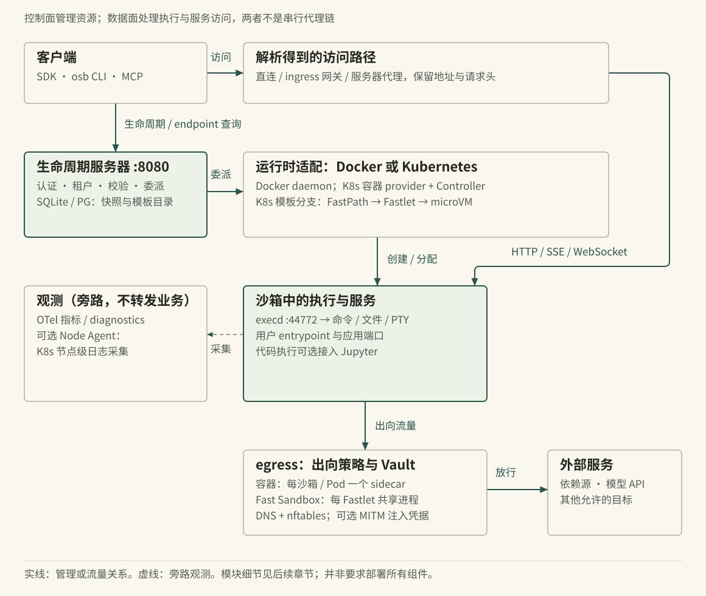
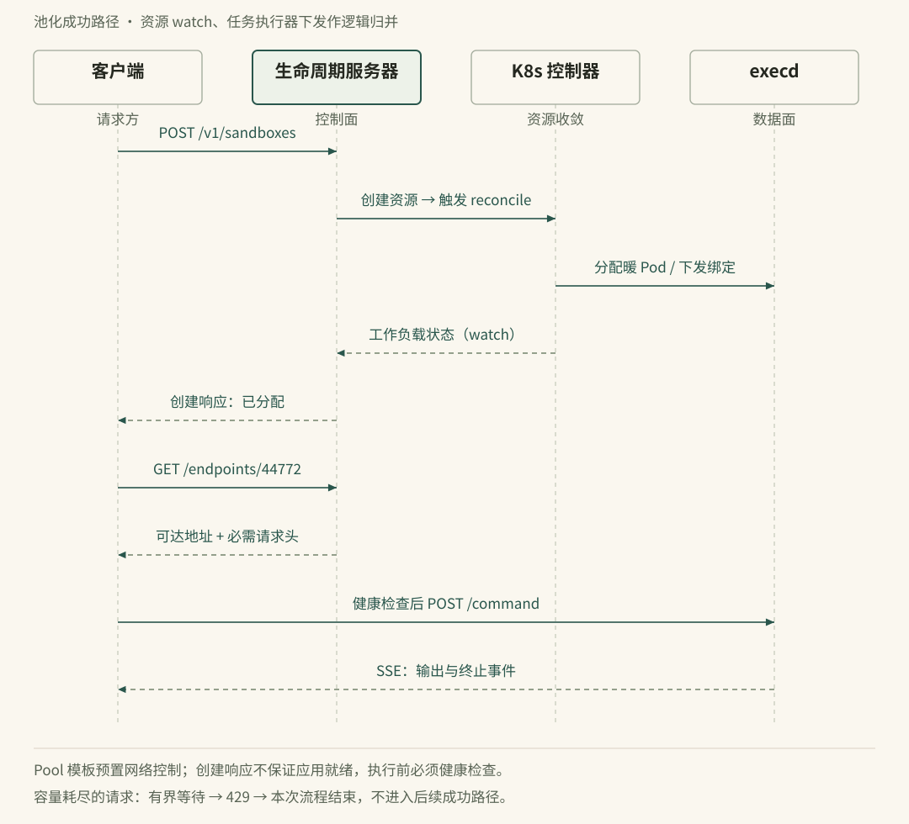
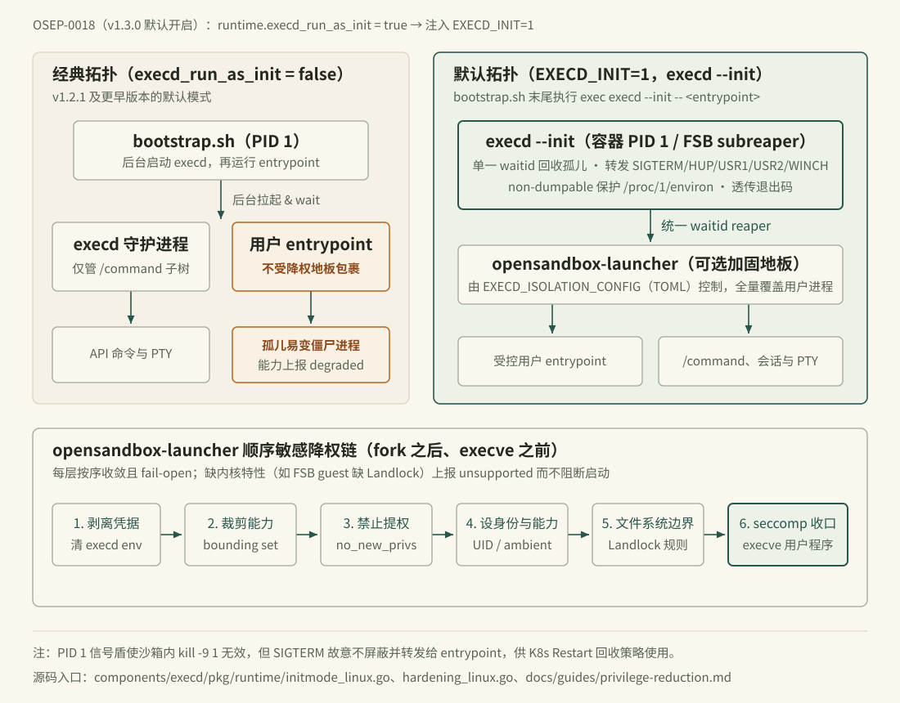
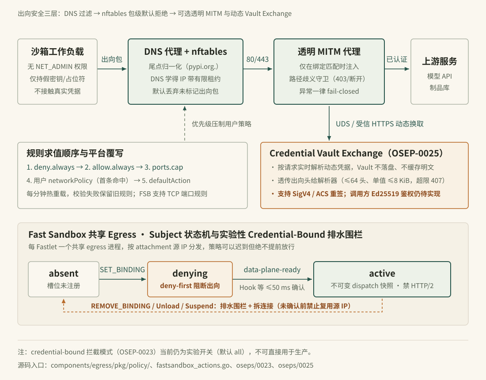
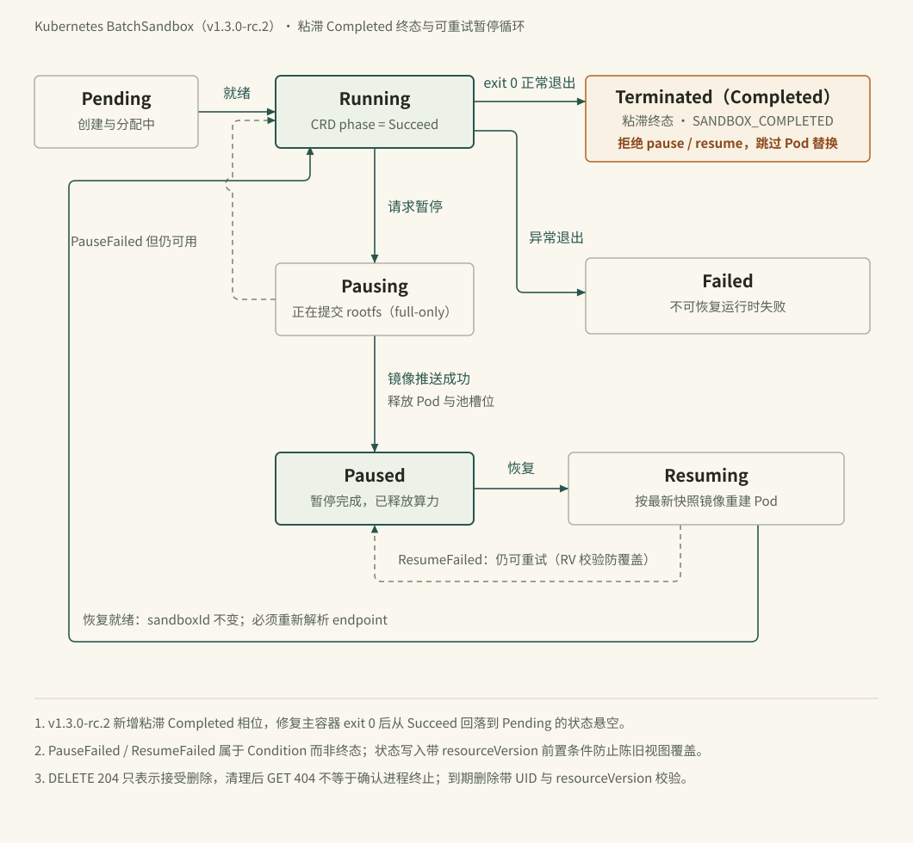
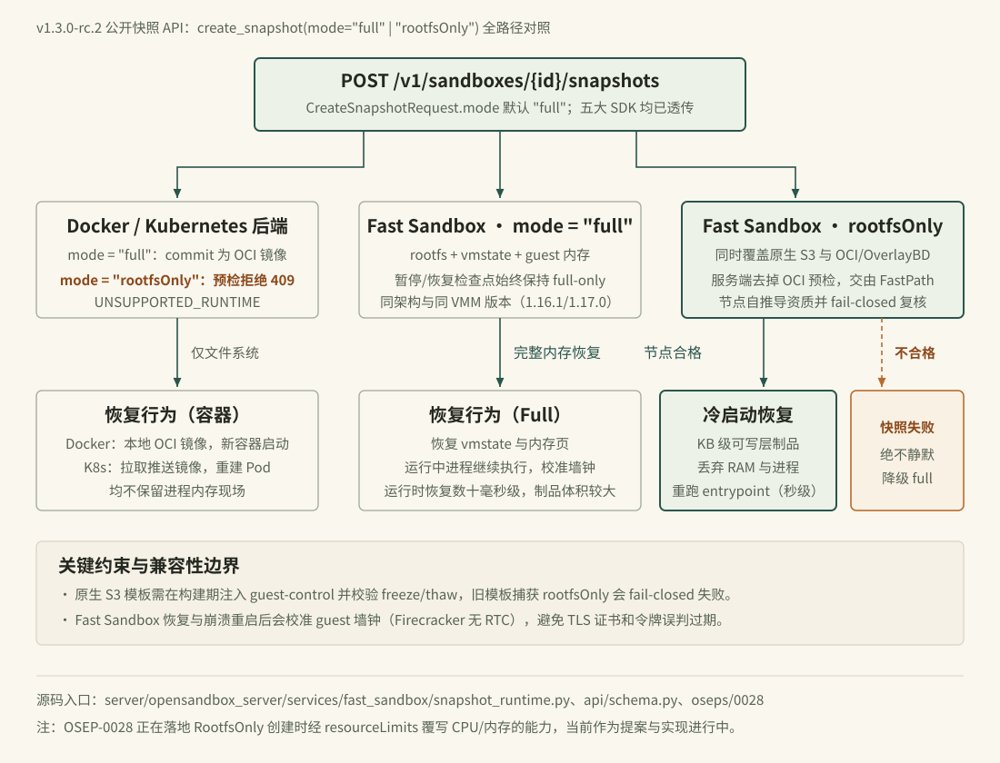

# OpenSandbox 架构解剖

从一次创建请求到沙箱里的进程

# 前言：一次创建请求背后到底发生了什么

周五下午你给编码 Agent 派了个修 bug 的活：拉仓库、跑单测、改两行代码、再跑一遍测试。模型很快吐出了一段补丁和三条 shell 命令，可这几条命令必须找个地方真跑起来。直接放宿主机跑，一次失误就能把本地环境搅乱；放到传统微服务部署链路里，等 CI 构建完镜像再调度 Pod，对话早就凉了。

OpenSandbox 解决的就是这个缺口：在几秒甚至几十毫秒内，按一次 HTTP 请求拉起一个带隔离边界的执行环境，让 Agent 跑命令、读写文件、开交互终端、按白名单联网，用完即焚。本地用 Docker 起步，上集群换成 Kubernetes 或 Firecracker microVM，调用方看到的始终是同一套沙箱接口。

全书围绕一条主线展开：**客户端发出 `POST /v1/sandboxes` 之后，控制面、运行时后端、沙箱内守护进程和网络组件各自做了什么，又为什么这样划分边界。**

## 从 2026-10-30 快照到 v1.3.0-rc.2 的关键演进

本书前版固定在 `c2f55b20e945`（2026-10-30），本次全面核对并同步至 **`release-1.3.0-rc.2`**（提交 `45043e7f0df258b6b76ef6753dd9b1819d59a332`，2026-11-19）。在这三周涵盖 `1.2.1` 与 `1.3.0-rc.1` / `rc.2` 的迭代里，底层两平面、三后端的骨架没有推倒重来，但有六处直接影响架构与运维的变化已经融入对应章节：

1. **OSEP-0018 `execd-as-init` 成为服务端默认拓扑**。`runtime.execd_run_as_init` 默认值由 `false` 改为 `true`，服务端自动注入 `EXECD_INIT=1`，让 `bootstrap.sh` 以 `exec execd --init -- <entrypoint>` 接管容器 PID 1（在 Fast Sandbox 中为 guest init 下的 subreaper）。孤儿进程回收、信号转发、退出码透传以及基于 `opensandbox-launcher` 的进程降权地板从此覆盖镜像入口进程（第 9、15 篇）。
2. **`rootfsOnly` 快照登上公开生命周期 API 并覆盖原生 S3 与 OCI**。五大 SDK 全部暴露 `create_snapshot(mode="rootfsOnly")`，产出 KB 级可写层制品并以冷启动方式恢复；服务端移除了多余的 OCI 预检镜像逻辑，把模式准入交由 FastPath 门禁与 Fastlet 的 fail-closed 节点资质自推导把关，而 pause/resume 检查点依然保持 `full` 模式（第 8、13 篇）。
3. **BatchSandbox 新增粘滞 `Completed` 终态，消除状态悬空与两个静默丢失竞态**。主容器以退出码 0 正常结束后进入粘滞 `Completed` 相位，对外映射为 `Terminated`（原因码 `SANDBOX_COMPLETED`）并拒绝 pause/resume，不再从 `Succeed` 跌回 `Pending`；同时 Docker 续期纳入每沙箱生命周期锁序列化，Kubernetes 到期删除与状态写入都带上了 UID 或 `resourceVersion` 前置校验（第 6、7、13 篇）。
4. **Credential Vault Exchange 与实验性 credential-bound 出向链路落地**。OSEP-0025 的动态凭据交换在 `1.2.1` 与 `1.3.0` 补齐了出向请求头透传（上限 64 个头、单值 8 KiB、超限 407），支持 SigV4/ACS 按请求重签且不落盘明文；Fast Sandbox 侧的实验性 credential-bound 拦截推进到 50 ms `data-plane-ready` 确认、不可变 dispatch 快照、排水围栏与源 IP 复用阻断（第 11、12 篇）。
5. **观测与诊断面完成清理与扩容**。已废弃的 `api/devops.py` 纯文本路由与 `osb devops` 命令群彻底移除，稳定的 Diagnostics API 强制要求 `scope` 参数；`execd` 补上了带 2 秒挂载超时的 OTLP 磁盘用量与 IO 指标，Node Agent 新增可选的 `vm-console` 采集源（第 9、16 篇）。
6. **部署基线与控制面扩展边界收紧**。所有 Helm Chart 将 Kubernetes 最低版本提升至 `1.22`；Pool 管理移至 `WorkloadProvider` SPI 之后；Fast Sandbox 强制 `--role=all` 单副本 `Recreate` 升级、开放 `controller.fastletProxy.resources` 与可选 gRPC-Web 端口、补齐 FSEP-0003 的 Fastlet ServiceAccount JWKS 鉴权；实验性 `components/e2b-shim`（OSEP-0027）已以骨架形态入仓（第 5、8、17 篇）。

## 快照与证据边界

把研究边界在这里一次性说清，正文不再反复叠甲。

- **上游仓库**：`https://github.com/opensandbox-group/OpenSandbox`
- **版本与提交**：`release-1.3.0-rc.2`，commit `45043e7f0df258b6b76ef6753dd9b1819d59a332`（2026-11-19）
- **核对日期**：2026-11-22
- **上游许可**：代码 Apache-2.0，文档 CC BY 4.0（`CHARTER.md` 第 7.b.iv 条）

本书全部结论来自静态阅读源码、`specs/` 下的四份 OpenAPI 契约、`docs/` 下的架构与运维指南、`oseps/` 下的 28 份设计提案，以及用 Python 标准库独立编写的配套教学实现 `examples/mini_osb.py`。本书没有部署真实集群，没有复现性能压测，也不构成安全审计。正文出现的所有延迟数字均转述自上游公开基准并标注口径与适用条件；遇到基于静态代码推理设计动机的地方，会直接点明这是工程推演而非作者口述记录。完整来源清单与 104 个核对文件的 SHA-256 哈希见附录 B 与 `sources/inventory.json`。

## 怎么读这本书

全书 20 篇正文按一条请求的生命周期顺序排开，另附 3 份附录。

- **只想弄清调用方式与系统边界**：读第 1、2、3、10、13 篇，查阅附录 A 的路径表。
- **在评估自建还是接入这套执行层**：重点看第 2、5、17、18 篇，它们专门算兼容性、单活边界和设计代价。
- **准备改代码或写新后端**：从第 4 篇顺序读到第 16 篇，先吃透控制面的四条不变量和三后端分工，再进 `execd`、ingress、egress 的源码。
- **想离线跑一遍核心语义**：直接运行 `python3 examples/mini_osb.py` 与 `python3 -m unittest discover -s examples -v`（附录 C 收录了完整源码）。


---

# 需求篇：Agent 执行环境要满足什么

如果跳过需求直接翻 OpenSandbox 源码，很多决定会显得奇怪：为什么 Docker 后端每个容器只映射一个宿主端口，为什么 Kubernetes 暂停要把容器提交成镜像再推回仓库，为什么出向网络默认全拒而且沙箱进程不能持有 `NET_ADMIN`。每一条实现都在回应 Agent 执行场景里的一个硬约束。

## 从一个修 bug 的编码 Agent 说起

设想一个自动修 bug 的编码 Agent，它的日常循环只有五步：克隆代码仓库、跑单元测试定位失败用例、修改源码、重跑测试验证、把 diff 交给人审。

这五步背后压着四类真实执行动作：跑 shell 命令、读写文件树、拉起语言运行时与测试框架、按需联网拉依赖或调模型接口。放到多人并发的团队环境里，它还带着三个隐含前提：同一时刻几十个任务并行互不干扰；任务一完环境立刻清理不留残渣；模型吐出来的代码默认不可信，可能手滑删光目录，也可能被提示注入后去探内网元数据服务。

OpenSandbox 把这些要求压成了六条具体需求，每一条都能在上游仓库里找到对应的工程落点。

## 需求一：隔离是运行时属性，不能靠约定

靠提示词叮嘱模型别删不该删的目录，迟早会失手。容器命名空间能挡住大多数误操作，但共享宿主机内核意味着内核漏洞仍可能带来逃逸。不同业务对安全与成本的容忍度不同，隔离必须做成可替换的层次：

- 默认用标准容器 `runc`，换取最低开销与完整系统调用兼容；
- 需要缩窄内核攻击面时，切到用户态内核 gVisor 或轻量虚拟机 Kata（支持 QEMU、Cloud Hypervisor 与 Firecracker）；
- 追求高密度硬隔离时，直接给每个沙箱分配一台独立的 Firecracker microVM。

上游把选择权留在服务端配置 `[secure_runtime]` 里（`type` 取 `""`、`gvisor`、`kata` 或 `firecracker`），调用方不改请求参数。把隔离强度固定在平台层，同一个集群就不会混出说不清边界的异构沙箱，审计时也有据可查。

## 需求二：创建要快在提前准备好的容量上

对话式 Agent 等 30 秒才拿到一个空壳环境，交互节奏就断了。缩短创建延迟只有两条路：把现建链路里的 API 往返和拉镜像压到极致，或者干脆让创建请求不再从零创建，而是认领一份已经跑起来的容量。

OpenSandbox 两条路都铺了。Kubernetes 容器后端靠 `Pool` 维护一组预热好的 Ready Pod，分配时写一条注解即可认领，跳过调度器与镜像拉取；Fast Sandbox 走得更彻底，把 OCI 镜像预编译成带 guest 接线的不可变 golden image，创建时从内存与设备快照里唤醒 microVM。

上游性能文档给出了两套量级参考：Kubernetes 启用 `Pool` 后交付 100 个沙箱总耗时 0.92 秒；Fast Sandbox 在 ACK 两节点集群上（模板已缓存、串行 100 次）的 SDK 创建 p50 为 64.0 ms。两个数字的测量边界差异极大，不能直接横向比快慢，第 8 篇会逐条拆开它们的测试条件。

## 需求三：沙箱内部要有结构化的干活接口

拿到一个隔离空壳还不够，Agent 需要流式执行命令、管理后台长任务、原子替换文件、打开交互式 PTY 终端、在持久 Jupyter 内核里跑代码片段，并读取 CPU、内存与磁盘指标。把这些事塞给 SSH 很难收场：SSH 是面向人类终端的字节流协议，既没有结构化事件模型，也不好做细粒度接口鉴权。

因此数据面契约围绕三件事设计：一套覆盖命令、文件、PTY、代码上下文与指标的 HTTP/WebSocket API；边跑边推的 SSE 流式语义；能让客户端明确区分正常结束、执行超时、非零退出和中途断流的终止契约。比如前台命令正常结束必须返回携带 `exit_code: 0` 的 `execution_complete` 事件，超时明确报 `CommandTimeout`，在终止事件之前断流绝不能乐观当成成功。

## 需求四：访问路径由平台签发，调用方不猜拓扑

沙箱里常跑着 8080 Web 服务、5900 VNC 桌面或 8888 Jupyter。单机 Docker 用宿主端口映射，Kubernetes 用集群内 ingress 网关，网络隔离时还要回退到控制面代理。如果让调用方自己拼 URL，换一种部署拓扑，客户端代码就得重写。

契约层把这件事收口到一个端点：`GET /v1/sandboxes/{id}/endpoints/{port}` 返回已经可用的地址和必须原样携带的请求头。客户端不需要分辨后面是宿主代理、头路由网关还是 Fast Sandbox 的签名路由，只要原样拿着地址和头去发请求即可。这种设计换来调用端统一，代价是 endpoint 解析会被高频调用，且在 Fast Sandbox 这类本地签名模式下，拿到 endpoint 并不等于证明沙箱已经就绪。

## 需求五：出向流量默认拒绝，凭据留在沙箱之外

放开沙箱出网等于把内网出口交给一段模型生成的代码。控制出向却很难一步到位：运维习惯按域名写白名单（如 `pypi.org`、`*.github.com`），但内核发包只认 IP；只拦 DNS 时，代码直接连已知 IP 就能绕开；落到包级过滤，又得实时跟踪域名解析出来的动态 IP 集合，还要保证平台禁止的目标绝不被租户策略打开。

上游的解法是分层执行：DNS 代理按域名放行并把解析出的 IP 喂给 nftables 集合，未命中策略的出向包默认丢弃，平台规则 `deny.always` / `allow.always` 和端口白名单永远压过租户策略。顺着这条链路往下，还衍生出 Credential Vault：Agent 调外部模型或私有制品库时，真实密钥停在沙箱外的 egress 代理里，沙箱内只放假值或占位符，请求出站前再由代理注入或按请求动态换取签名。

## 需求六：生命周期细化到绝对过期、暂停与快照

短任务跑完就该回收，等人类审批的长任务不该一直占着计算节点，跑了一半的实验环境需要存成可复用的起点。OpenSandbox 把生命周期拆成四个正交机制：

1. **绝对过期（TTL）**，创建时写死到期时间戳，服务端重启或暂停都不重置，保证每个沙箱的寿命可审计；
2. **暂停与恢复**，释放算力同时保留同一个 `sandboxId`；
3. **公开快照**，从运行中（或 Docker 暂停态）的沙箱产出可复用制品，支持 `full` 与面向 Fast Sandbox 的 `rootfsOnly` 两种模式，恢复时创建全新的沙箱 ID；
4. **访问驱动的续期与空闲暂停**，活跃会话自动延寿，长时间无流量自动挂起并在下次访问时唤醒。

## 明确不做的事

看清一套系统的边界，往往要先看它主动放弃了什么。从 `ROADMAP.md` 与兼容性文档可以确认四条克制的红线：

- **暂不承诺稳定的生命周期 v1 契约**。ROADMAP 把不贸然宣布稳定 v1 放在非计划项首位，因为多后端语义与 SDK 兼容性仍在收口。
- **不把单活控制面包装成通用高可用**。服务端默认单副本，升级采用 `Recreate` 策略并有短暂中断；PostgreSQL 只用来协调 Kubernetes 公开快照创建这一窄路径，文档直言通用负载均衡高可用尚未实现。
- **不掩盖三种后端的能力差异**。模板只归 Fast Sandbox，卷挂载在 Fast Sandbox 被拒绝，`rootfsOnly` 快照在 Docker 与 Kubernetes 返回 `409`，这些差异全部摊在 `docs/api/implementation-compatibility.md` 里。
- **不承诺容器可写层自动持久化**。显式暂停或快照之外，主进程退出、OOM、Pod 驱逐或节点丢失都不会触发自动保存。

## 六条需求之间的拉扯

这六条需求彼此冲突，而非简单叠加。要毫秒级创建就得用预热池，预热 Pod 在请求到来之前就已就位，天然与按请求定制卷挂载和网络策略打架，于是上游把 `entrypoint` 和环境变量改造成分配后的 task，并禁止 `poolRef` 与 `networkPolicy` 同用。要高密度 microVM 隔离就不能给每个沙箱挂独立 sidecar，Fast Sandbox 因此改为每个 Fastlet 共用一个共享 egress 进程按源 IP 分治。要透明拦截 HTTPS 注入凭据就得把代理 CA 装进沙箱信任库，这又增加了数据面硬依赖。后面每一篇拆到看似绕弯的设计时，根源几乎都落在这几组拉扯上。

## 源码入口

| 路径 | 看什么 |
|---|---|
| `README.md` | 项目定位与核心能力清单 |
| `CHARTER.md` | 厂商中立的沙箱执行平台使命与文档许可 |
| `ROADMAP.md` | 当前演进重点与明确不做的边界 |
| `docs/guides/secure-container.md` | 五种安全容器运行时的隔离机制与开销对照 |


---

# 技术方案：一条契约、三种后端、两个平面

把上篇的六条需求塞进同一套代码库，第一步是决定在哪里画界线。如果把命令执行、文件传输和容器调度全揉进一个中心服务，控制面重启就会掐断所有正在跑的测试流；如果给 Docker、Kubernetes 和 Firecracker 各写一套独立 API，本地调试到线上集群的迁移成本就会失控。

OpenSandbox 给出的结构解法很凝练：**对外一条契约，对内三种后端，横向切成两个平面。**

## 四份 OpenAPI 契约分给三类进程

`specs/` 目录下的四份 OpenAPI 文件是公开行为的唯一来源，`AGENTS.md` 明确要求 SDK 生成物必须从契约源头重新生成，不得手改补丁：

| 契约文件 | 当前体量（v1.3.0-rc.2） | 承担职责 | 实现进程 |
|---|---:|---|---|
| `specs/sandbox-lifecycle.yml` | 约 124 KB（3349 行） | 沙箱创建、查询、删除、续期、endpoint、暂停/恢复、快照、模板、网络策略 | 生命周期服务器（`:8080`） |
| `specs/execd-api.yaml` | 约 119 KB（3475 行） | 命令执行、Shell 会话、文件与目录、代码上下文、指标、隔离会话 | `execd`（`:44772`） |
| `specs/egress-api.yaml` | 约 29 KB（827 行） | 出向策略热更新、Credential Vault 与动态凭据交换 | `egress`（`:18080`） |
| `specs/diagnostic-api.yml` | 约 16 KB（434 行） | 诊断路由上下文、带 `scope` 的日志与事件描述符 | 生命周期服务器（`:8080`） |

三类进程之间没有耦合在一起的内部 RPC 链路。客户端先向控制面申请沙箱并查询 endpoint，拿到可达地址和必需请求头后，直接连向数据面的 `execd` 或 `egress`。代价是客户端要同时理解三个默认端口和各自的鉴权头；收益是故障域彻底分开，控制面升级或重启不会打断沙箱内正在推流的命令。

## 两个配置值装下三种运行时后端

服务端配置文件里的 `runtime.type` 只有两个合法取值：`docker` 和 `kubernetes`。第三种后端 Fast Sandbox 并没有另立一个新的 `runtime.type`，而是挂载在 `kubernetes` 下的组合分支：

```text
runtime.type = "docker"
  └── DockerSandboxService             直连本地 Docker daemon

runtime.type = "kubernetes"
  └── CompositeSandboxService
        ├── KubernetesSandboxService   容器负载：BatchSandbox 或 agent-sandbox
        └── FastSandboxService         模板负载：FastPath gRPC -> Fastlet -> Firecracker microVM
```

分流规则在 `server/opensandbox_server/services/composite_service.py` 里写得直白：创建阶段看请求来源，带 `templateId` 或引用了 `fsb` 后端快照的请求进 `FastSandboxService`，其余进 `KubernetesSandboxService`；沙箱建好之后，凡是 ID 以 `fsb-` 开头的全部分发给模板分支，其余归容器分支。没有额外映射表，前缀本身就是路由器。

## 两个平面的硬分工

架构文档把全站流量画成三条路径：生命周期管理、执行与服务访问、出向控制。落到进程职责上只有一条红线：**控制面不碰沙箱内部，数据面不碰沙箱账本。**

- **控制面**只负责认证、租户解析、请求校验、持久化自己拥有的目录数据（快照元数据与模板定义），然后把工作负载动作委派给对应后端。容器、Pod 与 CRD 才是沙箱本身的状态真相，控制面数据库里不存沙箱表。
- **数据面**把命令执行、文件读写、PTY、Jupyter 内核、资源指标和出向网络拦截全部留在沙箱内或紧邻沙箱的代理进程里。控制面自带的 `/sandboxes/{id}/proxy/{port}` 在 `1.2.1` 起已明确转入维护模式，仅作直连与网关都不可达时的兼容退路。

图 1 把四个交互维度拆开来画，避免把观测和出向误解成串行代理链。



换到时间轴上，图 2 追踪一次 Kubernetes BatchSandbox 池化创建的成功路径。需要纠正一个常见直觉：生命周期 API 整体是异步模型，但 Kubernetes 容器后端会在服务端借助 watch 等待工作负载进入 `Running` 或 `Allocated` 才返回；可即便如此，响应返回只说明 Pod 就位，客户端仍需先走健康检查再发业务命令。池容量耗尽时请求在 `429` 处结束，不会进入后续步骤。



## 同一份 API 在三种后端上的翻译表

生命周期请求里全是跨运行时抽象字段：`resourceLimits`、`volumes`、`networkPolicy`、`platform`、`secureAccess`、`metadata`、`extensions`。它们落到底层时各不相同：

| 抽象概念 | Docker | Kubernetes 容器 | Fast Sandbox |
|---|---|---|---|
| 算力单位 | 容器 | Pod（BatchSandbox / agent-sandbox） | Firecracker microVM |
| 卷挂载 | 绑定挂载 / 命名卷 | PVC / hostPath | 不支持（适配层拒绝） |
| 出向控制 | 每沙箱 egress sidecar | Pod 内 egress sidecar | 每 Fastlet 共享 egress 进程 |
| 暂停机制 | 容器 pause（冻结内存） | commit rootfs 镜像并释放 Pod | 写 vmstate+内存+rootfs 检查点并释放 Fastlet |
| 公开快照模式 | 仅 `full`（本地 commit） | 仅 `full`（推 registry） | `full` 与 `rootfsOnly`（原生 S3 与 OCI 均支持） |
| 访问入口 | 单宿主端口 + `/proxy/{port}` | ingress 头/URI 路由或 Pod IP | 本地签名 `f1.` 路由 scope |

运行时中立只保到 API 形状这一层，后端能兑现什么语义，靠契约错误码与兼容性矩阵如实交代。

## 真正左右代码形态的四条工程原则

架构文档列出的设计原则里，有四条直接塑造了仓内代码的结构：

**契约先行（Protocol First）**，公开字段与状态码以 `specs/` 为准。服务端代码里的 `API_CONTRACT_VERSION` 对齐 `specs/sandbox-lifecycle.yml` 的 `info.version`（`0.1.0`），发布版本号另走 `GET /version`，协议演进和组件发版彼此解耦。

**安全默认配显式逃生舱**，非交互环境下未配 API key 直接拒绝启动，除非显式注入 `OPENSANDBOX_INSECURE_SERVER=YES`；开启多租户或声明安全运行时，启动阶段就验证命名空间可达与运行时可用，配置有误立刻退出，不带病接流量。

**失败必须可观测**，沙箱状态对象除了 `state`，还携带机器可读的 `reason`、人类可读的 `message` 与迁移时间 `lastTransitionAt`。`execd`、`egress`、`ingress` 和 Node Agent 都按低基数纪律输出指标，并把策略拒绝与基础设施故障分开计数。

**兼容面显式收口**，已废弃的 `devops` 纯文本路由在 `1.3.0-rc.1` 直接移除，未知请求字段在封闭对象上返回 `422`，还在探索期的新适配层（如 `1.3.0-rc.2` 引入的实验性 `components/e2b-shim`，对应 OSEP-0027）以独立 Go 模块和健康探针骨架先落位，不污染主控制面。

## 仓库目录与体量速览

| 目录 | 职责 | 主要语言 |
|---|---|---|
| `server/` | 生命周期控制面（FastAPI） | Python |
| `components/execd/` | 沙箱内执行守护进程与 init 进程 | Go |
| `components/egress/` | 出向策略、DNS/nftables、Vault 与 MITM | Go + Python |
| `components/ingress/` | Kubernetes 入向反向代理 | Go |
| `components/nodeagent/` | 节点级容器日志、系统调用与 `vm-console` 采集 | Go |
| `components/e2b-shim/` | 实验性 E2B 兼容适配骨架（OSEP-0027，暂无业务路由） | Go |
| `kubernetes/` | 三个 CRD 与 reconciler 控制器 | Go |
| `sdks/sandbox/*` | Python / JS / Kotlin / Go / C# 五语言沙箱 SDK | 多语言 |
| `sdks/code-interpreter/*` | 高层代码解释器 SDK | Py / TS / Kotlin |
| `cli/` | `osb` 命令行工具 | Python |
| `manifests/charts/` | umbrella 与子组件 Helm Chart（要求 K8s >= 1.22） | YAML |
| `specs/` | 四份 OpenAPI 契约与契约测试 | YAML |

## 为什么不选更省事的替代方案

把执行接口合进生命周期服务器，调用方只要记一个 base URL，确实省心，但所有命令的 SSE 长流都会穿过控制面，重启控制面等于掐断在跑任务，带宽与连接数也会迅速压垮 Python 服务。把三种后端拆成三个独立项目，各家能做出更贴合底层的接口，但五套语言 SDK 要维护三倍工作量，本地 Docker 写完无缝迁到集群的体验也随之消失。干脆砍掉 Docker 只保 Kubernetes，维护负担小不少，却把单机快速体验挡在了门外。

OpenSandbox 把复杂度压进了运行时适配层和兼容性文档里。调用方拿到的是一致的编程模型，维护者则承担起把三套异构底层塞进同一份契约的长期成本。

## 源码入口

| 路径 | 看什么 |
|---|---|
| `docs/architecture/index.md` | 六个对外界面、三条交互路径与五条核心流程 |
| `server/opensandbox_server/services/factory.py` | 配置到具体服务实现的映射（66 行） |
| `server/opensandbox_server/services/composite_service.py` | `fsb-` 前缀路由与创建分流（184 行） |
| `manifests/charts/opensandbox/Chart.yaml` | umbrella chart 的组件拼装关系 |
| `components/e2b-shim/go.mod` | 实验性 E2B 兼容适配模块边界 |


---

# 契约层：四份 OpenAPI 与它们没写的东西

接手一套多语言平台时，最容易踩的坑是把某一个 SDK 的当前行为当成协议承诺。昨天用 Python SDK 调通的字段，换到 Go SDK 或另一套后端就报错，根源往往出在分不清哪些语义写进了契约、哪些只是某个实现的现状。

OpenSandbox 把 `specs/` 下的四份 OpenAPI 文件定为唯一公开契约，并用 `docs/api/implementation-compatibility.md` 把契约覆盖不到或各后端做不到的地方单独摊开。读懂这一层，后面看控制面和数据面才不会把刻意留下的差异误判成 bug。

## 生命周期契约的骨架与演进细节

`specs/sandbox-lifecycle.yml`（`info.version: 0.1.0`，约 124 KB）统一挂载在 `/v1` 下，端点按四组资源组织：

| 资源组 | 核心路径 | 语义 |
|---|---|---|
| 沙箱 | `POST /sandboxes`、`GET /sandboxes`、`GET/DELETE /sandboxes/{id}` | 创建、分页列举、查询详情、提交删除 |
| 状态与元数据 | `POST .../pause`、`.../resume`、`.../renew-expiration`、`PATCH .../metadata` | 中间态切换、续期、修改非保留元数据 |
| 访问与网络 | `GET .../endpoints/{port}`、`/networkpolicy`、`/credential-vault` | 解析可达入口、管理出向策略与凭据保管 |
| 派生制品 | `/snapshots`、`/templates` | 快照创建/查询/删除、Fast Sandbox 模板管理 |

创建请求 `CreateSandboxRequest` 在 `server/opensandbox_server/api/schema.py`（2054 行）里展开，核心字段分成四块：

```text
来源       image / snapshotId / templateId        （三者互斥）
形状       platform / resourceLimits / resourceRequests / volumes
行为       entrypoint / env / lifecycle / networkPolicy / credentialProxy
元数据     metadata / extensions / secureAccess / timeout
```

最近两个版本里，生命周期契约有四处变化直接影响调用方：

1. **快照模式进入公开契约**。`CreateSnapshotRequest.mode` 支持 `full`（默认）与 `rootfsOnly`，快照对象顶层暴露只读的 `Snapshot.mode`。五大 SDK 全部透传该字段，缺省时不往线上发字段以兼容旧服务端，读到未携带 `mode` 的响应时按 `full` 解释。
2. **封闭请求对象拒绝未知字段**。从 `1.2.1` 起，拼错字段名或在封闭对象里塞入未定义键不再静默忽略，统一返回 `422`；同一个字段同时写两个别名也会被拒。
3. **显式澄清 `DELETE 204` 与后续 `404` 的含义**。`1.3.0-rc.2` 把这条纪律写进了 API 规格：收到 `204` 只代表控制面接受了删除请求，不代表底层容器或进程已经退出；之后轮询拿到 `404` 只能说明资源对象已被清理，绝不能直接推导为工作负载已确认终止（比如使用 `Noop` 回收策略的池 Pod 可能仍留着进程）。
4. **保留字符串扩展槽 `extensions`**。它以 `map<string,string>` 承载过渡期语义，比如访问续期的旧写法 `extensions["access.renew.extend.seconds"]` 在 1.x 周期内继续有效，新代码迁移到结构化的 `lifecycle.renewalPolicy`（OSEP-0009）。

另外，`resourceLimits` 采用 `RootModel[Dict[str,str]]`，直接透传 `"500m"`、`"512Mi"` 这类 Kubernetes 数量字符串，Docker 后端再自行换算。这省掉了跨后端数值单位的二次翻译，代价是契约层管不住大小写拼错（如 `"500M"` 与 `"500m"`），必须留给服务端校验器把关。

## 四字段状态与按语义分层的错误码

沙箱对象的 `status` 由四个字段共同描述：

```text
status.state             Pending / Running / Pausing / Paused / Resuming / Stopping / Terminated / Failed
status.reason            机器可读原因码（如 SANDBOX_COMPLETED、Expired）
status.message           面向人的补充说明
status.lastTransitionAt  最近一次状态迁移时间
```

光给一个 `Failed` 或 `Terminated` 无法指导重试。带上 `reason` 之后，客户端能区分是镜像拉取失败、池容量打满，还是主进程以退出码 0 正常收尾（`1.3.0-rc.2` 中 BatchSandbox 的 `Completed` 相位会映射为 `Terminated` + `SANDBOX_COMPLETED`）。

错误响应体统一为 `ErrorResponse{code, message}`。HTTP 状态码负责粗粒度路由：`400` 参数非法、`401` 认证失败、`404` 不存在、`409` 状态冲突或运行时不支持该模式（例如 Docker/K8s 收到 `mode="rootfsOnly"`）、`422` 校验失败（包括 `Diagnostics` 漏传必填 `scope` 或 `bufferMin > bufferMax`）、`429` 容量耗尽、`501` 能力未实现（例如非 BatchSandbox 的 `WorkloadProvider` 调用 `/v1/pools` 返回 `501 KUBERNETES::POOL_NOT_SUPPORTED`）、`503` 暂不可用。

兼容性文档特意提醒调用方，不同子系统对不支持的操作并没有统一成一个状态码，不要写死一套 `if status == 501` 去判断能力边界。

## 异步创建与 endpoint 打包契约

创建沙箱天生耗时不可控，契约因此定为异步返回，客户端随后轮询 `GET /v1/sandboxes/{id}` 或调用 SDK 的就绪等待逻辑。不用长连接，是因为中间网关极易在数十秒后掐断空闲连接；不用回调，是因为大量调用方本身躲在无法被服务端反连的内网里。

`GET /v1/sandboxes/{id}/endpoints/{port}` 是整份契约里最省事却最容易被低估的端点。它不返回裸 URL，而是把地址和必需请求头打包返回：

```json
{
  "endpoint": "http://10.0.0.12:44772/proxy/8080",
  "headers": { "X-EXECD-ACCESS-TOKEN": "..." }
}
```

不同拓扑需要的请求头完全不同：单机直连带 execd 令牌，Kubernetes 网关带 `OpenSandbox-Ingress-To` 与可选 `secureAccess` 凭据，Fast Sandbox 返回签名路由和 `OPEN-SANDBOX-ORIGIN: template` 响应头。把头和地址绑在一起下发，客户端只需原样透传就能跨拓扑复用同一份代码。

## 数据面契约：SSE 事件模型写死了三条红线

`specs/execd-api.yaml`（约 119 KB）定义沙箱内 API，默认端口 `44772`。路由列表之外，真正决定客户端会不会写错的是 SSE 事件模型：

```text
init / status / stdout / stderr / result / execution_complete / execution_count / error / ping
```

Go 侧的 `ServerStreamEvent` 字段刻意压得很薄，只有 `type`、`text`、`exit_code`、`execution_time`、`timestamp`、`results`、`error` 等少量核心键，方便五种语言的客户端精准解码。契约钉死了三条语义：

1. **原始行尾原样保留**。`stdout` 与 `stderr` 事件保留 `\n`、`\r`、`\r\n`，客户端按序拼接即可还原终端进度条或半行输出。
2. **退出码明确归位**。前台 `POST /command` 成功结束必须带 `execution_complete` 与 `exit_code: 0`；超时则发出 `ename: "CommandTimeout"`（`1.3.0-rc.2` 起不再混用 `CommandExecError`）。后台启动确认和部分代码执行事件不带 `exit_code`，缺字段不能推断成功。
3. **断流不等于成功**。在收到终止事件前流被截断，客户端必须当成结果不确定来处理。

## 契约没写进去的部分

`docs/api/implementation-compatibility.md` 老实列出了契约和实现之间的四条缝隙：

- **PTY 路由尚未写进 `execd-api.yaml`**。`execd` 已经实现了 `/pty` 的 HTTP 创建与 WebSocket 接入，但 OpenAPI 规格还没覆盖它，不能因为某实现兼容 OpenAPI 就假定它支持 PTY。
- **隔离会话的 `diff` 与 `commit` 在契约里却未实现**。两个端点当前返回 `503`，而 `/v1/isolated/capabilities` 会明确报 `diff_supported: false` 和 `commit_supported: false`。
- **能力随后端分化**。模板属于 Fast Sandbox，生命周期钩子属于 Kubernetes 容器后端，Fast Sandbox 拒绝卷挂载与 `credentialProxy`。
- **尚无全局能力协商端点**。目前只有局部的能力探测（如隔离会话与加固地板的 capabilities 端点），全局层面仍依赖文档和具体错误码。

另外，五种语言的 SDK 只是契约的消费者，不等于契约本身。比如当前 Python SDK 的 `create()` 会依次查 `44772` 和 `18080` 两个端口，而 `create_from_template()` 只查 `44772`。如果要自建兼容后端，只要不绑定官方高级 `Sandbox` 封装类，完全可以只实现窄集合的生命周期端点并配自己的执行客户端。

## 源码入口

| 路径 | 看什么 |
|---|---|
| `specs/sandbox-lifecycle.yml` | 生命周期资源组、快照 `mode`、删除语义与错误响应 |
| `specs/execd-api.yaml` | 数据面路由与 SSE 事件模型 |
| `specs/egress-api.yaml` | 出向策略与 Credential Vault 接口 |
| `specs/diagnostic-api.yml` | 必填 `scope` 的诊断描述符契约 |
| `server/opensandbox_server/api/schema.py` | 契约在 FastAPI 侧的 Pydantic 落地（2054 行） |
| `docs/api/implementation-compatibility.md` | 契约覆盖与后端能力差异清单 |


---

# 控制平面：一台 FastAPI 服务器的四条不变量

很多控制面服务写着写着就会烂掉：路由函数里塞满 `if runtime == "docker"`，数据库里养着一张和底层容器永远对不上账的沙箱状态表，线上漏配了一把 API key 却照常启动，等安全团队找上门才发现裸奔了一周。

`server/` 目录承载了 OpenSandbox 的生命周期控制面（基于 FastAPI）。读这几万行 Python 代码不需要逐行记路由，抓住它死守的四条不变量，整个目录结构立刻清晰。

## 目录分层一览

```text
server/opensandbox_server/
  main.py          启动 lifespan、中间件注册、路由挂载与启动期断言（367 行）
  startup_guard.py 无 API key 时的交互确认与环境变量逃生舱（117 行）
  config.py        服务端配置模型，含默认开启的 runtime.execd_run_as_init
  api/             lifecycle（547 行）、proxy（844 行）、diagnostics（112 行）、pool（279 行）、schema（2054 行）
  middleware/      auth、request_id、date_header、http_metrics
  services/        SandboxService 抽象与 docker/、k8s/、fast_sandbox/ 适配
  repositories/    仅持久化 snapshots/ 与 templates/ 两张目录账本
  tenants/         file / http 租户提供方
  integrations/    renew_intent、idle_pause、otel
```

在 `release-1.3.0-rc.1` 里，早期面向人工排障的 `api/devops.py` 已经彻底移除，统一收口到带必填 `scope` 参数的 `api/diagnostics.py`。同时沙箱、模板与快照的列表分页和元数据 patch 校验在 `1.3.0-rc.2` 抽成了跨后端共用实现，保留元数据键被拒绝时在三个后端统一返回 `SANDBOX::INVALID_METADATA_LABEL`。

## 不变量一：API 层绝不触碰运行时细节

所有路由处理函数只认识 `SandboxService` 抽象接口。以 `api/lifecycle.py` 的创建路由为例，真正执行的有效逻辑不到 30 行：校验 `extensions`、检查续期策略冲突、归一化 `networkPolicy` 动作、必要时解析 `snapshotId` 对应的源镜像与后端，随后直接委派给 `sandbox_service.create_sandbox(request)`。

里面没有 Docker client，没有 Kubernetes API 调用，也没有针对某个后端的条件分支。把 API 层收成纯粹的校验与委派边界，单元测试只需替换一个内存版 `SandboxService` 就能验证整套契约逻辑，不需要拉起 Docker daemon 或 Kind 集群。

## 不变量二：沙箱不是数据库里的一行

服务端数据库（默认 SQLite `~/.opensandbox/opensandbox.db`，可切换 PostgreSQL）只持久化两类平台自身拥有的目录数据：**快照元数据**（`repositories/snapshots/`）和**模板目录**（`repositories/templates/`）。

沙箱本体不在库里。Docker 容器、Kubernetes 的 `BatchSandbox` / `Pool` 以及 `sandbox.fast.io` 的 CR 才是唯一状态真相，每次 `GET` 和 `LIST` 都向底层运行时读取。这带来两个直接后果：

- **换存储不等于迁移沙箱**。从 SQLite 切到 PostgreSQL 只需搬运快照和模板目录，不影响正在跑的工作负载。
- **进程重启靠运行时元数据自愈**。Docker 后端重启时从容器标签 `opensandbox.io/created-at` 重建过期定时器，若恢复过期守护遇到持久异常（除并发已删容器外），从 `1.2.1` 起直接阻止启动，避免出现永不过期的孤儿容器；暂停与恢复过渡期的时间戳暂存在 `~/.opensandbox/metadata/_transition/`，重启后只有与观测到的真实容器状态一致才采纳，不一致直接丢弃。

## 不变量三：不安全配置必须在启动期炸掉

单个请求成功，往往掩盖了最致命的隔离误配。少配 API key、租户命名空间无权限、声明的安全运行时未安装，或者在配置里把签名密钥打进错误日志，都会让问题潜伏到事故爆发。

`main.py` 的 lifespan 在接流量前串联了一组硬断言，任何一条不过直接 `os._exit(1)`：

- **鉴权确认**：未配 `server.api_key` 且未启用多租户时，交互式 TTY 要求人工键入 `YES`（30 秒超时），非交互环境（Docker、Kubernetes、CI）必须显式声明 `OPENSANDBOX_INSECURE_SERVER=YES`，否则拒绝启动。
- **租户与命名空间校验**：校验租户配置合法性，在 Kubernetes 模式下逐一验证可枚举的租户命名空间存在且可访问；租户提供方的 `ttl` 若配置为 `null`、负数或 `NaN`，在 `1.3.0-rc.2` 会安全回落到 30 秒默认缓存时间，不再触发 lookup 崩坏或永久缓存。
- **安全运行时校验**：校验 `[secure_runtime]` 声明的 `gvisor` / `kata` / `firecracker` 在当前宿主机或集群中真实可用。
- **配置报错脱敏**：`1.3.0-rc.1` 修复了配置校验报错的密钥回显，包括 `OPENSANDBOX_SECURE_ACCESS_KEYS` 环境变量路径，防止安全签名密钥落入启动日志。

此外，`config.py` 中的 `runtime.execd_run_as_init` 自 `1.3.0-rc.1` 起默认为 `true`，控制面会在创建容器或渲染 Fast Sandbox 模板时自动注入 `EXECD_INIT=1`，让 `execd` 接管沙箱进程树。

## 不变量四：状态机语义只在控制面收口

`resume()` 是暂停态专属操作，不是通用重启器。已经自然退出或异常失败的沙箱处于 `Terminated` 或 `Failed`，调用方应当新建沙箱而不是原地复活。

控制面的主迁移链路保持清晰：

```text
创建：Pending -> Running
暂停：Running -> Pausing -> Paused -> Resuming -> Running
正常完成（BatchSandbox exit 0）：Running -> Terminated（reason = SANDBOX_COMPLETED）
删除：任意活跃态 -> Stopping -> 清理完成后 404
异常：任意态 -> Failed（带 reason 与 message）
```

请求级校验全部集中在 `services/validators.py`（673 行），因为 SDK 往往不强制部分上限或跨字段约束，服务端必须充当最终权威。比如 `1.3.0-rc.1` 在所有运行时统一拦截带 Windows 反斜杠遍历的 `volumeMounts.subPath`（如 `foo\..\secret` 或前导反斜杠），封堵了 Windows 节点上的卷根逃逸；`1.2.1` 起封闭请求对象里出现未知键直接返 `422`。

## 维护模式下的控制面代理层

`api/proxy.py`（844 行）实现了 `/sandboxes/{id}/proxy/{port}`，用来在客户端既无法直连沙箱、又没有 ingress 网关时兜底转发 HTTP 和 WebSocket。

从 `1.2.1` 开始，官方文档已经把服务端代理数据路径标记为**维护模式**：既有流量继续兼容，但生产部署应当迁移到独立的 `ingress` 网关。即便如此，这段代理逻辑依然守着克制的转发规则：剥离逐跳头与上游 `Server` 头，保留上游 `Date`（缺失时再补当前时间），只把单斜杠开头的相对 `Location` 重写到同一沙箱代理前缀下，绝不改写绝对 URL 或 `//host/path`，也不替客户端跟随重定向，避免把凭据带到过期目标。

## 单活默认与极窄的双副本能力

默认 Helm Chart 的 `server.replicaCount` 为 `1`，升级采用 `Recreate` 策略，先停旧实例再起新实例，升级窗口内控制面 API 短暂不可用。

换用 PostgreSQL 后端并不代表获得了通用水平扩展的生命周期高可用，它只打开了一个极窄的能力：**两个副本协同推进 Kubernetes 公开快照创建**。实现上没有引入分布式锁或 leader election，而是靠三条现成的不变量配合：

1. **先观察再创建**：`SandboxSnapshot` CR 名称由快照 ID 确定性派生，副本先查后建，撞到 `409 AlreadyExists` 当作已提交；
2. **终态写入走 CAS**：数据库把行更新到终态时校验期望前态，双副本并发收尾时一个成功、另一个空操作；
3. **周期恢复扫描**：某副本中途崩溃留下的非终态记录，由存活副本定期扫表并沿同一套 CR 观察路径推进收口。

文档明确声明这不提供跨数据库、Kubernetes 与镜像仓库的 exactly-once 保证，恢复周期只决定接管延迟。

## 源码入口

| 路径 | 看什么 |
|---|---|
| `server/opensandbox_server/main.py` | lifespan 启动断言、中间件链与路由注册 |
| `server/opensandbox_server/startup_guard.py` | 无 API key 时的确认逻辑 |
| `server/opensandbox_server/config.py` | `runtime.execd_run_as_init` 默认值与全局配置模型 |
| `server/opensandbox_server/api/lifecycle.py` | 创建、续期、暂停、快照路由与校验顺序 |
| `server/opensandbox_server/services/validators.py` | 跨后端请求校验、`subPath` 防遍历与保留元数据校验 |
| `server/opensandbox_server/api/proxy.py` | 维护模式下的 HTTP/WebSocket 反向代理 |
| `docs/architecture/control-plane/server.md` | 控制面分层与单活/双副本边界说明 |


---

# 运行时路由：一个接口装下三种后端

上一篇定下了规矩：API 层不碰任何运行时细节。可真正落到代码里，Docker 操作的是本地容器、Kubernetes 操作的是自定义资源和预热 Pod、Fast Sandbox 操作的是远端 FastPath gRPC 服务。三种完全异构的底层，怎么放进同一个抽象类里而不把接口撑散？

答案在 `server/opensandbox_server/services/` 下的四份文件里：`sandbox_service.py`、`factory.py`、`composite_service.py` 和 `k8s/workload_provider.py`。

## `SandboxService`：按调用方动作组织的抽象接口

翻开 `sandbox_service.py`（345 行），随着 `1.3.0-rc.1` 彻底移除旧的 `devops` 路由与 `get_sandbox_inspect`，抽象接口的方法分布变得更加干净：

```text
生命周期（8 个）：create_sandbox / list_sandboxes / get_sandbox / delete_sandbox
                pause_sandbox / resume_sandbox / renew_expiration / patch_sandbox_metadata
访问入口（1 个）：get_endpoint
诊断通道（5 个）：get_sandbox_diagnostic_context / get_sandbox_log_diagnostics /
                get_sandbox_event_diagnostics / get_sandbox_logs / get_sandbox_events
```

此外还有两个默认可空实现的成员 `set_tenant_provider` 和 `close`，加上一组共用辅助方法（UUID4 沙箱 ID 生成、端口范围校验、保留元数据 patch 校验与合并）。

接口完全按调用方能发起的业务动作组织，而不是按某个后端恰好有的命令来切。`set_tenant_provider` 留成空实现而非抽象方法，说明抽象类能统一方法签名，但没法抹平依赖差异，Docker 后端本就不需要租户提供方。

## 工厂函数：66 行决定运行态装配

`services/factory.py` 只有 66 行，逻辑没有弯绕：

```python
implementations = {
    "docker": DockerSandboxService,
    "kubernetes": KubernetesSandboxService,
}
if selected_type not in implementations:
    raise ValueError(...)
if selected_type == "kubernetes":
    implementation = KubernetesSandboxService(config=active_config)
    return CompositeSandboxService(
        implementation,
        FastSandboxService(active_config, k8s_client=implementation.k8s_client),
    )
return implementations[selected_type](config=active_config)
```

这里藏着三个刻意的工程决定：配置项 `runtime.type` 只认 `docker` 和 `kubernetes`，Fast Sandbox 不另设配置枚举；`FastSandboxService` 直接复用 `KubernetesSandboxService` 初始化好的 `k8s_client`，避免维护两套集群连接；遇到不认识的 `runtime.type` 立刻抛错退出，绝不降级成默认 Docker。

## 组合路由器：无状态前缀分发

`CompositeSandboxService`（184 行）把容器分支和模板分支包成一个 `SandboxService`，路由逻辑浓缩在两段判断里：

```python
def _backend(self, sandbox_id: str) -> KubernetesSandboxService | FastSandboxService:
    return self._fsb if sandbox_id.startswith("fsb-") else self._kubernetes

async def create_sandbox(self, request: CreateSandboxRequest) -> CreateSandboxResponse:
    if (request.template_id or "").strip():
        return await self._fsb.create_sandbox(request)
    if (request.snapshot_id or "").strip() and request.resolved_snapshot_backend == "fsb":
        return await self._fsb.create_sandbox(request)
    return await self._kubernetes.create_sandbox(request)
```

创建时看意图来源：传了 `templateId`，或者引用了 `fsb` 后端产出的快照，就走 `FastSandboxService`，其余走 `KubernetesSandboxService`。创建完成后，后续一切查询、暂停、续期、删除、查 endpoint 只看 ID 前缀：以 `fsb-` 开头就走模板后端，否则走容器后端。

这套做法最大的好处是**零状态**：不需要维护一张 `sandbox_id -> backend` 的数据库映射表，控制面崩溃重启后路由信息依然完好无损地写在 ID 里。代价也很明确：前缀成了硬编码的隐式契约，任何后端一旦漏加或误加 `fsb-` 前缀，请求不会立刻报错而是静默落进错误分支；如果未来要再接入第三种并行后端，单靠前缀就撑不住了。

## 快照跨后端路由：让数据自己说话

按 `snapshotId` 创建沙箱时，控制面不会按当前默认后端瞎猜，而是在路由前由 `services/snapshot_restore.py` 查询持久化快照表，从 `restore_config.backend` 读出该快照究竟由谁产出，并挂到请求的 `resolved_snapshot_backend` 上。

Docker 快照是本机 OCI 镜像，Kubernetes 快照是推到远端仓库的镜像，Fast Sandbox 快照是对象存储或 OverlayBD 里的内容寻址制品集（含 `full` 与 `rootfsOnly` 两种模式）。让快照记录自带归属元数据，就能准确把恢复请求送回唯一能读懂它的后端。

## 新增的 `WorkloadProvider` SPI：把 Pool 路由从硬编码里解耦

在 Kubernetes 容器分支内部，还藏着更细的一层抽象：`kubernetes.workload_provider` 可以选默认的自有 CRD `batchsandbox`，也可以选社区的 `agent-sandbox`（`kubernetes-sigs/agent-sandbox`）。

早期版本里，`/v1/pools` 路由和池分配逻辑直接写死了对 `pools.sandbox.opensandbox.io` CRD 的查询，导致集群选用非 BatchSandbox 的工作负载 provider 时会撞上一堆硬编码报错。`1.3.0-rc.2` 把池管理与分配彻底移到 `services/k8s/workload_provider.py`（446 行）的 `WorkloadProvider` SPI 之后：

- `BatchSandboxProvider` 覆盖 `create_pool_service`，正常提供池 CRUD 与缓冲容量管理；
- 未实现池服务的 provider 沿用基类默认行为，`api/pool.py` 懒创建时直接返回清晰的 `501 KUBERNETES::POOL_NOT_SUPPORTED`，且整进程共享同一份 `PoolService` 和 `K8sClient`，不再像旧版那样按请求反复重写进程全局的 kube 配置。

## 三种后端的能力对照与失败约定

同一个接口下，各后端动作和不支持时的失败方式保持诚实区分：

| 操作 | Docker | Kubernetes 容器 | Fast Sandbox |
|---|---|---|---|
| `create` | 拉镜像、建容器、注入 execd、分配宿主端口 | 建 BatchSandbox 或从 Pool 认领、watch 等就绪 | FastPath gRPC 提交 intent，CR 收敛 |
| `pause` | 冻结主容器与 sidecar（保留内存） | commit rootfs 镜像并推仓、释放 Pod | 写完整检查点落 store、释放 Fastlet |
| `resume` | 先解冻 sidecar、再解冻主容器 | 改写模板镜像、重建 Pod | 任意合格 Fastlet 恢复检查点并校准时钟 |
| `create_snapshot` | 仅 `full`（支持运行中或暂停态）；`rootfsOnly` 返 `409` | 仅 `full`；`rootfsOnly` 返 `409` | `full` 与 `rootfsOnly`（原生 S3 与 OCI 均支持） |
| `diagnostics` | 日志与事件均支持（必填 `scope`） | 日志与事件均支持（必填 `scope`） | 仅支持 `runtime` 事件，日志未实现（`501`） |
| `pools` | 不支持 | BatchSandbox 支持；其他 provider 返 `501` | 由 fast-sandbox 独立池管理 |

此外，安全运行时配置也在 `services/runtime_resolver.py` 完成跨后端翻译：

```python
DEFAULT_DOCKER_RUNTIMES = {"gvisor": "runsc", "kata": "kata-runtime"}
DEFAULT_K8S_RUNTIME_CLASSES = {"gvisor": "gvisor", "kata": "kata-qemu", "firecracker": "kata-fc"}
```

同样一行 `[secure_runtime] type = "kata"`，在 Docker 侧变成 `--runtime kata-runtime`，在 Kubernetes 侧变成 `runtimeClassName: kata-qemu`，调用方无需感知底层名词差异。

## 源码入口

| 路径 | 看什么 |
|---|---|
| `server/opensandbox_server/services/sandbox_service.py` | 抽象方法定义与共用元数据校验逻辑 |
| `server/opensandbox_server/services/factory.py` | 配置到后端实例的装配入口 |
| `server/opensandbox_server/services/composite_service.py` | `fsb-` 前缀分发与快照后端分流 |
| `server/opensandbox_server/services/k8s/workload_provider.py` | `WorkloadProvider` SPI 与池服务扩展点 |
| `server/opensandbox_server/api/pool.py` | `501 KUBERNETES::POOL_NOT_SUPPORTED` 与共享 `PoolService` |
| `server/opensandbox_server/services/runtime_resolver.py` | 安全运行时的跨后端映射与启动自检 |
| `server/opensandbox_server/services/snapshot_restore.py` | 按快照元数据反查归属后端 |


---

# Docker 后端：单端口复用与续期竞态锁

把单机 Docker 后端当成简单的容器封装，上手写两天就会撞上三个具体问题：一台宿主机同时跑 30 个沙箱、每个沙箱里的用户镜像随时可能新开 8080、5900、8888 端口，宿主端口怎么分配才不打架；刚给沙箱续完命、客户端拿到了 `200 OK`，下一毫秒后台过期定时器却把活生生的容器和工作区删光了；用户传了 2 GiB 磁盘配额限制，容器却照常把宿主机根分区写爆。

OpenSandbox 的 Docker 后端围绕这几类现场问题做了一套很实在的单机方案。

## 用一个宿主端口装下容器里所有服务

用户镜像会监听哪些端口，控制面事先不可能知道。如果为每个服务单独映射宿主端口，不仅宿主端口迅速枯竭，防火墙规则和容器重建后的端口追踪也会一团糟。

Docker 后端的解法很干脆：**每个沙箱只绑定一个宿主端口**，指向容器内监听 `44772` 的 `execd`，并在容器标签 `opensandbox.io/embedding-proxy-port` 里记下分配到的宿主端口号。`execd` 内置了一层轻量反向代理，把发往 `/proxy/{port}/...` 的请求直接转到容器回环地址 `127.0.0.1:{port}`：

```text
客户端 -> host:40xxx/proxy/8080/app  -> execd (44772) -> 127.0.0.1:8080/app
       -> host:40xxx/proxy/5900      -> execd         -> 127.0.0.1:5900
```

调用 `get_endpoint(sandbox_id, 8080)` 时，服务端返回 `{public_host}:{host_proxy_port}/proxy/8080`。因为 `execd` 代理完整保留 `Upgrade` 与 `Connection` 头，HTTP、SSE 和 WebSocket 共用这一个映射，VNC 远程桌面和交互终端都不需要额外开端口。对于无法处理路径前缀的特殊客户端（如某些内置 API 的镜像），后端还保留了可选的第二映射标签 `opensandbox.io/http-port` 直指 `8080`。

在 `1.3.0-rc.1` 里，当部署配置了 `[docker].publish_host` 把端口绑定到指定宿主地址时，服务端代理和 egress sidecar 就绪探针也会改拨这个地址，不再错误硬连默认回环口。

## 容器化部署服务器时的网络陷阱

`get_endpoint(..., resolve_internal=True)` 可以直接返回容器的 Docker 桥接 IP（如 `172.17.0.3:5900`），省掉宿主端口转发。但文档专门标出一条高频踩坑场景：当生命周期服务器自己跑在 Docker Compose 网络里，又通过挂载 `/var/run/docker.sock` 在默认 `bridge` 上建沙箱时，服务器容器根本路由不到默认 `bridge` 的容器 IP。

此时必须在配置里显式关掉内部解析并指定宿主机别名：

```toml
[proxy]
resolve_internal = false

[docker]
network_mode = "bridge"
host_ip = "host.docker.internal"
```

Linux 上还要给服务器容器补上 `extra_hosts: ["host.docker.internal:host-gateway"]`。另外在 Podman rootless 的 `pasta` / `slirp4netns` 用户态网络模式下，容器本身没有宿主可达的 IP，`resolve_internal=True` 会自动回退到宿主映射端口，和共享 egress sidecar 网络命名空间时的行为保持一致。

各种网络模式的约束很明确：

| 网络模式 | 行为 | 关键约束 |
|---|---|---|
| `bridge`（默认） | 独立桥接网络，映射单宿主端口 | 唯一支持 `networkPolicy` 的模式 |
| `host` | 共享宿主网络栈 | 实际单机难以多沙箱隔离，拒绝 `networkPolicy` |
| `none` | 完全断网 | 仅离线执行 |
| `pasta` / `slirp4netns` | 用户态网络 | 无宿主可路由容器 IP，强制走端口映射 |
| 自定义网络名 | 接入已有 Docker network | 启动期校验网络存在 |

## execd 注入与 `EXECD_INIT=1` 默认接管

用户给的普通镜像里并没有 `execd`。创建容器时，`services/docker/container_ops.py` 会从 `[runtime].execd_image` 把 `execd` 二进制、`opensandbox-launcher` 和 `bootstrap.sh` 暂存进沙箱容器。

从 `1.3.0-rc.1` 起，`runtime.execd_run_as_init` 默认为 `true`，`container_ops.py` 会自动往容器环境变量里追加 `EXECD_INIT=1`。容器启动后，`bootstrap.sh` 不再把 `execd` 丢到后台，而是以 `exec execd --init -- <entrypoint>` 直接替换成容器的 PID 1，接管孤儿进程回收、信号转发和进程降权地板。老镜像如果依赖旧的后台启动拓扑，可以把 `[runtime].execd_run_as_init` 显式设回 `false`。

## 修复续期与过期删除之间的竞态丢失

在单机模式下，沙箱的 TTL 过期靠服务端进程内的定时器触发。早期版本存在一个隐蔽的工作区丢失竞态：客户端调用 `renew-expiration` 刚完成校验并返回 `200 OK`，同一毫秒内旧定时器刚好到期开火，顺手把还在运行的容器和元数据全删掉了，客户端手里还攥着一张续期成功的回执。

`1.3.0-rc.2` 在 `services/docker/docker_service.py` 引入了基于 `WeakValueDictionary` 的每沙箱生命周期锁 `_sandbox_lifecycle_lock(sandbox_id)`：

- `renew_expiration` 在加锁状态下进入 `_renew_expiration_locked`，串行校验容器存在、检查非手动清理、更新内存定时器、落盘持久化过期时间覆写并刷新容器标签；
- 过期清理、删除、暂停与恢复操作全部竞争同一把每沙箱锁。

结果只有两种确定落点：要么续期先拿到锁，把过期时间往后推、让旧定时器检查失效；要么过期清理先拿到锁把容器删掉，随后的续期请求拿到干净的 `404`。不会再出现返回 `200` 却丢掉活容器的中间态。

与此同时，服务端重启后的过期恢复也在 `1.2.1` 收紧为 fail-fast：启动时从容器标签 `opensandbox.io/created-at` 与过期覆写文件重建所有定时器，除并发已被移除的容器外，任何持久 daemon 异常都会直接阻止服务端启动。

## 磁盘配额、PID 上限与暂停态快照

最近两个版本补齐了 Docker 后端的三块资源与快照能力：

**可写层磁盘配额真正生效**，从 `1.2.1` 起，创建请求里的 `resourceLimits.disk`（以及 `storage`、`ephemeral-storage` 别名）会真实映射到 Docker 容器可写层配额；如果当前存储驱动不支持配额或传入非法值，直接返回 `400` 拒绝，不再静默忽略。需要注意的是配额只覆盖容器可写层，不覆盖 bind mount、命名卷和只读镜像层。

**`docker.pids_limit = 0` 语义修复**，`1.3.0-rc.1` 允许把 `pids_limit` 设为 `0` 按文档语义关闭 PID 上限，不再在配置校验阶段误报非法。

**支持对已暂停沙箱直接做 `full` 快照**，Docker 后端的暂停操作是容器级 `docker pause`（有 egress sidecar 时先冻结主容器再冻结 sidecar，恢复时先解冻 sidecar 再解冻主容器，避免主容器恢复后发出的第一批包绕过未就绪的防火墙）。从 `1.2.1` 起，处于 `Paused` 状态的 Docker 沙箱可以直接调用公开快照接口执行 `docker commit` 生成本地 OCI 镜像；不过 Docker 后端依然只支持 `mode="full"`，收到 `mode="rootfsOnly"` 会在预检阶段直接返回 `409 UNSUPPORTED_RUNTIME`。

## 容器标签就是半个数据库

既然控制面数据库里不存沙箱行，Docker 后端就把关键运行元数据写进容器标签：

| 容器标签 | 作用 |
|---|---|
| `opensandbox.io/created-at` | 创建时间真相与重启后过期重建基准 |
| `opensandbox.io/expires-at` | 续期后的绝对过期时间记录 |
| `opensandbox.io/embedding-proxy-port` | 单宿主代理端口映射记录 |
| `opensandbox.io/http-port` | 可选的 8080 无前缀直连端口 |
| `opensandbox.io/egress-sidecar-for` | 主容器与 egress sidecar 的绑定关系 |
| `opensandbox.io/volume-managed-by` | 卷归属标记，防止清理时误删外部卷 |

这也是为什么 `PATCH /metadata` 在所有后端都严格禁止用户写入 `opensandbox.io/` 保留前缀，并在 `1.3.0-rc.1` 统一返回标准错误码 `SANDBOX::INVALID_METADATA_LABEL`。

## 源码入口

| 路径 | 看什么 |
|---|---|
| `server/opensandbox_server/services/docker/docker_service.py` | 生命周期主流程、`_sandbox_lifecycle_lock` 与续期序列化 |
| `server/opensandbox_server/services/docker/container_ops.py` | execd 暂存注入、`EXECD_INIT=1` 与磁盘/PID 限制 |
| `server/opensandbox_server/services/docker/networking.py` | 网络模式校验、`publish_host` 与 sidecar 关联 |
| `server/opensandbox_server/services/docker/port_allocator.py` | 宿主端口分配与回收 |
| `server/opensandbox_server/services/docker/metadata.py` | 保留标签前缀与校验 |
| `server/opensandbox_server/services/docker/snapshot_runtime.py` | 本地 `docker commit` 与 `rootfsOnly` 409 预检 |
| `docs/architecture/network/single-host-network.md` | 单机单端口路由与容器化服务器配置陷阱 |


---

# Kubernetes 后端：BatchSandbox、预热池与 Completed 终态

在 Kubernetes 集群里直接按请求新建 Pod，创建延迟的大头不在业务代码，而在调度链路本身：写 API Server、调度器选节点、kubelet 拉镜像、初始化容器、等待探针就绪。哪怕一切顺利，拉起几十个沙箱也动辄几十秒。

更隐蔽的坑出在状态收敛上。一个跑完脚本以退出码 0 正常退出的沙箱，如果控制器只认 Ready Pod 数量，就会把 `status.phase` 从 `Succeed` 退回 `Pending`，让所有调用方误以为沙箱还在运行直到 TTL 过期被删；或者陈旧的 informer 缓存刚好在续期成功后发起一次到期删除，把刚延寿的沙箱静默抹掉。

OpenSandbox 的 Kubernetes 后端由三个 CRD 控制器与服务端 provider 配合运转。这一篇拆解它的池化容量模型，以及 `1.2.1` 至 `1.3.0-rc.2` 里补齐的终态机与并发防线。

## 三个 CRD 与注解通信

`kubernetes/` 下的 operator 围绕三个自定义资源运转，彼此不走私下 RPC，全靠对象注解和 Pod 内 task-executor 协作：

| CRD | 职责 | 关键字段 |
|---|---|---|
| `BatchSandbox` | 描述单个或多个同构沙箱实例 | `replicas`、`template`、`poolRef`、`expireTime`、`pause`、`taskTemplate` |
| `Pool` | 维护可瞬间认领的预热 Pod 缓冲池 | `template`、`capacitySpec`、`scaleStrategy`、`recycleStrategy` |
| `SandboxSnapshot` | 记录暂停/恢复与公开快照的镜像提交过程 | 目标 `BatchSandbox` 名、提交后的镜像 digest |

Pool reconciler 把暖 Pod 认领给 `BatchSandbox` 后，把结果写进 `sandbox.opensandbox.io/alloc-status` 和 `sandbox.opensandbox.io/endpoints` 注解，并给 Pod 打上 `pool-name` 与 `pool-revision` 标签；BatchSandbox reconciler 里的 `TaskScheduler` 再把具体命令作为 task 下发给 Pod 内的 task-executor。用注解传状态虽然缺强 schema 约束，但运维直接敲 `kubectl describe` 就能看到完整现场。

## 两级容量模型与常数时间认领

Pool 把容量切成两个嵌套区间：

```text
poolMin ─────────────── poolMax        总池规模（含正在启动与已分配的 Pod）
        bufferMin ─── bufferMax        可用缓冲区（仅限 Running + Ready 且未分配的 Pod）
```

控制器持续把可用缓冲区维持在 `[bufferMin, bufferMax]` 之间。还在拉镜像或未就绪的 Pod 计入总池，绝不计入可用缓冲区，因此池子不会承诺自己交不出来的容量。每次扩缩受 `maxUnavailable`（默认 25%）节流，防止突发流量引发 Pod 雪崩。从 `1.3.0-rc.1` 起，服务端校验直接以 `422` 拒绝 `bufferMin > bufferMax` 的非法规格，彻底堵住了控制器来回建删 Pod 的震荡死循环。

认领一个池 Pod 是常数时间写注解操作，不经过 kube-scheduler。归还时的清理代价由 `recycleStrategy` 决定：

| 回收策略 | 动作 | 风险与权限依赖 |
|---|---|---|
| `Delete`（默认） | 直接销毁旧 Pod、补建干净新 Pod | 最干净，重建成本由后台缓冲吸收 |
| `Restart` | 原地重启容器进程 | 省掉调度开销；需 `pods/exec: create` RBAC（`1.3.0-rc.1` 修复了 Helm Chart 遗漏该权限导致重启回收 403 的缺陷） |
| `Noop` | 原样归还 | 最快，但文件系统与进程状态会泄漏给下一次分配，仅限沙箱自清理场景 |

池化换来毫秒级分配的同时，也锁死了三条 API 约束：请求里的 `entrypoint` 和 `env` 改走分配后的 task 下发，不会改写 Pod spec；`volumes` 与 `networkPolicy` 不能和 `poolRef` 同用，必须提前配进 Pool 模板；池模板 Pod 必须内置 task-executor、bootstrap 与 `execd`。

当可用缓冲区耗尽时，控制器在 `BatchSandbox` 上写入 `PoolAllocationPending` 条件（reason `PoolCapacityExhausted`）并每 5 秒重试；服务端通过 watch 在 `pool_acquisition_timeout_seconds`（默认 30 秒）窗口内有限等待，超时后返回可重试的 `429`，既不无限排队也不盲目重读 API。

## 粘滞 `Completed` 终态与并发防线

`1.3.0-rc.2` 在控制器和服务端同步落地了三项关键状态机加固：

**1. 粘滞 `Completed` 终态终结状态悬空**。过去 `BatchSandbox` 的 `status.phase` 只有 `Pending`、`Succeed`（代表至少一个 Pod Running+Ready，属于稳态运行）、`Pausing`/`Paused`/`Resuming` 和 `Failed`。一旦主容器以退出码 0 正常退出，Pod 不再 Ready，控制器就把相位退回 `Pending`，导致上层一直把已结束的沙箱当成运行中直到 `expireTime` 删除对象。

现在 CRD 新增了粘滞的 `Completed` 终态。主容器正常退出后，`BatchSandbox` 永久锁定在 `Completed`，控制器跳过 Pod 替换与任务调度，拒绝任何后续 pause/resume 意图并挂出 `SandboxCompleted` 条件；服务端 `batchsandbox_provider.py` 将 `Completed` 直接映射为公开状态 `Terminated`、原因码 `SANDBOX_COMPLETED`，附带退出详情与完成时间，对已完成沙箱调用暂停或恢复直接报错拒绝。升级集群时必须**先应用新 CRD 再升级控制器**，否则旧 CRD 会拒绝写入 `Completed` 相位。

**2. 状态写入带 `resourceVersion` 前置条件**。控制器更新 `BatchSandbox` 状态时携带 `resourceVersion` 乐观锁，防止陈旧的运行时视图覆盖刚写下的 `PauseFailed` 或 `ResumeFailed` 条件。此前这两个条件一旦被覆盖，服务端的暂停/恢复重试路径就会静默失效。

**3. 到期删除带 UID 与 `resourceVersion` 校验，且删除时清净内存态**。服务端执行到期删除时携带对象 UID 与 `resourceVersion` 前置条件，陈旧 informer 副本再也不可能误删刚完成续期的沙箱；同时控制器在 `BatchSandbox` 删除或同名替换时，会彻底遗忘该对象的全部内存状态（扩缩预期、Pod 恢复预算与任务调度器），避免新沙箱继承前任残留；控制器重启时也会先恢复池分配记录再执行驱逐（`1.2.1`），保护在跑沙箱 Pod 不被误杀。

## 暂停、恢复与持久化红线

Kubernetes 容器后端的暂停走镜像提交路径：把单副本（`spec.replicas=1`）沙箱的容器 rootfs 通过源节点上的 commit Job 打包成 OCI 镜像推送到配置好的 registry，确认每个容器都回报了完整镜像 digest 并将内部 `SandboxSnapshot` 置为 `Succeed` 后，再释放 Pod 与池槽位。

如果 commit Job 丢失或结果不完整（`CommitResultUnavailable` / `CommitResultIncomplete`），`1.2.1` 起控制器会明确保留原运行时 Pod，向 `BatchSandbox` 写入 `PauseFailed` 条件供调用方重试，绝不删掉唯一可恢复的运行现场。恢复时复用同一个 `BatchSandbox` 对象，把模板镜像替换成最新快照镜像并重建 Pod；哪怕旧 Pod 终止略晚于 `Paused`，控制器也会等旧 Pod 彻底消失再拉新 Pod。

容器后端的公开快照依然只支持 `mode="full"`（推送 OCI 镜像到 registry，不含内存），收到 `mode="rootfsOnly"` 会在服务端预检阶段直接返回 `409`。另外，所有 Helm Chart 在 `1.3.0-rc.2` 将 Kubernetes 最低版本门槛上调至 `>=1.22.0-0`（支持范围 `v1.22` 至 `v1.34`）。

## 怎么读池化性能对比数字

上游 `operator.md` 列出了一组交付 100 个沙箱的总耗时对照：`agent-sandbox` 在并发 1 / 10 / 50 下分别耗时 76.4 s、23.2 s、33.9 s，而启用预热池的 `BatchSandbox` 总耗时 0.92 s。

这组数字量的是**预热认领与现建调度**之间的两个数量级落差，而不是两个社区项目的绝对优劣，因为 `agent-sandbox` 走的是标准现建 Pod 路径，而它自身也具备独立的池化机制。

## 源码入口

| 路径 | 看什么 |
|---|---|
| `kubernetes/apis/sandbox/v1alpha1/batchsandbox_types.go` | `BatchSandbox` 规格、状态与 `Completed` 相位定义 |
| `kubernetes/apis/sandbox/v1alpha1/pool_types.go` | 两级容量字段与回收策略枚举 |
| `kubernetes/apis/sandbox/v1alpha1/sandboxsnapshot_types.go` | 内部与公开快照 CRD 结构 |
| `server/opensandbox_server/services/k8s/batchsandbox_provider.py` | `Completed -> Terminated (SANDBOX_COMPLETED)` 映射、pause/resume 校验与 `EXECD_INIT=1` 注入 |
| `server/opensandbox_server/api/pool.py` | `bufferMin > bufferMax` 422 校验与 `WorkloadProvider` SPI 委派 |
| `docs/architecture/control-plane/operator.md` | 容量模型、回收策略与状态条件解读 |
| `docs/getting-started/configuration.md` | 创建等待超时与池耗尽等待窗口配置 |


---

# Fast Sandbox：模板、Fastlet 与 Firecracker

前面两篇都以容器为调度单位。想把每个沙箱放进独立 KVM microVM、又要把创建延迟压到百毫秒以内，容器的现拉现启思路就撞墙了：现起一台 Linux 虚拟机加初始化用户态，怎么调优都要秒级；而每台 microVM 外再挂一个独立 egress sidecar，节点内存密度马上就垮掉。

Fast Sandbox 换了一套设计单位：**模板（Template）**。运行时、镜像、入口命令、环境变量和参考机型在创建请求到达之前就已经编成不可变的 golden image；创建请求只表达意图：用哪个模板、归谁、活多久。

## 在 OpenSandbox 里的位置与组件边界

Fast Sandbox 挂载在 `kubernetes` 运行时下，作为 `CompositeSandboxService` 维护的组合分支：创建时看 `templateId` 或 `fsb` 快照归属，创建后看 `fsb-` ID 前缀。

控制协议分两段：OpenSandbox 服务器通过 FastPath v2 gRPC（默认 `:9090`；`1.3.0-rc.2` 支持通过 `controller.fastpathHTTPPort` 额外开启可选的 HTTP/1.1 gRPC-Web 端口，默认 `0` 关闭）提交沙箱与快照意图，FastPath 和 Reconciler 到节点上预热 Pod（Fastlet）则走 JSON over HTTP（`/api/v2/fastlet/*`）。FastPath、Fastlet、CRD 与节点代理的实现位于独立的 `opensandbox-group/fast-sandbox` 仓库，本仓库拥有控制面适配层、路由与共享 egress 接入。

九个核心组件的分工如下：

| 组件 | 核心职责 | 工程落点 |
|---|---|---|
| FastPath | 控制面入口，内存维护候选放置视图 | 常数时间选址，重启后从 CR 重建状态 |
| Reconcilers | 驱动模板构建、池维护、沙箱收敛与快照发布 | 单副本运行，无 leader election |
| `sandbox.fast.io` CRD | 持久化沙箱意图、放置、策略绑定与观测状态 | 意图活过任何控制面进程崩溃 |
| Fastlet | 宿主机上预热的容器 Pod，内部托管多台 microVM | 预置网络槽位，复用共享 egress 与 DNS |
| runtime agent | 节点级 Firecracker 生命周期守护进程（经 Unix socket 控制） | 自检宿主能力后自动给节点打标签 |
| DART | 节点间 4 MiB 块级 P2P 制品分发守护进程 | `cache -> peer -> origin`，摊薄源站带宽 |
| 共享 egress 进程 | 每 Fastlet 一个进程，按源 IP 管理 N 个 subject | 无每沙箱 sidecar 仍坚持 fail-closed |
| 模板构建器 | 把 OCI 镜像与 guest 接线编译成 golden image | 注入 guest init、execd 与 freeze/thaw 能力 |
| janitor | 清理失败操作遗留的孤儿资源 | 负责兜底擦除，收敛负责补齐 |

## 模板双层结构与不可变制品

模板拆成两份状态：服务端数据库（SQLite/PostgreSQL）保存租户私有定义与归属，`SandboxTemplate` CR 驱动远端构建器异步出包。

构建器把普通 OCI 镜像编译成内容寻址的不可变 golden image，过程中会写入 guest init、烘进 `execd` 与 `EXECD_INIT=1` 拓扑、固化业务 `entrypoint` 和字面环境变量，并记录目标 Firecracker VMM 版本。从 `1.2.1` 到 `1.3.0-rc.2`，模板构建链路增加了三项硬约束：

- **强制注入 guest-control 并校验 freeze/thaw**。无论 OCI/OverlayBD 模板还是原生 S3 模板，构建期都会强制注入 guest 控制代理并实测文件系统冻结与解冻，校验不过直接阻断构建；旧版本构建的模板无法原地改元数据凑数，必须重建才能支持 `rootfsOnly` 快照捕获。
- **支持托管多版本 Firecracker（1.16.1 / 1.17.0）**。新构建默认选中宿主机托管目录里安装的最高版本，已有制品恢复时严格按 manifest 记录的精确 VMM 版本启动，宿主机缺失对应二进制时显式失败，绝不静默回退到最新版。
- **OCI 制品要求 SHA-256 固定**，模板构建状态同时暴露分阶段时间戳与耗时（镜像拉取、rootfs 准备、guest 就绪、快照与发布），便于定位慢构建。

因为工作负载在构建期已经定死，创建请求带 `entrypoint`、`env`、`volumes` 或 `credentialProxy` 都会被适配层直接拒绝；更新模板产出新 digest，已运行沙箱继续沿用接纳时的旧版本。正在实现中的 OSEP-0028 准备为 `rootfsOnly` 快照创建开放通过 `resourceLimits` 覆写 CPU 和内存的通道。

## 创建热路径、路由签名与安全加固

一次模板创建从提交到就绪沿着四步推进：服务器校验后经 FastPath 提交 intent；FastPath 按镜像缓存亲和、归一化负载、稳定哈希在内存候选池选出 Fastlet；在选中的 Fastlet 上原子分配预置网络槽位（netns、veth、独立网关 IP）并写全 CR（意图、初始策略、pool 引用）；节点 runtime agent 从 vmstate 检查点拉起 Firecracker microVM。

网络槽位和 CR 都先于 microVM 启动，保证沙箱绝不会出现先通网后补防火墙的时间窗。入向访问由 ingress 的 `FastSandboxProvider` 承接，服务器本地签发绑定命名空间、沙箱 ID 和端口的 `f1.` 路由 scope（`opensandbox-fsb-route-v1`），签发时不调用 FastPath，路由未发布时 ingress 返回 `503` 加 `Retry-After` 而非 `404`，避免向调用方泄漏未就绪与不存在的差别。

`1.2.1` 至 `1.3.0-rc.2` 补齐了四块面向生产的运维与安全边界：

- **FSEP-0003 Fastlet 控制面鉴权落地**。Fastlet 使用 Kubernetes ServiceAccount 令牌访问控制 API，由控制器通过 JWKS 验签并从自身命名空间派生默认调用者白名单，基础 Chart 同步授予受限的 token-minting Role。升级时必须同步升级 Chart 与镜像，否则开启鉴权的 Fastlet 会 fail-closed 拒连。
- **Guest 墙钟恢复校准**。Firecracker microVM 没有硬件 RTC，早期从检查点恢复或崩溃续跑后，guest 内部时钟仍停留在做快照那一刻，直接导致 TLS 证书校验失败、令牌误判过期和定时任务错乱。`1.3.0-rc.2` 在恢复与崩溃恢复后自动校准 guest 墙钟。
- **Fastlet Proxy 资源可配置与单副本硬约束**。`controller.fastletProxy.resources` 允许在 Helm Chart 中自定义 Fastlet Proxy 的 CPU/内存请求与上限，并计入 `ResourceAware` 内存预算；同时 `ResourceAware` 直跑 Firecracker 的 VMM 进程放进有界 cgroup v2 子树，防止单个池内 OOM 波及整个 Fastlet。全功能（`--role=all`）控制器被 Chart 强制锁死单副本并采用 `Recreate` 策略，防止两个控制器并发调和同一个 `SandboxPool`。
- **原生 S3 与 OCI 双路径 `rootfsOnly` 快照**。`1.3.0-rc.2` 把 `rootfsOnly` 公开快照扩展到了原生 S3 模板，同时去掉了手工维护的 `FAST_SANDBOX_ROOTFS_QUALIFICATION` 配置，改为从节点托管 VMM 目录与 StateRoot 自动推导捕获资质；节点不合格时快照直接失败，绝不静默降级生成 `full` 快照。具体对照见第 13 篇。

## 存储、宿主自检与性能数字的真实边界

Fast Sandbox 把存储收束成一种形态：对象存储或 OCI 仓库里的内容寻址制品，加上节点私有的 XFS + reflink CoW 状态根，以及节点间 P2P 分发守护进程 DART。`1.2.1` 为对象存储模板打开了 free-page reporting 以把 guest 释放的内存还给宿主，为 OCI 存储增加了可复用暖 ublk 设备与本地 checkpoint blob 复用。

节点准入是全自动的：`firecracker-runtime` DaemonSet 核验内核 >= 5.10、`/dev/kvm`、`/dev/net/tun`、cgroup v2、XFS reflink 探测（失败即拒不降级）、充足的 `/dev/shm` 以及默认 10 GiB 空闲磁盘和 2 GiB 空闲内存，全部通过才打上 `sandbox.fast.io/kvm=true` 标签接收调度。每台 VM 分配独立的 veth 与独立网关地址，绕开 `arp_ignore=1` 下共享网关丢 ARP 的坑；跨 VM 流量从 Pod 视角属于二层桥流量，因此权威防火墙执行点设在 pod-netns 的 forward 链而非 guest 内部。

上游性能文档记录了 2026-10-08 在 ACK 两节点集群（Firecracker 1.16.1、模板已缓存）的实测：

| 场景 | 成功率 | p50 | p90 | p99 |
|---|---:|---:|---:|---:|
| SDK 创建，串行 100 次 | 100/100 | 64.0 ms | 93.8 ms | 108.3 ms |
| SDK 创建，并发 10 | 100/100 | 102.7 ms | 120.1 ms | 125.4 ms |
| SDK 创建，并发 20 | 51/100 | 136.7 ms | 163.0 ms | 197.0 ms |

引用这组数据时必须带着三个前提：SDK 创建口径覆盖整条请求链直到 guest `/ping` 返回 200（同窗口纯 runtime 创建 p50 为 33.5 到 50.0 ms）；并发 20 一行剔除了 48 次 `429 CapacityRejected` 和 1 次超时，文档明确说明它不能证明 20 路并发可靠；同节点恢复的纯 runtime 耗时中位数虽仅 35.49 ms，但 SDK 端到端恢复中位数仍高达 62.66 秒，瓶颈落在网关、endpoint 生效与客户端重试等待之间，尚未完全收口。

## 源码入口

| 路径 | 看什么 |
|---|---|
| `server/opensandbox_server/services/fast_sandbox/snapshot_runtime.py` | FastPath 快照提交、去掉 OCI 预检与状态 watch |
| `docs/architecture/fast-sandbox/index.md` | 九组件全景与控制/数据解耦原则 |
| `docs/architecture/fast-sandbox/scheduling.md` | 候选排序、Fastlet 接纳与 `failurePolicy` |
| `docs/architecture/fast-sandbox/networking.md` | `f1.` 签名路由与共享 egress subject 生命周期 |
| `docs/architecture/fast-sandbox/checkpoints.md` | `full` 检查点、`rootfsOnly` 与快照发布 |
| `docs/architecture/fast-sandbox/firecracker.md` | 宿主自检地板、每 VM 独立网关与 netfilter 边界 |
| `manifests/charts/fast-sandbox/values.yaml` | `fastpathHTTPPort`、`fastletProxy.resources` 与镜像配置 |
| `oseps/0028-rootfs-only-create-overrides.md` | RootfsOnly 创建期覆写 CPU/内存的设计提案 |


---

# 数据平面：execd-as-init、命令流与文件语义

把执行守护进程塞进不可信沙箱里，最容易出事故的地方集中在进程树失控和流式边界含糊：容器里跑了几百条 Agent 命令后堆满僵尸进程；主进程被 `kill` 却传不出真实退出码；一条没换行的 200 MB 日志直接把守护进程吃 OOM；文件覆盖上传写到一半断网，把仓库里原本完好的配置文件截断成半截垃圾。

`components/execd/`（Go + Gin，默认监听 `44772`）是 OpenSandbox 的沙箱内执行平面。它随 Docker 暂存、Kubernetes `execd-installer` init 容器或 Fast Sandbox 黄金镜像进入沙箱，在 `release-1.3.0` 里更是直接站到了进程树顶端。

## OSEP-0018：`execd-as-init` 成为默认拓扑

在 `1.2.1` 及更早版本中，`bootstrap.sh` 自己当容器 PID 1，把 `execd` 丢在后台，再拉起用户 `entrypoint`。这套经典拓扑有三个硬伤：孤儿进程容易积成僵尸；外部发给容器的信号和退出码很难精准透传；更麻烦的是，用户 `entrypoint` 不经 `execd` 启动，哪怕镜像里开启了进程降权地板，入口进程依然拿着完整的容器上限权限在跑，能力探针只能老实回报 `degraded`。

从 `1.3.0-rc.1` 起，`runtime.execd_run_as_init` 默认值改为 `true`。服务端在 Docker、Kubernetes 和 Fast Sandbox 模板渲染时注入 `EXECD_INIT=1`，`bootstrap.sh` 末尾执行 `exec execd --init -- <entrypoint>`，让 `execd` 直接成为容器 PID 1（在 Fast Sandbox 模板里则是 guest init 下的 subreaper）。



翻开 `components/execd/pkg/runtime/initmode_linux.go`（801 行），几个实现细节直接解释了它为什么靠谱：

- **单一 `waitid` 回收器**：全进程只有唯一一个 reaper 调用 `SYS_WAITID`，绝不混用 Go 标准库的 `os/exec.Cmd.Wait`，并在启动子进程与注册子进程之间持有注册表锁，从结构上消灭启动与回收的竞态。无主孤儿由 reaper 自动回收并记日志。
- **精准信号处理与 PID 1 信号盾**：`execd` 转发 `SIGTERM`、`SIGHUP`、`SIGUSR1`、`SIGUSR2`、`SIGWINCH` 给用户 `entrypoint`，并把入口退出码原样透传给底层运行时。作为容器 PID 1，内核天然屏蔽了沙箱内发出的 `kill -9 1`；而 `SIGTERM` 故意不屏蔽，收到后转发给入口进程并在默认 10 秒宽限期（`initShutdownGrace`）内收尾，这是 Kubernetes `Restart` 池回收策略依赖的停止契约。同时 `execd` 把自身标为 `non-dumpable`，防止沙箱内代码通过 `/proc/1/environ` 偷走它的访问令牌。
- **配合 `opensandbox-launcher` 落实进程降权地板**：镜像里通过 `EXECD_ISOLATION_CONFIG` 指定一份 TOML 配置（如仓内自带的 `components/execd/configs/isolation.hardened.toml`）并开启 `[hardening] enabled = true` 后，`execd` 通过原生辅助程序 `opensandbox-launcher` 拉起所有用户代码进程（涵盖镜像 entrypoint、`/command`、Shell 会话与 PTY）。在 `fork` 到 `execve` 之间按固定顺序剥离 execd 凭据环境变量、裁剪 capability bounding set、设置 `no_new_privs`、切换身份与保留能力、加载可选 Landlock 文件系统白名单、最后安装 seccomp 系统调用拒绝列表。配置语法错误在启动期致命退出，运行时缺失内核特性（例如当前 Fast Sandbox guest 内核不含 Landlock）则按 fail-open 契约跳过并在能力接口中如实标为 `unsupported`。

## 沙箱级令牌与预热复用时的绑定门禁

除永远开放的 `/ping` 和 `/ready` 外，所有业务端点共享沙箱级令牌 `X-EXECD-ACCESS-TOKEN`。

为了支撑预热池里的 Pod 跨分配安全复用，`components/execd/pkg/binding/` 实现了一道原子门禁：暖 Pod 分配给具体沙箱时，平台下发 per-allocation 绑定（沙箱 ID、环境变量、访问令牌、生命周期钩子），`execd` 在完成原子应用前，除健康探针外的所有业务端点一律返回 `503`。上一任沙箱的环境、凭据和遥测归属因此绝不会漏进下一任。

## 命令执行、16 MiB 切分与 `CommandTimeout`

`/command` 同时接受 shell 语法和直接 `argv`（绕过 shell 解析，适合拼入不可信参数）。前台走 SSE 实时推流，后台立即返回并保留已完成任务日志 24 小时（运行中任务永不被清）。

围绕流式命令执行，最近两个版本补上了几处实打实的线上防爆机制：

- **前台超时独立为 `CommandTimeout`**：`1.3.0-rc.2` 把前台命令超时事件名从宽泛的 `CommandExecError` 拆成了专门的 `CommandTimeout`（退出码 `-1`），并在日志、traceback 和状态里记录请求的超时时长，调用方不再靠解析字符串猜超时。
- **单行超 16 MiB 按 UTF-8 边界切块**：`components/execd/pkg/runtime/output_limits.go` 将扫描行上限钉在 `16 * 1024 * 1024` 字节。以往一条 200 MB 无换行输出会直接把 `execd` 撑爆 OOM，现在超长行按合法 UTF-8 字符边界分段推送，仅最后一段携带原始行尾。
- **三条契约底线**：原始行尾（`\n`/`\r`/`\r\n`）原样透传；前台成功结束携带 `execution_complete` 与 `exit_code: 0`；终止事件前断流视为结果不确定。为照顾老版本 Kotlin/JVM 客户端（`sandbox-api < 1.0.18`）因 `kotlinx-serialization` 未知字段触发 `AbstractMethodError` 挂死的旧账，保留了默认关闭的 `EXECD_SSE_LEGACY_COMPAT` 开关，不过官方推荐直接升级带阴影依赖的新版 SDK。

有状态 Shell 会话（`/session`）在多次调用间保留环境变量与工作目录，合并 stdout 与 stderr 为单路事件流，并在最小镜像里自动从 `bash` 回退到 POSIX `sh`；`1.2.1` 起删除 Bash 会话会连带终止所有仍在运行中的命令。

## 代码执行、PTY 与文件系统的防呆边界

**Jupyter 代码上下文（`/code`）**。`execd` 托管持久 Jupyter 内核，支持在 `JUPYTER_TOKEN` 未设时自动发现运行时令牌文件。`1.3.0-rc.2` 为 `/code` 增加了回复锚定收尾超时 `--jupyter-reply-finalize-timeout`（默认 2 秒，输出静默时重置），防止内核完成信号丢失导致 SSE 流永不关闭、会话锁死锁。此外，非法工作目录或非内核语言上下文查询现改为立即返 `400`，不再白白重试 5 分钟后返 `500`。

**交互式 PTY（`/pty`）**，采用一持有者（可写键盘）、多观看者（回放历史 + 实时只读）的 WebSocket 模型。浏览器无法自定义 WS 握手头，因此允许在子协议里同时提供 `opensandbox-pty` 与无填充 base64url 编码的凭据子协议；但只要请求带了显式 `X-EXECD-ACCESS-TOKEN` 头，即便值为空或非法也绝不回退到子协议。关闭 PTY 时先发 `SIGHUP` 并等待最多 500 ms 再清理进程组，兼容 `nohup` 等忽略 HUP 的后台作业。

**文件系统（`/files/*`）与隔离会话（`/v1/isolated/*`）**。文件上传采用**先写同目录隐藏暂存文件（`.osb-upload-` / `.osb-staging-`）再 `rename` 原子替换**，避免断流截断旧文件；目录只读但目标文件可写时回退到原地截断写入。`1.3.0-rc.2` 堵住了两处路径漏洞：批量重命名在移动任何项前先整体校验，且所有文件 API 一律拒绝展开后的空路径（关闭了 `{"": {"mode": 700}}` 误改守护进程工作目录权限的洞）；同时未命中变量的 `$` 字面量（如 Java 内部类 `Outer$1.class`）保持原样不再错误展开。

Linux 下可信后端还能通过 `/v1/filesystem/{uid}/{gid}` 在独立 worker 进程里按指定 UID/GID 执行文件操作（不继承 `execd` 补充组与环境变量），但文档写得很直白：它没有独立 mount namespace，不是租户隔离边界。

隔离会话（`/v1/isolated/*`）基于 bubblewrap 为每次会话创建私有挂载命名空间，创建耗时约 100 ms，后续 `run` 复用同一进程。`diff`/`commit` 仍未实现并返回 `503`，`/v1/isolated/capabilities` 如实上报支持状态。

## OTLP 磁盘指标与共享反向代理池

除了 CPU 与内存快照（`/metrics`）以及在 `1.3.0-rc.2` 修正为准确每秒推送一次的 `/metrics/watch`，`execd` 的 OTLP 遥测管道（`components/execd/pkg/telemetry/init.go`）新增了磁盘指标：

- 每挂载点用量仪表 `execd.system.disk.usage_bytes` 与 `execd.system.disk.total_bytes`（带 `mountpoint`/`fstype`/`source` 属性），每次挂载点 stat 均设 2 秒硬超时，防止卡死的网络挂载拖垮整个采集管线；
- 累计 IO 计数器 `execd.system.disk.io.bytes` 与 `execd.system.disk.io.operations`，优先读取沙箱 cgroup 统计，缺失时回退到 `/proc/diskstats`。

最后，支撑单端口复用的内置反向代理 `/proxy/{port}` 在 `1.3.0-rc.1` 改用共享上游连接池，解决了以往按请求新拨连接并滞留 socket 600 秒的泄露问题。

## 源码入口

| 路径 | 看什么 |
|---|---|
| `components/execd/pkg/runtime/initmode_linux.go` | OSEP-0018 单一 `waitid` reaper、信号转发与 PID 1 退出语义（801 行） |
| `components/execd/pkg/runtime/hardening_linux.go` | `opensandbox-launcher` 降权链与能力探测上报（685 行） |
| `components/execd/pkg/runtime/output_limits.go` | 16 MiB UTF-8 边界行切分常量与逻辑 |
| `components/execd/pkg/web/controller/command.go` | 前台 SSE、`CommandTimeout` 与后台日志管理 |
| `components/execd/pkg/web/controller/pty_ws.go` | PTY 持有者/观看者模型与子协议鉴权 |
| `components/execd/pkg/telemetry/init.go` | OTLP CPU/内存/磁盘指标导出与 2 秒挂载超时 |
| `docs/guides/privilege-reduction.md` | `EXECD_INIT=1` 与 `isolation.hardened.toml` 落地指南 |
| `oseps/0018-execd-as-sandbox-init.md` | execd-as-init 设计提案 |


---

# 入向网络：endpoint 解析、ingress 与访问续期

单机上连沙箱里的 Web 服务很轻松，记个 `localhost:40001/proxy/8080` 就完事了。一上 Kubernetes 集群，麻烦立刻堆上来：沙箱 Pod 只有内网 ClusterIP，暂停恢复后 IP 必然换掉，浏览器开着交互终端走 WebSocket 不能被网关擅自改写关闭码，前置 TLS 代理一开 HTTP/2 还会把 WebSocket 升级挡在门外。

OpenSandbox 把入向问题拆成两半：对外用 `GET /v1/sandboxes/{id}/endpoints/{port}` 屏蔽拓扑差异，对内用无状态的 `components/ingress/` 反向代理统一承接集群流量。

## 三种访问形态，服务端代理转入维护模式

endpoint 接口始终返回「可达地址 + 必须原样携带的请求头」，背后的物理路径分三种：

| 形态 | 适用场景 | 定位 |
|---|---|---|
| 直连 | Docker 单宿主端口映射或 Pod IP 直接可达 | 单机或同网段主路径 |
| ingress 网关 | Kubernetes 与 Fast Sandbox 集群部署 | 集群生产主路径 |
| 控制面代理 | 直连与网关均不可达的兼容环境 | **维护模式退路**（`1.2.1` 起建议迁移至 ingress） |

服务端 `/sandboxes/{id}/proxy/{port}` 在 `1.2.1` 被明确划进维护模式：存量流量照常工作，但吞吐与隔离的演进重点全部放在独立部署的 `ingress` 组件上。

## 无 per-sandbox 配置的 ingress 路由

`components/ingress/` 面对成百上千个短命沙箱，坚持**零每沙箱静态配置**。它直接 watch 底层工作负载发布出来的状态，把路由实时缓存在内存里：

- `BatchSandbox` 读取 `sandbox.opensandbox.io/endpoints` 注解；
- `agent-sandbox` 读取 `status.serviceFQDN`；
- Fast Sandbox 路由由 `FastSandboxProvider` 校验签名 `f1.` scope 并向 FastPath 解析实际 Fastlet 目标。

客户端标识「沙箱 ID + 端口」有两种模式：

- **头模式（默认）**：携带 `OpenSandbox-Ingress-To: <sandbox-id>-<port>`，或通过主机名子域编码 `<sandbox-id>-<port>.example.com`（Fast Sandbox 不支持通配主机名模式，因为命名空间、ID 与签名塞不进单个 DNS label）；
- **URI 模式**：路径前两段编码为 `/<sandbox-id>/<port>/<rest>`，照顾无法自定义请求头的客户端。

`1.3.0-rc.1` 在头模式与 URI 模式的端口解析里收紧了校验，带前导加号的端口段（如 `+8080`、`+08080`）直接拒掉，不再被宽松解析后静默路由；历史主机名里的端口也要求为 `1` 到 `65535` 之间的规范十进制数。

转发动作克制而严格：剥除内部路由头与续期控制头、注入 `X-Forwarded-*`、过滤逐跳头、**原样保留路径与查询串**（不做合并 `//` 或解码 `%2F` 这类善意规范化），并且**绝不跟随后端返回的重定向**，防止过期 `Location` 把沙箱凭据误发给无关主机。

## 三类错误码与 WebSocket 一等路径

ingress 对路由阶段的失败坚持三分法，确保调用方能做出正确决策：

| 状态码 | 含义 | 调用方动作 |
|---|---|---|
| `404` | 沙箱确实不存在 | 停止重试 |
| `503` | 沙箱存在但尚未就绪，或 Fast Sandbox 返回 `FailedPrecondition`（附 `Retry-After`） | 按退避重试 |
| `502` | 集群 API 或上游基础设施故障 | 触发运维告警 |

一旦流量真正抵达沙箱，响应码和响应体全部原样透传。WebSocket 在这里作为一等主路径处理：遵循 RFC 6455 over HTTP/1.1，后端握手预算 45 秒，双向单条消息上限 64 MiB，不缓冲对端，原样透传子协议、`Set-Cookie` 以及应用关闭码（比如策略拒绝 `1008` 或自定义码 `4001+` 绝不被改成正常关闭 `1000`）。`1.3.0-rc.1` 还修掉了一处中继细节：当后端拒绝 WebSocket 握手且错误体大于 1 KiB 时，代理会丢弃陈旧的 `Content-Length`，保证完整报错体直达客户端。

由于 `ingress` 本身只说明文 HTTP/1.1、不做 TLS 终结，生产环境通常在前面挂 L7 TLS 代理。这里有一条硬约束：RFC 8441 的 WebSocket-over-HTTP/2 不被接受，绝不能把 HTTP/2 转发给 `ingress` 本身。最稳妥的部署是从面向浏览器的 ALPN 列表去掉 `h2`，或者让前置代理对 WebSocket 升级回退 HTTP/1.1。

## 两个健康端点：把进程存活和网络体感拆开

`ingress` 有意暴露了两个语义分开的健康端点：

- `/status.ok`：标准存活与就绪探针，控制负载均衡摘流；
- `/status.ok/network-readiness`：由 `pkg/proxy/connectivity/tracker.go` 驱动的**影子信号**，统计近期打开的上游 TCP 连接分布（success、timeout、unreachable、refused），当 timeout 与 unreachable 在多个不同目标上占主导时输出 `DEGRADED`，但 HTTP 状态码永远返回 `200` 且**绝不影响流量调度**，指标里也不含目标 IP 或沙箱 ID。

把「进程还能不能干活」和「集群跨节点网络看起来健不健康」拆成两个信号，避免了一次底层网络抖动把所有健康网关 Pod 一起摘掉引发雪崩。

## `secureAccess`、唤醒预算与访问驱动续期

在 Kubernetes 加 ingress 模式下开启 `secureAccess` 后，控制面为 endpoint 签发访问凭据并打包在响应头里。这些头本身就是沙箱访问凭据，绝不能塞进 URL 或共享缓存。若经控制面代理改写地址，`api/proxy.py` 只剥除 `OpenSandbox-Ingress-To` 路由头，保留其他鉴权头。

流量穿过 ingress 时还会顺手驱动两条生命周期联动：

- **访问即续期（OSEP-0009）**：解析出目标沙箱后，网关按沙箱节流发布一条尽力而为的 `renew-intent` 事件（经 Redis 送到控制面，服务器代理路径也遵守同样规则）。监控探针不想替空闲沙箱续命时，可以带上精确头 `OpenSandbox-Access-Renew: skip`（转发前会被剥除）；长连 WebSocket 仅在握手请求上触发，不按帧续期。
- **访问唤醒（OSEP-0024）**：配合空闲暂停策略，命中已暂停沙箱的请求会进入唤醒排队等待。`1.2.1` 把唤醒等待统一收进单一的排队加等待预算，并强制校验 `--wake-park-budget` 必须小于 `--wake-max-flight-lifetime`，同时修复了集群同时混跑常规容器沙箱和 Fast Sandbox 时唤醒路由在启动期 panic 的缺陷；观测探针可通过 `OpenSandbox-Skip-Activity: skip` 避免重置自己测量的空闲计时器。

## 源码入口

| 路径 | 看什么 |
|---|---|
| `components/ingress/pkg/proxy/header.go` | 路由头、续期头、`skip` 哨兵与逐跳头常量 |
| `components/ingress/pkg/proxy/connectivity/tracker.go` | 上游连接分类与 `network-readiness` 影子降级判定 |
| `server/opensandbox_server/api/proxy.py` | 维护模式控制面代理与路由头剥离 |
| `docs/architecture/network/ingress.md` | 路由模式、错误三分法、WebSocket 规则与前置 TLS 约束 |
| `docs/guides/secure-access.md` | 签名路由与 endpoint 凭据安全边界 |


---

# 出向网络：DNS、nftables 与共享 Egress 状态机

给沙箱加出向白名单听起来像个十分钟的活，真写起来却处处是漏洞：只做 DNS 过滤，沙箱里的代码直接拨硬编码 IP 就绕过去了；改成全 IP 防火墙，运维根本写不出 `pypi.org` 或 `*.github.com` 背后不断漂移的 CDN 地址池；把防火墙装在沙箱容器里，拿到 root 的代码自己敲一行命令就能清空规则。

OpenSandbox 的 `components/egress/` 用两层联动加权限剥离解开了这个死结，并在 `1.2.1` 至 `1.3.0-rc.2` 补齐了 Fast Sandbox 共享 egress 的端口策略、热重载和实验性 credential-bound 排水围栏。

## 执行位置：数据路径上，权限在沙箱外

容器后端（Docker 与 Kubernetes）把 `egress` 部署成与沙箱共享网络命名空间的 sidecar，且**整个 Pod 里只有 egress sidecar 持有 `NET_ADMIN`**。沙箱主容器的所有出向包都必须穿过这层命名空间，但主容器自己没有改表权限，从根本上挡住了内部关防火墙的可能。池化预热 Pod 无法按请求临时加 sidecar，所以 `poolRef` 与 `networkPolicy` 组合会被控制面拒绝，策略必须提前写进 Pool 模板。

Fast Sandbox 走另一套 profile（`OPENSANDBOX_EGRESS_PROFILE=fast-sandbox`）：一台 Fastlet Pod 里跑着多台 microVM，每台挂独立 sidecar 太吃内存，因此改为每 Fastlet 启动一个共享 egress 进程，把每台沙箱抽象成一个 subject，按预置网络槽位的源 IP 分发流量。



## 两层过滤与平台压制租户的优先级

**第一层是 DNS 代理**。所有发往 53 端口的查询被重定向到 egress 内置 DNS 代理：命中拒绝规则的域名直接回 `NXDOMAIN`；放行的域名向上游解析，并把返回的 IP 地址记入动态允许集合。`1.3.0-rc.2` 修正了一个隐蔽的匹配漏洞：带根尾点的域名规则（例如 `pypi.org.` 或 `*.github.com.`）以前会被静默忽略并跌落到 `defaultAction`，现在统一归一化为无尾点形式正常生效。同时 `1.3.0-rc.1` 补齐了两处 DNS 协议卫生：给非 EDNS UDP 客户端的应答严格压在 512 字节以内并置 TC 位引导走 TCP，不再塞入对方未请求的 OPT 记录；`OPENSANDBOX_EGRESS_DNS_UPSTREAM` 里填了 `0` 或 `70000` 这类非法端口时在启动期直接失败，不再带着坏配置启动后把每次查询都回成 `SERVFAIL`。

**第二层是 `dns+nft` 包级过滤**。nftables 默认丢弃未放行的出向包，只放行静态 IP/CIDR 白名单和 DNS 代理学到的动态地址集合。学到的 IP 携带有限租约（活跃 TCP 连接由刷新循环续租，UDP/QUIC 只靠 DNS TTL），保证放行不会悄悄变成永久通行证。在 `1.2.1` 里，`dns+nft` 模式下的 sidecar `PATCH`/`DELETE` 策略接口新增了可选参数 `dropEstablished=true`，允许在撤权时主动安装丢包规则切断既有连接（该参数发数据包丢弃而非 TCP RST，且暂不支持 Fast Sandbox、dns-only 或 live-revision 模式）。

规则求值顺序在 `components/egress/pkg/policy/always_rules.go` 里写死，租户策略永远压不过平台红线：

1. **平台 `deny.always`**：运维拒绝列表永远优先生效，即使租户写了 `allow`；
2. **平台 `allow.always`**：平台明文放行的公共目标（注意若与 `deny.always` 冲突仍需在 deny 列表挖洞，deny 压倒 allow）；
3. **端口地板 `reachable.ports.cap`**：列出允许的 TCP 端口或区间，egress 自动取补集插在所有用户规则之前，白名单外的端口一律封死；
4. **用户 `networkPolicy`**：按声明顺序首条命中生效，缺省落入 `defaultAction`（`1.2.1` 起非法取值直接拒接，防止静默退化成 fail-open）。

平台规则文件每分钟热重载一次，并且自 `1.2.1` 起扩展到 Fast Sandbox 共享 egress：重载采用原子切换，必须先通过 nftables 验收才发布，失败则原样保留上一份规则；重载成功会清掉旧的 DNS 租约，强迫受影响域名重新走一遍策略审查。部署时运维 ConfigMap 必须按目录挂载，不能用 `subPath`，否则 kubelet 不会投影更新。

## TCP 端口规则的边界

一条策略规则可以只写 `ports`（如禁止一切出向 25 端口防发垃圾邮件），或将 IP/CIDR 与 `ports` 组合。边界很清晰：只管 TCP 不管 UDP，单条规则最多 256 个端口，域名目标绝不能与 `ports` 混写（因为域名在 DNS 层求值，那一刻还没有端口信息），删除纯端口规则需显式传空目标串 `""`。同时从 `1.2.1` 起，Fast Sandbox 共享 egress 也已经支持每 subject 的 TCP 端口和 IP/CIDR 加端口策略（涵盖经 MITM 转发时的原始目的地址校验）。另外要留意无 target 的纯端口 allow 规则对 DNS 代理不可见，在默认拒绝模式下仍需配合显式域名 allow 才能解析主机名。

## 透明 TLS 拦截与上游代理

前两层管能不能连，第三层透明 MITM（由 egress 托管的 mitmproxy 监听 80/443 及可选额外端口）管连上去发什么。sidecar 导出自己的 CA 并由沙箱启动脚本装入系统、NSS 与 JDK 信任库（`1.2.1` 起 `execd` 会在 Kubernetes egress sidecar 轮换 CA 后自动刷新 MITM 信任），沙箱内工具无需关证书校验即可通信。

如果上游环境要求走企业代理，配置 `OPENSANDBOX_EGRESS_UPSTREAM_PROXY` 后所有 MITM 流量经 `CONNECT` 链式出站并坚持 fail-closed：无法走链式代理的无 SNI、匹配 `ignore_hosts` 或 UDP 流量直接拒绝而非直连，且代理目标本身在 `dns+nft` 下只对 mitmproxy 进程 UID 放行。`1.3.0-rc.2` 还改进了上游 TLS 排障体验：上游证书校验失败时，egress 日志会输出连接 ID 和固定原因码（如 `self_signed`），不再吐出敏感主机名、证书或凭据，运维不用开冗长调试日志也能看懂 `502` 的根因。

## Fast Sandbox Subject 状态机与实验性 Credential-Bound 拦截

在 Fast Sandbox 共享 egress 里，每个沙箱对应一个 subject，状态机强制遵循**策略可以迟到、绝不提前放行**：

```text
absent --SET_BINDING--> denying --data-plane-ready--> active
  ^                        |                            |
  +----REMOVE_BINDING------+----------------------------+
```

新槽位注册进 `denying` 立刻阻断全部出向，直到数据面就绪 Hook 确认生效才进入 `active`。forward 路径用 `meta mark 0x2` 标记放行流量并由主链丢弃未标记包，刻意不发显式 `accept` 裁决，避免在 `bridge-nf-call-iptables=1` 拓扑下把包送回二层桥导致丢包。

面向未来生产隔离的实验性模式 `OPENSANDBOX_EGRESS_FSB_INTERCEPTION_MODE=credential-bound`（OSEP-0023，默认仍为 `all`）在 `1.3.0-rc.1` 与 `rc.2` 连续补齐了四块关键地基：

- **不可变 dispatch 快照与禁 HTTP/2**：已准入的 HTTP/1.1 请求绑定到握手时的不可变 subject 快照并做响应头脱敏，subject TLS 显式禁用 HTTP/2 协商；被拒绝的 TLS 握手立刻关闭客户端传输，不让它干等超时。
- **`data-plane-ready` 50 ms 确认门禁**：Actions v1 的 `data-plane-ready` Hook 最多等待 50 ms 拿到 subject 快照确认，消除了首次创建必吃拒接的毛刺。
- **排水围栏与源 IP 复用阻断**：移除绑定时按 `OPENSANDBOX_EGRESS_REVISION_DRAIN_TIMEOUT_SECONDS` 对既有解密连接执行排水围栏；在 Unload、挂起、接收器故障或关机时拆除全部 subject 传输，在旧连接确认拆净前**拒绝复用同一个源 IP**，并输出低基数的迁移状态计数与延迟直方图。

这个模式目前仍标记为实验特性且默认关闭，真正的生产流量仍走默认 `all` 模式。此外需要牢记两条硬性不兼容：egress 不能与透明服务网格（Istio/Envoy）同 Pod 共存，也不能跑在 gVisor 上（缺少所需 nftables 特性）。

关闭 sidecar 时，egress 会先维持 DNS 与防火墙规则直到在途日志与遥测发完（Docker 侧给 9 秒停止预算），再拆除规则。OTLP 指标特意把**策略拒绝**与**DNS 解析器故障**拆成两个计数器，绝不把查询域名放进 label，防止高基数拖垮监控。

## 源码入口

| 路径 | 看什么 |
|---|---|
| `components/egress/pkg/policy/policy.go` | 策略模型、端口范围与尾点域名归一化 |
| `components/egress/pkg/policy/always_rules.go` | `deny.always`、`allow.always` 与 `reachable.ports.cap` |
| `components/egress/fastsandbox.go` | 共享 egress 入口与 subject 源 IP 分发 |
| `components/egress/fastsandbox_actions.go` | `SET_BINDING` / `data-plane-ready` Hook 与排水围栏 |
| `docs/architecture/network/egress.md` | 两层执行、透明 MITM 与已知边界 |
| `docs/guides/network-security.md` | 替代旧 `network-isolation.md` 的部署、优先级与热重载指南 |
| `oseps/0023-credential-bound-tls-interception.md` | 实验性 credential-bound 拦截演进路线 |


---

# 凭证保管：让 Agent 用得上密钥，却拿不到密钥

把模型 API key、Git 令牌或对象存储 AK/SK 塞进沙箱环境变量，是最快让 Agent 跑通的做法，也是最容易漏勺的做法。密钥一旦进了容器，环境变量、`/proc/self/environ`、历史日志、甚至一段被提示注入的测试脚本都能顺手把它读出来发往外网。

Credential Vault 的目标很直接：**让沙箱里的进程照常发出带鉴权的 HTTPS 请求，但沙箱自身从头到尾拿不到真实凭据。**

## 请求流与本地 Unix Socket 硬依赖

整套流程靠沙箱内假值与沙箱外注入打配合：

1. 控制面为沙箱挂载 egress sidecar（或 Fast Sandbox 共享 egress）；
2. 宿主机侧的可信调用方通过 Credential Vault API 把凭据来源与绑定规则写进 egress；
3. 沙箱内的工具（Claude Code、git、curl、npm）带着假环境变量照常运行（如 `ANTHROPIC_API_KEY=fake`），不改工具链本身；
4. 沙箱发出 HTTPS 请求，被 egress 透明 MITM 拦截并检查 scheme、host、port、method、path；
5. 恰好命中一条绑定时，代理在出站前注入真实认证头或替换占位符；
6. 响应内容与 Vault 回读接口一律脱敏，绝不回显秘密明文。

MITM 进程读取活跃 Vault 状态走 sidecar 内部私有 Unix domain socket，沙箱进程无法通过任何代理路由触达。每次新连接用不透明快照 tag 携带 `If-None-Match` 条件查询：未变更时回 `304 Not Modified`，直接复用进程内不可变快照、避免重复传输明文；更新后回 `200 OK` 与新 `ETag`，且写操作在切换 tag 后才确认，下一个流立刻生效、没有 TTL 滞后。删除再重建 Vault 时公开 revision 可能回到 `1`，但内部不透明 tag 会换新，绝不会误用已删快照里的旧秘密。

这个私有 socket 对所有被 Credential Proxy 拦截的流量都是**硬可用性依赖**。遇到超时、连接拒绝、畸形快照或非法 `ETag`，代理立刻清空受影响明文缓存并 fail-closed：已被安全缓冲的小请求返回本地 `503`；已经进入流式传输或长度未知的请求直接断开连接，宁可中断也绝不让未注入凭据的请求漏发到上游。

## 静态绑定、占位符替换与路径歧义守卫

对于静态凭据（inline source），绑定对象的 `auth` 支持五种渲染方式：

| 认证类型 | 行为 |
|---|---|
| `bearer` | 注入 `Authorization: Bearer <credential>` |
| `basic` | 注入 `Authorization: Basic <credential>`（值需已为 base64 编码的 `user:pass`） |
| `apiKey` | 注入到指定头名（如 `x-api-key`） |
| `customHeaders` | 用多个凭据分别渲染多个自定义头 |
| `passthrough` | 不自动加头，专供占位符替换使用 |

当上游接口要求凭据放在路径、查询串或请求体里时，可以打开精确、字面、大小写敏感的 `substitutions`。所有替换基于原始请求文本单遍完成（防止一个秘密意外触发二次替换），替换后自动重算 `Content-Length` 并移除 `Transfer-Encoding`；其中 `path` 替换会做 URL 编码并拦截歧义段，`header` 跳过逐跳与安全敏感头，`body` 仅处理 UTF-8 JSON 与表单并跳过压缩体与 multipart。

凡是会触发凭据注入的请求，还要过一道**路径歧义守卫**：在任意层百分号解码中出现 `..`、反斜杠（`\`、`%5c`）或解码迭代不收敛的请求，小请求直接回 `403`，超过约 1 MiB 流式阈值或 chunked 请求直接断连。唯独编码斜杠（如 `%2f`、`%252f`）网开一面，只要**每一层解码结果都命中同一条绑定**就放行，既兼容 npm 作用域包（`/@scope%2fname`）与内部 PyPI 代理的双重编码路径，又堵住借二次解码跨出绑定边界的逃逸。

## OSEP-0025：Credential Vault Exchange 动态凭据解析

把静态长期密钥塞进 Vault，在面对短期 STS 令牌或请求级签名（如 AWS SigV4、阿里云 ACS 签名）时依然不够用。`1.2.1` 至 `1.3.0-rc.2` 在服务端、egress 和全部五种 SDK 上落地了 **Credential Vault Exchange**（OSEP-0025）：

- **按请求实时换取，零落盘、零缓存**。绑定里不再存静态明文，而是指向一个 UDS 或受信 HTTPS 的外部 exchange resolver。每次命中绑定时，egress 把派生出的沙箱身份和目标请求元数据发给 resolver，实时拿回本次请求专用的认证头，Vault 本身既不落盘也不缓存解析出的动态秘密，任何解析失败一律 fail-closed。
- **支持出向请求头透传以完成重签**。`1.3.0-rc.2` 补齐了 OSEP-0025 的最后一块拼图：egress 把出向请求头透传给 exchange resolver（剔除结构性与逐跳头黑名单，上限 **64 个请求头**、单值上限 **8 KiB**，越界直接以 **`407` fail-closed** 拒掉），让 resolver 能基于原始请求头完成 SigV4、ACS 等签名重算。
- **诚实写明当前边界**。上游文档明确标注了两条限制：一是 sidecar 的实验性 live-revision 运行时暂不支持 exchange；二是 resolver 调用方的 Ed25519/JWKS 身份鉴权目前仍停留在设计阶段、尚未实现，生产上必须靠受保护的本地 UDS 或仅对受信 egress 开放的 HTTPS 加受信 CA 守住 resolver，且绝不能在沙箱的出向白名单里放行 resolver 地址。

## 前置安全要求与后端暂停差异

要启用 Credential Vault，必须满足四项硬前提：服务端配置 `[egress].mode = "dns+nft"`（纯 DNS 过滤无法防直连 IP 绕过，Vault 会直接拒绝激活）；创建沙箱时附带出向 `networkPolicy` 且强烈推荐 `defaultAction = "deny"`（兼容期内 `allow` 仍可跑但会打安全警告）；沙箱 Pod 不得混装透明服务网格 sidecar；需要严格限制作用面时可开启默认关闭的三个安全旋钮：`OPENSANDBOX_EGRESS_CREDENTIAL_VAULT_REQUIRE_TLS`、`TRUSTED_PROXY_CIDRS` 与 `REQUIRE_SCOPED_MATCH`（强制每条绑定写明非空 `methods` 和 `paths` 且禁用 `/*`）。

暂停再恢复之后，Vault 状态在不同后端上行为截然不同，极易引发线上误判：

- **Kubernetes 容器后端与 Docker**：Vault 保存在 egress sidecar 进程内存里，不在容器 rootfs 中。Kubernetes 暂停会销毁旧 Pod，恢复后新拉起的 sidecar **Vault 是空的**；Docker 重启或替换 sidecar 同样清空 Vault。恢复到 `Running` 后，可信控制面必须重新调用 Vault API 注入凭据与绑定，绝不能把真实密钥塞进沙箱 `metadata`、环境变量或快照里凑数。
- **Fast Sandbox**：服务端经 FastPath relay 把完整 Vault revision 同步推给共享 egress，egress 在内存外同时写入 Pod 级 `emptyDir` 的每沙箱明文文件，暂停时在 teardown 前导出进检查点并在恢复时带运行时围栏重新导入。代价是这块 `emptyDir` 卷成为凭据信任面的一部分，生产建议配 `medium: Memory` 避免落宿主机磁盘。

## 源码入口

| 路径 | 看什么 |
|---|---|
| `components/egress/pkg/credentialvault/` | Vault 存储、不透明 tag、Exchange 解析与脱敏逻辑 |
| `components/egress/mitmscripts/` | 请求头注入、占位符单遍替换、64 头/8 KiB 透传上限与路径守卫 |
| `server/opensandbox_server/api/credential_vault.py` | 服务端 Vault 路由与 Fast Sandbox relay 转发 |
| `docs/guides/credential-vault.md` | 认证类型、路径守卫、Exchange 边界与暂停后重载规范 |
| `oseps/0012-credential-vault.md` | Credential Vault 原始设计提案 |
| `oseps/0025-credential-vault-provider-spi.md` | 动态凭据交换（Exchange）与请求头签名支持 |


---

# 状态机：暂停、恢复、快照模式与绝对过期

沙箱平台的账单和事故常常在收尾和休眠阶段冒出来：一个沙箱跑完脚本正常退出，状态却掉回 `Pending` 一直占着坑位；用户想保存干净的文件系统起点，被迫连带导出几个 GB 的 guest 内存；或者客户端以为 `renew(300)` 是在原剩余寿命上加 5 分钟，结果把还剩半小时的沙箱活生生砍短成了 5 分钟。

OpenSandbox 把中后半段生命周期拆成了四块独立机制：绝对 TTL 过期、暂停与恢复、`full` 与 `rootfsOnly` 公开快照，以及访问驱动的续期与空闲暂停。

## 绝对 TTL 与三个容易踩的语义坑

创建请求里的 `timeout` 是**绝对 TTL**，不是空闲超时。到期时间固定为创建时间加上 `timeout`，服务端重启或沙箱暂停都不会重置它。

围绕过期时间有三条必须记牢的语义：

1. **暂停不延寿**。沙箱在 `Paused` 态照常走表，不会因为反复暂停就永生。
2. **续期可以缩短寿命**。`POST /v1/sandboxes/{id}/renew-expiration` 接收绝对时间戳 `expiresAt`，只要仍在未来，设得比当前值更早也会生效；而且 `server.max_sandbox_timeout_seconds` 只限制创建时的 `timeout`，不约束后续续期。SDK 的 `renew(duration)` 计算的是 `now + duration` 而非 `current expiresAt + duration`，只想延长不缩短的调用方必须先读当前到期时间再算。
3. **竞态防线已补齐**。`1.3.0-rc.2` 修复了两个静默丢工作区的并发竞态：Docker 后端把 `renew_expiration` 与过期清理串行在同一把每沙箱生命周期锁下，绝不再出现续期刚返 `200`、旧定时器却删掉活容器的局面；Kubernetes 后端的到期删除带上对象 UID 与 `resourceVersion` 前置条件，陈旧 informer 副本无法误删刚续期的沙箱。

## 暂停/恢复与 BatchSandbox 粘滞 `Completed`

三种后端上，暂停与恢复的底层动作和算力释放截然不同：

| 维度 | Docker | Kubernetes 容器 | Fast Sandbox |
|---|---|---|---|
| 暂停动作 | 容器级 pause（先主容器后 sidecar） | commit rootfs 推 registry，释放 Pod 与池槽位 | 写 `full` 检查点落 store，释放 Fastlet |
| 恢复动作 | 容器级 unpause（先 sidecar 后主容器） | 模板改用快照镜像，重建 Pod | 任意合格 Fastlet 恢复检查点并校准墙钟 |
| 保留现场 | 内存与进程（冻结） | 仅 rootfs（QEMU 模式除外） | rootfs + vmstate + guest 内存 |
| 算力足迹 | 仍占宿主机内存 | 归零 | 归零 |
| 恢复后地址 | 不变 | 变化，需重查 endpoint | 变化（可能换节点），必须重查 endpoint |
| 限制 | 无副本限制 | 仅支持 `spec.replicas = 1` | pause/resume 检查点始终保持 `full` |

图 5 展示了 Kubernetes BatchSandbox 在 `release-1.3.0-rc.2` 的完整运行与暂停状态机：主容器以退出码 0 正常结束后，不再从 `Succeed` 退回 `Pending`，而是进入粘滞的 `Completed` 终态并映射为公开的 `Terminated`（`reason = SANDBOX_COMPLETED`），直接拒绝后续 pause/resume 意图；同时 `PauseFailed` 与 `ResumeFailed` 属于可重试条件而非终态，状态写入携带 `resourceVersion` 乐观锁防止被陈旧视图覆盖。



## 公开快照：`full` 与 `rootfsOnly` 的分道扬镳

暂停是平台内部为了释放算力、保留同一个 `sandboxId` 的连续性机制；公开快照（`POST /v1/sandboxes/{id}/snapshots`）则是产出可复用制品的公开能力，基于 `READY` 快照创建出来的永远是一个**新的沙箱 ID**。

在 `release-1.3.0-rc.1` 与 `rc.2` 中，五大 SDK 全部暴露了 `create_snapshot(mode="full" | "rootfsOnly")`（默认 `full`），把过去绑死在一起的两种快照需求彻底分开：



两条模式的核心差异与约束如下：

- **Docker 与 Kubernetes 容器后端**：只支持 `mode="full"`（分别产出本地 OCI 镜像与推送到 registry 的 OCI 镜像，仅含文件系统）；收到 `mode="rootfsOnly"` 在服务端预检阶段直接返回 `409 UNSUPPORTED_RUNTIME`。其中 Docker 自 `1.2.1` 起允许直接对 `Paused` 状态的沙箱创建 `full` 快照。
- **Fast Sandbox 的 `full` 模式**：捕获 `rootfs`、`vmstate`、`memory`（经 `/dev/shm` 暂存）与 `SHA256SUMS` 清单，恢复时原地继续跑内存里的进程，要求宿主机安装与 manifest 精确匹配的 Firecracker 版本（1.16.1 / 1.17.0），恢复后自动校准 guest 墙钟。暂停与恢复内部检查点依然保持 `full`-only。
- **Fast Sandbox 的 `rootfsOnly` 模式**：产出 KB 级、丢弃 RAM 与进程的纯可写文件系统制品，恢复走显式 `create(snapshotId=...)` 冷启动并重跑 `entrypoint`（恢复耗时从数十毫秒级变为秒级）。到 `1.3.0-rc.2` 为止，它已同时覆盖 **OCI/OverlayBD 与原生 S3 模板**：服务端移除了原有的 OCI 预检限制，把模式准入交由 FastPath 门禁（拒绝时不落库意图）和 Fastlet 节点 fail-closed 复核；节点捕获资质改为从托管 VMM 目录与 StateRoot 自动推导，不合格节点直接令快照失败，绝不静默产出 `full` 制品；但原生 S3 与 OCI 模板都必须经过新版构建器重建（强制注入 guest-control 并校验 freeze/thaw），老模板捕获会直接 fail-closed。

持久性红线同样没有模糊空间：对 Kubernetes 容器后端，只有内部或公开快照达到 `Succeed` 且镜像真实推到 registry 后 rootfs 才算持久，进行中的 `Pending`/`Committing` 不构成任何承诺；进程退出、OOM、Pod 驱逐或节点故障都不会自动触发快照；挂载卷的数据也不包含在 OCI rootfs 快照里；删除快照记录同样**不会删除**已经推送到仓库或对象存储里的底层制品，存储回收留给外部运维策略。

## 访问驱动的续期、空闲暂停与客户端池

为了弥补绝对 TTL 对长交互会话不够友好，控制面配了一对反向机制，共用「访问即信号」：

- **访问续期（OSEP-0009）**：通过创建时的 `lifecycle.renewalPolicy`（或兼容期内的 `extensions["access.renew.extend.seconds"]`）开启，经 ingress 或服务器代理的请求会节流发布 `renew-intent` 延长绝对过期时间。
- **空闲暂停（OSEP-0024）**：创建时在 `lifecycle.idlePolicy` 声明 `idleTimeoutSeconds`、`onIdle: "pause"` 与 `wakeOnAccess: true`。`server/opensandbox_server/integrations/idle_pause/` 通过 `activity`、`decision`、`locking`、`probe`、`sweeper` 和 `executor` 周期扫描并自动暂停空闲沙箱，下次访问到达网关时自动唤醒（同样要重新解析 endpoint）。探针携带 `OpenSandbox-Skip-Activity: skip` 避免重置自己测量的时钟。

在客户端侧，Python、JS、Kotlin、Go SDK 还提供实验性的**客户端沙箱池**（C# 暂缺）。它池化的是一组预热好的 Ready 沙箱 ID：单 leader 后台按 `max_idle` 补齐暖缓冲，任意节点调用 `acquire()` 弹出一个 ID 并续期后独占使用，没有 `release()`，用完直接销毁。要格外清楚 `max_idle` 管的是空闲缓冲池大小，不是并发使用上限，空池行为由 `AcquirePolicy`（如 `DIRECT_CREATE` 或 `FAIL_FAST`）决定；`1.2.1` 也补齐了 Python 优雅停池清理与 Go 池销毁失败围栏重试。

## 源码入口

| 路径 | 看什么 |
|---|---|
| `server/opensandbox_server/services/snapshot_service.py` | 公开快照状态机、`mode` 持久化与双副本恢复扫描（999 行） |
| `server/opensandbox_server/services/fast_sandbox/snapshot_runtime.py` | FastPath `rootfsOnly`/`full` 提交与 S3/OCI 放行逻辑（497 行） |
| `server/opensandbox_server/integrations/renew_intent/consumer.py` | 访问续期意图消费 |
| `server/opensandbox_server/integrations/idle_pause/decision.py` | 空闲暂停判定逻辑 |
| `docs/guides/pause-resume.md` | 暂停/恢复持久性边界、中断语义与后端对照 |
| `docs/guides/client-pool.md` | 客户端沙箱池 leader 预热与 `AcquirePolicy` |


---

# 身份与多租户：三种凭据，两层边界

多团队共用一套沙箱平台时，最容易混为一谈的是「管理权限」和「进入权限」。很多接入方拿到控制面的 API key，顺手就拿它去直连沙箱里的 `execd`，或者以为在 Kubernetes 里开了多租户配置，资源配额和预热池也就自动按租户隔开了。

OpenSandbox 的身份模型恰恰反过来：**每一层只守自己那一亩三分地，不造一个包打天下的全局授权中心。**

## 三种互不替代的凭据

| 凭据 | 携带方式 | 保护对象 |
|---|---|---|
| 生命周期 API key | `OPEN-SANDBOX-API-KEY` 请求头 | 控制面管理操作（创建、列举、删除、暂停、续期、模板、快照） |
| `execd` 访问令牌 | `X-EXECD-ACCESS-TOKEN` 请求头或 PTY 子协议 | 沙箱内部数据面（命令、文件、代码、PTY、指标） |
| endpoint 凭据（`secureAccess` / `f1.` 签名 / sidecar auth） | `GET /endpoints/{port}` 响应头打包下发 | 经网关触达沙箱应用端口或调用 egress 策略接口 |

文档在数据面契约里直截了当地提醒：不要硬编码 `execd` 地址，也不要假设持有生命周期 API key 就能直接进入沙箱。单租户部署只需要在配置里填一把 `server.api_key`，除 `/health`、`/version`、`/docs`、`/redoc`、`/openapi.json` 外的接口全部校验此头；未配 key 时必须通过交互式 `YES` 或 `OPENSANDBOX_INSECURE_SERVER=YES` 显式确认，防止无鉴权实例静默上线。配置报错日志在 `1.3.0-rc.1` 做了脱敏加固，包括 `OPENSANDBOX_SECURE_ACCESS_KEYS` 在内的安全签名密钥不再被校验报错回显出来。

## 多租户：仅限 Kubernetes，身份留在提供方

多租户是可选能力，且**只支持 Kubernetes 运行时**（Docker 模式下配置 `[tenants]` 会在启动期直接致命退出）。

租户表不写死在服务器主配置里，而是通过 `TenantProvider` 对接已有身份系统，支持两种实现：

- **file 提供方**：读取本地 TOML，变更约 2 秒热重载；
- **http 提供方**：拉取远端身份接口并按 TTL 缓存；当远端不可达且缓存超过 `max_stale_seconds` 时返回 `503 TENANT_PROVIDER_UNAVAILABLE`。`1.3.0-rc.2` 修补了一处配置边界漏洞：如果远端返回的 `ttl` 为 `null`、负数、`NaN` 或 `Infinity`，不再导致查询报错或把过期租户永久锁死在缓存里，而是安全回退到 30 秒默认 TTL。

启动期有三条硬断言把配置锁死：`[tenants]` 与 `server.api_key` 互斥，同时存在直接拒绝启动；不同租户的 API key 必须唯一；所有可枚举的租户命名空间在启动阶段就校验存在且可访问（Fast Sandbox 的 CR reader 保持惰性初始化，在首次读取时核验集群凭据与权限，不拖垮纯容器部署）。

请求进入开启多租户的服务器后按六步流转：

1. `middleware/auth.py` 经 `TenantProvider` 将 `OPEN-SANDBOX-API-KEY` 解析为 `TenantEntry`（未知 key 返 `401`）；
2. 租户名与目标命名空间写入当前请求作用域的 `ContextVar`；
3. 创建、查询、列举、删除等生命周期操作全部绑定到解析出的命名空间；
4. `list` 仅返回已认证租户命名空间内的对象；
5. 服务器代理路由（`/sandboxes/{id}/proxy/...`）在多租户模式下同样强制校验 API key（区别于单租户默认行为）；
6. 创建时在工作负载上打上 `opensandbox.io/tenant=<name>` 标签。当多个租户刻意共享同一个命名空间时，读、删、代理请求对其他租户的带标签沙箱返回 `404` 实现软隔离，历史未打标签的旧沙箱在自然过期前仍保持可见，避免升级瞬间把存量任务变成黑洞。

在 Fast Sandbox 分支里，带请求上下文的操作从 `ContextVar` 读租户命名空间，而没有 HTTP 上下文的后台任务（janitor、空闲暂停扫描、快照 watch 收敛）则回落到按沙箱 ID 反查对象归属。此外，Fast Sandbox 节点与控制面之间在 `1.3.0-rc.2` 落地了 **FSEP-0003 Fastlet 控制面鉴权**：Fastlet 使用 Kubernetes ServiceAccount 令牌访问控制 API，由控制器经 JWKS 验签并默认只放行同命名空间调用方，把节点到控制面的通道也纳入了强身份校验。

## 命名空间配额与两个明确未覆盖的盲区

多租户文档对控制面自身能做什么交代得很坦率：**服务器本身不执行资源配额或网络隔离，硬隔离全部委托给 Kubernetes 原生对象**。每租户命名空间通过 `ResourceQuota` 管 CPU、内存、存储与 Pod 总数上限，通过 `LimitRange` 设容器默认限额，通过 `RoleBinding` 控 API 权限，再叠加每沙箱的 egress sidecar 管出向流量。同时 `1.3.0-rc.1` 修复了开发者控制台（Console）的租户过滤视图，不再把集群系统 Pod 和事件混进单租户视图里。

但有两个现实边界必须在架构评审时提前摆上桌面：

- **`/v1/pools` 池管理路由目前不是租户作用域的**，所有请求统一落在服务器配置的默认命名空间里。预热池当前属于集群共享基础设施；确实需要每租户独立池管理的环境，只能按租户拆成多套独立的服务器实例。
- **局部身份特性不等于租户边界**。`execd` 的 `/v1/filesystem/{uid}/{gid}` 只解决单沙箱内多会话的文件属主隔离，没有独立 mount namespace；`secureAccess` 的 endpoint 头证明调用方有权访问该端口，但不区分支配它的具体人类身份；Credential Vault 隔的是密钥明文而非租户。每一层都有明确边界，不能混用。

## 源码入口

| 路径 | 看什么 |
|---|---|
| `server/opensandbox_server/middleware/auth.py` | API key 校验、租户解析与 `ContextVar` 注入 |
| `server/opensandbox_server/tenants/file_provider.py` | 本地文件租户提供方与热重载逻辑 |
| `server/opensandbox_server/tenants/` | HTTP 租户提供方、异常 TTL 30 秒回退与启动期命名空间校验 |
| `server/opensandbox_server/api/pool.py` | 池管理路由默认命名空间行为 |
| `docs/guides/multi-tenancy.md` | 六步请求流、共享命名空间软隔离与 Kubernetes 配额分工 |


---

# 隔离与加固：从 runc、进程降权到 microVM

安全评审里最常听到的一句空话是「我们已经跑在容器里了」。跑不可信的 AI 生成代码，只靠标准容器命名空间往往挡不住两类最现实的威胁：一类是通过内核漏洞或宿主挂载越权逃出容器；另一类是根本不逃逸，直接在沙箱内部利用残留 capabilities 或共享工作区提权、改写启动脚本或偷走守护进程令牌。

OpenSandbox 把防御拆成四层，并且要求**每一层都能对外如实汇报当前到底处于 `active`、`degraded` 还是 `unsupported`**，不让调用方对着配置文件盲信。

## 纵深防御的四层分工

| 防护层 | 核心机制 | 挡住的威胁 | 开启方式 |
|---|---|---|---|
| 1. 沙箱边界 | 资源限额、安全运行时（runc / gVisor / Kata / Firecracker） | 容器逃逸、越权访问宿主机 | 服务端 `[secure_runtime]` 或 Fast Sandbox 模板 |
| 2. 沙箱内加固地板 | `EXECD_INIT=1` + `opensandbox-launcher`（cap drop、`no_new_privs`、seccomp、可选 Landlock） | 沙箱内提权、读 `/proc/1/environ` 偷令牌、越界写文件系统 | 镜像内置或挂载 TOML（`EXECD_ISOLATION_CONFIG`） |
| 3. 隔离会话 | per-execution bubblewrap 命名空间与受控 bind mount | 同一沙箱内并发或串行任务互相污染 | 每次执行调用 `/v1/isolated/*` |
| 4. eBPF 审计 | 基于沙箱 cgroup 记录 `exec`、`connect` 与权限变更 | 事后取证（仅审计不阻断） | 单独发布的 `execd-ebpf` 变体镜像 |

## 安全运行时选型与硬性不兼容矩阵

服务端通过 `[secure_runtime].type` 全局配置隔离运行时，并在启动阶段由 `validate_secure_runtime_on_startup` 强校验可用性（不可用立刻退出）。上游 `docs/guides/secure-container.md` 给出的开销与能力对照，比单纯背安全等级有用得多：

| 运行时 | 隔离原理 | 启动开销 | 内存开销 | 系统调用 | GPU | systemd / 特权 |
|---|---|---|---|---|---|---|
| `runc`（默认） | Linux 命名空间 + cgroup | ~0 ms | 极小 | 完整 | 支持 | 支持 |
| `gVisor` | 用户态内核拦截 syscall | ~10 到 50 ms | ~50 MB | 部分 | 需额外配置 | systemd 需额外配置 |
| `Kata (QEMU)` | 轻量虚拟机（QEMU） | ~500 ms | ~20 到 50 MB | 完整 | 支持 | 支持 |
| `Kata (CLH)` | Cloud Hypervisor 虚拟机 | ~200 ms | ~10 到 20 MB | 完整 | 支持 | 支持 |
| `Kata (Firecracker)` | Firecracker microVM | ~125 ms | ~5 MB | 受限 | 不支持 | 不支持 |

选型时真正卡脖子的，往往是分散在不同组件里的几条**硬性不兼容**：

- **gVisor 与 egress 包级策略不兼容**。egress 的 iptables 与原生 nftables 重定向路径都依赖 gVisor 未实现的 netfilter 特性；需要安全运行时叠加出向防火墙，必须选 Kata 或 Fast Sandbox。
- **gVisor 与 Kubernetes rootfs 快照不兼容**。Kubernetes 的 rootfs 快照提交器明确拒绝 `gVisor` RuntimeClass。选 gVisor 等于同时放弃 `dns+nft` 出向策略与暂停/恢复。
- **egress 与透明服务网格（Istio / Envoy）冲突**。两者会争抢同一网络命名空间的出向流量改写，必须把沙箱 Pod 排除在 mesh 自动注入之外，或改用 CNI 级平台出向控制。
- **Fast Sandbox 的防火墙执行点不在 guest 内部**。跨 VM 流量在 Pod 视角属于二层桥流量，权威规则装在 pod-netns 的 forward 链上，guest 内部防火墙不构成安全边界。
- **Firecracker 强依赖宿主硬件与文件系统能力**。缺 `/dev/kvm`、`/dev/net/tun`、cgroup v2、XFS reflink 或 10 GiB 磁盘余量，节点自检不通过，不会获得调度标签。

## OSEP-0018 加固地板：让降权覆盖镜像入口进程

在 `1.3.0-rc.1` 之前，即便在镜像里配置了沙箱内降权，由于 `execd` 只是后台进程，用户镜像自己的 `entrypoint` 依然拿着容器上限权限在跑。现在 `runtime.execd_run_as_init = true` 成为默认配置，配合 `docs/guides/privilege-reduction.md` 和仓内预置的 `components/execd/configs/isolation.hardened.toml`：

```toml
[hardening]
enabled = true

[landlock]
enabled = true
```

用户只需把这两行 TOML 烘进镜像（推荐，避免宿主机可写挂载被 UID 0 工作负载篡改）或经 Docker 只读 bind mount / Kubernetes ConfigMap 加请求环境变量投递，设置 `EXECD_ISOLATION_CONFIG=/etc/opensandbox/isolation.toml`，`execd --init` 就会让**包括镜像 entrypoint、`/command`、Shell 会话和 PTY 在内的全部用户代码进程**穿过 `opensandbox-launcher` 的顺序敏感降权链：清掉 execd 凭据环境、裁剪 bounding capabilities、锁死 `no_new_privs`、设定 UID 与保留能力、按需装上 Landlock 文件系统白名单（要求 Linux >= 5.13）、最后加载内置 seccomp 拒绝列表再 `execve`。

设计上有两条非常清醒的边界：

- **配置错即致命，特性缺即降级**。TOML 语法错、capability 拼写错或把保留调用 `execve` 写进 seccomp 拒绝表，会直接令 `execd` 启动退出；但老内核或当前 Fast Sandbox guest 内核缺少 Landlock 时，该层按 fail-open 契约跳过，并通过 `sbx.isolation.capabilities().hardening` 诚实报告 `landlock.state = "unsupported"`，其余层继续生效。如果运维开启了 `[hardening]` 却手动关掉了 `execd_run_as_init`，探针也会诚实上报 `degraded` 并提示存在开关漂移。
- **默认依然关闭加固地板**。隔离边界由平台在容器/VM 层先兜底，进程降权由镜像构建者按需开启，避免一刀切把依赖特殊 syscall 的存量镜像全搞挂。

此外，`1.3.0-rc.1` 在所有运行时统一拦截了含 Windows 反斜杠遍历或前导反斜杠的 `volumeMounts.subPath`，封堵了 Windows 节点的卷根逃逸；生命周期钩子则继续明确定性为平台配置的可信初始化代码，是便利设施而非安全边界。

## 一份诚实的威胁边界表

放到真实安全评审里，这套体系**能挡住的**包括：跨沙箱互访、容器向宿主机逃逸（强度取决于所选运行时）、沙箱内进程关闭或绕开出向防火墙（无 `NET_ADMIN`）、代码从环境或 `/proc/1/environ` 偷取真实外部凭据（Vault 外置 + `non-dumpable`），以及单沙箱内多任务互相污染（隔离会话）。

它**挡不住的**同样必须明说：通过已经被白名单放行的域名往外传数据（egress 是目的地控制，不是 DLP 数据防泄漏）；提示注入诱导 Agent 合法删光自己的工作区；部署刻意启用共享命名空间时的软隔离退化；默认镜像未启用 `execd-ebpf` 时的细粒度内核行为审计缺失；以及平台自己写错的生命周期钩子代码。

## 源码入口

| 路径 | 看什么 |
|---|---|
| `docs/guides/secure-container.md` | 运行时开销、配置与兼容性矩阵 |
| `docs/guides/privilege-reduction.md` | OSEP-0018 加固地板、TOML 模板与能力探测用法 |
| `docs/guides/network-security.md` | 出向策略边界、规则优先级与配置约束 |
| `components/execd/pkg/runtime/hardening_linux.go` | `opensandbox-launcher` 降权链与 `degraded`/`unsupported` 上报 |
| `components/execd/pkg/isolation/` | bubblewrap 隔离会话与路径解析校验 |
| `oseps/0004-secure-container-runtime.md` | 安全容器运行时提案 |


---

# 可观测性与诊断：让短命沙箱留下可核验的证据

传统后端服务排查故障，登录机器捞过去半小时的日志就行。沙箱平台的观测难在对象极短命：一个编码任务跑了 90 秒，建容器、装依赖、崩掉、被回收，进程和文件系统转眼烟消云散。如果此时用户只甩来一句「Agent 执行挂了」，手头往往连 Pod 名字都找不回来。

OpenSandbox 用五层互不重叠的证据链来接住这个问题，并且在 `release-1.3.0` 里把废弃的旧排障入口清理干净，同时补齐了 `execd` 磁盘遥测和 Node Agent 的虚拟机控制台采集。

## 第一、二层：状态字段、诊断上下文与请求 ID

最廉价的证据就在日常 API 响应里：沙箱对象的 `state`、`reason`、`message` 和 `lastTransitionAt` 能立刻区分是镜像拉取失败、池容量耗尽，还是主进程正常退出（`SANDBOX_COMPLETED`）。服务端挂在最外层的 `RequestIdMiddleware` 会透传或自动生成 `X-Request-ID`，串起控制面、网关、控制器和代理的同一条调用链。

需要查底层宿主对象时，`GET /v1/sandboxes/{id}/diagnostics/context` 返回运行时后端名和对应标识符：Docker 返回容器 ID，Kubernetes 返回命名空间、工作负载名与已分配 Pod 名（可在 Pod 分配前查询），Fast Sandbox 返回 `fast-sandbox` 加空 map（适配层不假装持有集群外运行时标识）。

## 第三层：收口后的 Diagnostics API（移除旧 `devops` 路由）

早期版本同时存在契约化的 Diagnostics API 和一套面向手工排障的纯文本 `api/devops.py` 路由（对应 CLI 的 `osb devops`）。两套口径并存极易漂移，**`release-1.3.0-rc.1` 彻底删除了 `api/devops.py`、`diagnostics/inspect`、`diagnostics/summary`、无 `scope` 的纯文本回退参数（`tail`/`since`/`container`/`limit`）以及 `osb devops` 命令群**。

现在的诊断通道全部收口在 `server/opensandbox_server/api/diagnostics.py`（112 行）和 `specs/diagnostic-api.yml` 之下：

```text
GET /v1/sandboxes/{id}/diagnostics/context
GET /v1/sandboxes/{id}/diagnostics/logs?scope=...    （scope 必填，省略返 422）
GET /v1/sandboxes/{id}/diagnostics/events?scope=...  （scope 必填，省略返 422）
```

各后端支持的 `scope` 边界明确：Docker 与 Kubernetes 容器后端对日志支持 `container`/`all`、对事件支持 `runtime`/`all`；Fast Sandbox 只支持事件（`runtime`/`all`），日志返回 `501 DIAGNOSTICS_NOT_IMPLEMENTED`。

响应统一返回 JSON 描述符，包含 `delivery`（`inline` 直接带 `content`，`url` 带 `contentUrl` 与过期时间）、`truncated` 布尔标记和可选 `warnings`。调用方必须牢记两条纪律：SDK 不会替你自动拉取 `contentUrl`；把日志拿去做根因分析前，先看 `truncated` 与 `warnings`，别把截断输出误读成完整日志。CLI 用户现统一迁移至 `osb diagnostics logs <id> --scope container -o raw`、`osb diagnostics events <id> --scope runtime -o raw` 和 `osb diagnostics context <id>`。

## 第四层：OTLP 指标与低基数纪律

Go 组件共用一套 OTLP 环境变量配置，Python 控制面走 `[otel]` 配置段。各组件覆盖的问题边界互补：

| 组件 | 关键可观测信号 |
|---|---|
| 生命周期服务器 | 创建延迟、HTTP 状态码分布、请求量；CRD 未装时快照 informer 仅记单条带名告警（`1.3.0-rc.2` 消除每 30 秒刷屏 traceback） |
| Kubernetes 控制器 | 池分配路径指标、缓冲水位与 controller-runtime 队列指标 |
| `execd` | CPU、内存、执行耗时、OOM 观测；**`1.3.0-rc.2` 新增 OTLP 磁盘用量仪表（`execd.system.disk.usage_bytes` / `total_bytes`，单挂载 stat 限时 2 秒防网络盘卡死）与累计 IO 计数器（`execd.system.disk.io.bytes` / `io.operations`，优先 cgroup 回退 `/proc/diskstats`）**；`/metrics/watch` 修正为精确 1 秒推送 |
| `egress` | 策略拒绝数、DNS 查询与解析失败数、nftables 更新错误、实验性 credential-bound 迁移计数与延迟直方图；`1.3.0-rc.2` 上游 TLS 失败日志带连接 ID 与固定原因码（如 `self_signed`）且不泄漏主机名或凭据 |
| `ingress` | 请求路由延迟、上游 TCP 连通性分类（影子 `network-readiness`） |
| `node-agent` | 采集记录数、字节数、有意丢弃、重试次数与有界队列深度 |

整套指标体系死守两条硬纪律：一是**把策略正常拒绝和系统故障拆成独立计数器**（例如 egress 拒绝与 DNS 解析器故障绝不混计），否则值班告警会颠倒因果；二是**严控 label 基数**，绝不把用户查询域名、目的 IP、沙箱 ID 或 Pod UID 放进指标标签，细节留给日志。

## 第五层：Node Agent 让日志活过沙箱寿命

沙箱一旦销毁，前面四层里依赖活体对象的接口都会变成 `404`。可选 DaemonSet 组件 `components/nodeagent/` 负责把节点上短命沙箱的输出提前落进持久对象存储，并附带可验证的完整性结案报告。

除了 kubelet 容器日志与 eBPF 系统调用源，`1.2.1` 还为 Node Agent 新增了可选的 **`vm-console` 采集源**：读取节点本地 VM 元数据与崩溃安全偏移量，持续收集 Fast Sandbox guest 内核与 init 控制台日志，不依赖集群级 Sandbox watch。同时 Fast Sandbox 第一方 Kubernetes 组件自 `1.2.1` 起默认向 `/var/log/fast-sandbox` 写带轮转的日志文件（单文件 100 MiB、保留 10 份、7 天过期、gzip 压缩），按需开启 stderr 镜像。

Node Agent 的四个核心工程决定极具参考价值：

- **编译期源与 sink 注册表**：运行时绝不动态加载外部插件，未知名称直接令 Agent 进入不就绪状态，堵死采集进程变成集群 RCE 入口的风险。
- **有界队列与显式背压/丢弃**：默认 `block` 模式在后端变慢时反压源端不丢数据；`drop` 模式锁死内存上限，但把受影响区间诚实记入流完整性标记。全局与每沙箱双层预算防止单个话痨沙箱饿死整机。
- **失败即降级就绪，拒绝崩溃重启循环**：配置非法、恢复状态损坏或目标桶不合规（如开启版本控制、WORM 或存在重叠生命周期规则）时，进程保持存活但 `readyz` 失败并报明原因（`1.3.0-rc.1` 修复了 IPv6 主集群下 readyz 探针未给 IPv6 地址加方括号导致的误报），绝不静默清零偏移重采。
- **两阶段事务与三态 `finalized` 完整性标记**：每条流按 `<cluster>/<namespace>/<sandbox_id>/<pod_uid>/` 组织，附带不可变的 `sandbox.finalized.<revision>.json`，给出每个分片的大小与校验和，并标明三种诚实状态：`complete`（无已知缺口，至少一次投递可能含重复）、`complete-with-drops`（已记录有意丢弃区间）或 `incomplete`（如进程重启期间无法证明未遗漏短命日志轮转）。采集凭据刻意**不授予 delete 权限**，清理留给独立离线工具。

## 源码入口

| 路径 | 看什么 |
|---|---|
| `server/opensandbox_server/api/diagnostics.py` | 必填 `scope` 的日志、事件与上下文路由（取代旧 `devops.py`） |
| `server/opensandbox_server/services/diagnostics.py` | 诊断上下文结构与 `DiagnosticResult` 描述符 |
| `components/execd/pkg/telemetry/init.go` | OTLP CPU/内存/磁盘用量与 IO 指标导出 |
| `components/nodeagent/pkg/marker/` | 三态 `finalized` 完整性标记与校验和生成 |
| `docs/architecture/data-plane/node-agent.md` | 有界队列、fail-closed 就绪、`vm-console` 与对象布局 |
| `docs/guides/telemetry.md` | 全组件 OTLP 配置与指标清单 |


---

# 运维与失败：升级顺序、单活红线与真实边界

评估一个基础设施项目能不能进生产，看功能列表用处不大，真正管用的是看它把哪些升级顺序、中断窗口和未收口限制提前写清楚了。OpenSandbox 的部署与发布文档在这方面非常直白，这一篇把最容易在上线和升级时翻车的约束集中理一遍。

## 集群基线与不可颠倒的安装顺序

从 `release-1.3.0-rc.2` 起，所有子 Chart（`base`、`controller`、`fast-sandbox` 等）把 Kubernetes 最低版本门槛统一上调至 **`>=1.22.0-0`**（官方支持范围 `v1.22` 至 `v1.34`），Helm 会直接拒绝在 1.21 集群上安装。

手工分步安装必须遵守依赖顺序：

```text
base -> opensandbox-controller -> fast-sandbox（可选） -> ingress-gateway -> opensandbox-server -> 可选组件（node-agent / console）
```

1. **`base`**：安装 `sandbox.opensandbox.io` 与 `sandbox.fast.io` 的 CRD 与基础 RBAC（含 `1.3.0-rc.2` 为 FSEP-0003 Fastlet 控制面鉴权新增的 token-minting Role 与匿名 issuer 发现权限），每集群装一次。
2. **`opensandbox-controller`**：运行 `BatchSandbox`、`Pool`、`SandboxSnapshot` 三个 reconciler，默认开启 leader election（`1.2.1` 起支持自定义选举时长且强制 `lease > renew > 1.2 * retry`，并支持命名空间级缓存与 `controller.extraArgs`）。
3. **`fast-sandbox`（可选）**：必须在 server 之前就位，因为 server 启动时就要连向 FastPath gRPC（`:9090`）并 watch `sandbox.fast.io` 对象。
4. **`ingress-gateway`**：Kubernetes 生产部署的**必需组件**。沙箱 Pod 只有内网 ClusterIP，跳过网关会导致沙箱能建起来却谁也访问不到。
5. **`opensandbox-server`**：生命周期控制面，最后启动确保依赖的 CRD、网关地址与 FastPath 均已可达。

使用顶层 umbrella chart（`manifests/charts/opensandbox`）时，子 chart 打包目录被 git 忽略，每次渲染前需先执行 `helm dependency build manifests/charts/opensandbox`。发布镜像同步推送至 Docker Hub、GHCR 与阿里云 ACR，均带 Cosign 无密钥签名与 provenance 证明；生产环境应按镜像 digest 固定，不要依赖早已冻结的旧 `server/v*` 标签。

## 升级至 v1.3.0 的七条必查清单

从 `1.2.x` 滚动到 `1.3.0` 系列，下面几处兼容性与顺序约束一旦踩空就会直接报错或触发异常行为：

1. **BatchSandbox `Completed` 升级顺序**：必须先应用新 CRD 再升级控制器，否则旧 CRD 会以校验错误拒绝控制器写入 `Completed` 相位（Helm 一体安装已自动处理）。
2. **`execd-as-init` 成为默认**：`runtime.execd_run_as_init` 现默认为 `true`。依赖经典后台拓扑的存量容器需显式改回 `false`；Fast Sandbox 黄金镜像保留构建时烘进去的拓扑直到重建。
3. **旧 DevOps 路由与 CLI 移除**：`diagnostics/inspect`、`diagnostics/summary`、无 `scope` 参数调用以及 `osb devops` 全部下线，遗漏 `scope` 现在返回 `422`；调用脚本需切换至 `osb diagnostics` 与 `osb sandbox get`。
4. **原生 S3 与 OCI 模板须重建才能做 `rootfsOnly` 快照**：新版构建器强制注入 guest-control 并校验 freeze/thaw，旧模板捕获 `rootfsOnly` 会 fail-closed 失败。
5. **Fast Sandbox Chart 与伴随镜像同步升级**：FSEP-0003 鉴权下，缺基础 Chart 新 RBAC 的 Fastlet 会拒连控制面；同时全功能 `--role=all` 控制器在 `1.3.0-rc.2` 被 Chart 强制单副本并改用 `Recreate` 升级策略（`replicaCount > 1` 直接渲染报错），升级时会有短暂 FastPath 变更中断；如需为 Fastlet Proxy 调优资源，可通过 `controller.fastletProxy.resources` 配置并同步计入 `ResourceAware` 内存预算。
6. **保留旧版托管 Firecracker 二进制**：托管 VMM 目录升级到 1.17.0 后，不要删除或改名 1.16.1 二进制；已有检查点与快照恢复时严格按 manifest 记录的精确版本拉起，缺版本直接失败。
7. **规则与错误名变化**：egress 带根尾点的规则（如 `pypi.org.`）现在真正生效，升级前需复核默认放行策略下的尾点拒绝规则；`execd` 前台超时错误名从 `CommandExecError` 改为 `CommandTimeout`；空字符串重命名返回 `400`。

## 单活红线、故障矩阵与三笔容量账

生命周期服务器默认 `replicaCount: 1` 加 `Recreate` 升级策略。多副本唯一受支持的拓扑是 **PostgreSQL + Kubernetes 运行时**，且仅用于协调公开快照创建，不等于通用控制面高可用；SQLite 和 Docker 快照执行不支持多活。

Fast Sandbox 控制面（FastPath + Reconcilers）同样坚持单副本无 leader election：控制面或服务器重启时，运行中的 microVM 与数据面流量不受影响，未完成意图由 CR 重放补齐；唯一会造成运行现场丢失的场景是 Fastlet Pod 意外消失，默认在 `recoveryTimeoutSeconds`（60 秒）后交由人工按 `failurePolicy` 处置，不做自动跨机盲目迁移。

运维预算里有三笔容易漏算的账：

- **Kubernetes 快照仓库凭据配在控制器侧**：镜像仓库地址模板与推仓 Secret 配置在 `opensandbox-controller` 启动参数里，不在服务器 `~/.sandbox.toml` 中；而且删除快照记录绝不删除远端镜像或对象存储文件，必须外挂独立的生命周期清理策略。
- **Fast Sandbox 节点 XFS reflink 状态盘**：状态根必须落在 `mkfs.xfs -m reflink=1` 分区上，按「已缓存模板 rootfs + guest 内存快照 + 活跃沙箱可写层」核算后起步留 50% 余量，并维持高于 10 GiB 的空闲磁盘地板。给已跑沙箱的节点新挂状态盘前，必须先排空该节点并重启 runtime Pod。
- **日志轮转与观测资源基线**：Fast Sandbox 后端组件日志自 `1.2.1` 起默认写 `/var/log/fast-sandbox` 轮转文件，不再直接吐到 `kubectl logs`（除非显式开启 stderr 镜像）；Node Agent 的 Chart 资源值目前仍是起点，尚未完成大规模 soak 定型。

## 排障顺序

线上一旦告警，按证据成本从低到高走六步最快定位现场：

1. 查 `GET /v1/sandboxes/{id}` 的 `state`、`reason`、`message`，先分清没建起、已正常完成（`SANDBOX_COMPLETED`）还是异常失败；
2. 查底层对象状态：Kubernetes 看 `kubectl describe batchsandbox` 的 Conditions（尤其 `PoolAllocationPending`、`PauseFailed`、`ResumeFailed`）并核对 `observedGeneration`；Fast Sandbox 看 `sandbox.fast.io` CR 的 `status.runtime`；
3. 查 `GET /v1/sandboxes/{id}/endpoints/{port}` 返回的地址形态与请求头，确认恢复后是否重新解析；
4. 调数据面 `/ping` 验证连通性，不行再拉取 `diagnostics/logs?scope=container` 和 `diagnostics/events?scope=runtime`，先核对 `truncated` 与 `warnings`；
5. 看指标与结构化日志：egress 区分策略拒绝与解析器故障，上游 TLS 失败看固定原因码（如 `self_signed`）；ingress 看 `/status.ok/network-readiness` 影子信号；
6. 对照已知边界清单：池满 `429`、并发 20 过载、K8s 恢复后 Vault 需重注、`DELETE 204` 与 `404` 不代表进程已终止。

## 源码入口

| 路径 | 看什么 |
|---|---|
| `docs/deployment/index.md` | 组件安装依赖顺序、单副本声明与 PostgreSQL 快照拓扑 |
| `manifests/charts/base/Chart.yaml` | `kubeVersion: ">=1.22.0-0"` 与基础 CRD/RBAC 定义 |
| `manifests/charts/controller/values.yaml` | leader election、Pod 恢复与快照仓库参数 |
| `manifests/charts/server/values.yaml` | 单副本 `Recreate` 默认策略 |
| `manifests/charts/fast-sandbox/templates/controller-deployment.yaml` | 单副本校验、`fastletProxy.resources` 与 `fastpathHTTPPort` 参数装配 |
| `docs/community/release-verification.md` | Cosign 无密钥签名与发布镜像校验步骤 |


---

# 权衡：这套架构主动放弃了什么

前十七篇一直在解释现有设计如何运转。任何系统只要跑在真实约束下，换取一项特性就必然丢掉另一项。把 OpenSandbox 最结构性的十个取舍翻到反面来看，才能判断它在什么时候顺手、什么时候会开始硌脚。

## 1. 无状态前缀路由，放弃多后端扩展弹性

`CompositeSandboxService` 用 `fsb-` 前缀把请求分给 Fast Sandbox，其余归 Kubernetes 容器后端。这省掉了维护 `sandbox_id -> backend` 映射表的一致性负担，控制面崩溃重启后路由信息零损失。代价是前缀成了散落在路由、SDK 约定与运维排障里的隐式知识；目前两个分支撑得住，一旦未来接进第三个需要并存的底层运行时，靠字符串前缀就得换成真正的元数据索引。

## 2. 统一公开契约，放弃后端能力完全等价

调用方用同一份 SDK 从本机 Docker 迁到 Kubernetes 集群，学习与迁移成本极低。反面代价是 API 类型无法表达各后端的语义落差：Docker 和 Kubernetes 拒接 `rootfsOnly` 快照（`409`），Kubernetes 暂停恢复后 Vault 为空而 Fast Sandbox 自动带走，Fast Sandbox 不支持卷挂载。目前全局层面没有统一的能力协商端点，只能靠 `docs/api/implementation-compatibility.md` 和局部探测（如 `/v1/isolated/capabilities`）补位。

## 3. 预热池与模板，放弃按请求任意定制

预热 Pod 把 100 个沙箱的交付压到 0.92 秒，预编译 golden image 把串行 microVM 创建 p50 压到 64 ms。为了这份速度，请求侧失去了在创建瞬间随意改 Pod 模板的自由：池化沙箱的 `entrypoint`/`env` 改走分配后 task、`poolRef` 排斥 `networkPolicy` 和 `volumes`，模板沙箱直接拒绝请求级 `entrypoint`/`env`，数据面还必须为安全复用补上 `execd` 的 per-allocation 原子绑定与未绑定前 `503` 门禁。当每个请求都需要截然不同的定制镜像时，预热收益会被池碎片化吃光。

## 4. 容器 Sidecar 与 Fastlet 共享 Egress 的两套实现

每沙箱挂一个独立 egress sidecar，网络隔离最直观，策略彼此零干扰，但每个沙箱多起一套 DNS 代理和规则进程，节点密度上不去。Fast Sandbox 反过来在一个 Fastlet 里塞进多台 microVM 共用一个共享 egress 进程，把密度拉回来了，代价是执行路径陡然变厚：要靠源 IP 分发、维护 per-subject 状态机、在实验性 credential-bound 模式下做排水围栏和源 IP 复用阻断。上游没有勉强把两套压成一套逻辑，而是做成互斥 profile，诚实承认不同密度下没有单一最优解。

## 5. 全线 fail-closed，放弃静默降级换来的虚假可用性

从启动期缺少 API key 或命名空间不可达直接 `os._exit(1)`，到节点不合格时 `rootfsOnly` 快照直接失败绝不回退 `full`，再到 Vault 私有 socket 故障立刻返回 `503` 或断连、Exchange 超出 64 头直接返 `407`，这套系统在安全与数据边界上几乎清一色选了 fail-closed。原因很现实：安全组件一旦静默降级，请求看似全绿，实则在裸奔放行或泄漏秘密。运维要付的代价是，egress sidecar 和 Vault socket 从附属组件变成了数据面可用性的硬依赖。

## 6. 单活控制面，放弃零中断控制面升级

生命周期服务器默认单副本 `Recreate`，Fast Sandbox 全功能控制器在 `1.3.0-rc.2` 更是被 Chart 硬锁单副本 `Recreate`。这省掉了分布式选主、内存放置视图共识和跨节点锁的巨额复杂度，使得控制面代码保持单线程直觉，只在 PostgreSQL 公开快照创建这一窄路径上用 CAS 加恢复扫描支持双副本。这份取舍之所以站得住脚，前提是**控制面故障域与数据面解耦**，升级期间在跑沙箱不断流；一旦业务规模大到每秒百次创建、连几秒控制面升级窗口都扛不住，就必须等 ROADMAP 里的通用控制面高可用落地。

## 7. SSE 文本流，放弃命令通道内置双向控制

命令与代码执行选用 HTTP SSE 而不是全双工 WebSocket（仅 PTY 走 WebSocket），换来的是普通 HTTP 客户端、代理网关和浏览器零门槛消费。放弃双向通道的后果，是中断命令必须另发请求，客户端必须死守「收到 `execution_complete` 才算结束、超时识别 `CommandTimeout`、断流视为不确定」的解析纪律，并且还要警惕强类型语言客户端在事件新增字段时的反序列化兼容问题。

## 8. 绝对 TTL，放弃省心的原生空闲超时

把 `timeout` 钉死成创建时刻起算的绝对过期时间，暂停不延寿、重启不重置，换来了极强的资源审计确定性：任何沙箱为什么还活着都有唯一账本。代价是违背了交互式用户「只要还在用就不该断」的直觉，结果平台不得不再叠加上访问续期（OSEP-0009）与空闲暂停/唤醒（OSEP-0024）两套独立子系统来补齐体验。

## 9. `full` 与 `rootfsOnly` 双轨快照，接受恢复体验分化

`1.3.0` 把 `rootfsOnly` 推上公开 API 后，Fast Sandbox 终于能以 KB 级制品替代动辄数 GB 的内存快照，代价是同一份快照接口下出现两种截然不同的恢复语义：`full` 恢复保留内存与在跑进程，耗时数十毫秒级但强绑定同构 VMM 版本；`rootfsOnly` 丢弃内存与进程、冷启动重跑 `entrypoint`，耗时升到秒级但换来更轻的存储与跨节点可移植性。调用方必须清楚自己要的是「接着跑的现场」还是「干净的文件起点」。

## 10. 生态兼容靠独立旁路 Shim，不污染主契约

面对外部生态（如 E2B 协议调用方），`1.3.0-rc.2` 引入的 OSEP-0027 没有把异构路径揉进 `sandbox-lifecycle.yml`，而是在 `components/e2b-shim` 另起独立 Go 模块按骨架逐步演进。主契约因此保持克制干净，代价是兼容层独立部署与后续路由对齐需要额外维护成本。

## 给自建者的选型对照

如果正打算从零搭一套类似的 Agent 执行层，可以把这十条压成七句工程判断：

| 你的约束 | 推荐落点 |
|---|---|
| 运行时后端只有两个 | 前缀路由足够用，别过早造全局映射数据库 |
| 计划持续接入多种异构后端 | 第一天就设计机器可读的能力声明接口，别全靠文档维护 |
| 创建延迟压到百毫秒级是硬指标 | 上预热池或模板快照，但同步设计复用时的原子身份绑定 |
| 单机密度决定毛利 | 把每沙箱 sidecar 换成节点/Pod 级共享代理，并接受源 IP 围栏复杂度 |
| 安全子系统失效时无明显报错 | 全线 fail-closed，并把它当作数据面一等可用性依赖来监控 |
| 控制面变更频次不高 | 先守住控制面与数据面解耦，单活加清晰升级窗口远胜半吊子多活 |
| 存在多档快照与持久语义 | 在创建与快照 API 上显式区分模式（如 `full` / `rootfsOnly`），不让调用方猜 |

## 源码入口

| 路径 | 看什么 |
|---|---|
| `docs/api/implementation-compatibility.md` | 契约覆盖与后端能力落差的公开账本 |
| `docs/architecture/fast-sandbox/ha.md` | 单副本控制面的明确设计立场 |
| `server/opensandbox_server/services/composite_service.py` | 零状态前缀分发实现 |
| `oseps/0027-optional-e2b-compatibility.md` | 独立旁路兼容层（`components/e2b-shim`）提案 |
| `ROADMAP.md` | 当前公开承认的未完成项与优先级 |


---

# 完结篇：跟着一次请求走完全书

把前面十八篇拆开的零件重新装回一条时间线，回到第 1 篇那个修 bug 的编码 Agent。它要完成一次真实任务：申请沙箱、跑单元测试、按白名单装一个依赖、改代码复测、视情况留存快照或拿走 diff，最后销毁现场。

## 第 0 毫秒：提交创建意图

客户端携带 `OPEN-SANDBOX-API-KEY` 发出 `POST /v1/sandboxes`：

```json
{
  "image": { "uri": "python:3.12" },
  "entrypoint": ["sleep", "infinity"],
  "resourceLimits": { "cpu": "2", "memory": "2Gi" },
  "timeout": 1800,
  "networkPolicy": {
    "defaultAction": "deny",
    "egress": [
      {"action": "allow", "target": "pypi.org"},
      {"action": "allow", "target": "*.github.com"}
    ]
  },
  "credentialProxy": { "enabled": true },
  "lifecycle": {
    "idlePolicy": { "idleTimeoutSeconds": 600, "onIdle": "pause", "wakeOnAccess": true }
  },
  "metadata": { "task": "fix-issue-418" }
}
```

如果这是一次面向 Fast Sandbox 模板的极速任务，请求体里则换成 `templateId`，去掉 `entrypoint`、`volumes` 与 `credentialProxy`，负载定义全部留在不可变 golden image 里。

## 控制面校验与路由分流

请求先过 `RequestIdMiddleware` 挂上 `X-Request-ID`，再进 `AuthMiddleware`：单租户比对 `server.api_key`，多租户经 `TenantProvider` 解析租户命名空间写入 `ContextVar`（第 14 篇）。

`api/lifecycle.py` 走完 `validators.py` 的集中校验（封闭对象拒接未知键、`subPath` 防遍历、`extensions` 与续期策略防冲突、`networkPolicy` 动作归一化）后，把请求交给 `SandboxService`（第 4 篇）。在 `runtime.type = "kubernetes"` 下，`CompositeSandboxService` 看到没有 `templateId` 也没有 `fsb` 快照来源，把请求路由给 `KubernetesSandboxService`（第 5 篇）。

## 容量认领与默认 `EXECD_INIT=1` 启动

服务端创建 `BatchSandbox` 对象，写进绝对过期时间 `expireTime`、资源上限、egress sidecar 注入以及 `EXECD_INIT=1` 环境变量（`runtime.execd_run_as_init = true` 默认生效）。

若命中预热 `Pool`，Pool reconciler 在常数时间内把一个已处于 Running+Ready 的暖 Pod 标注给该 `BatchSandbox`，并由 `TaskScheduler` 把入口命令作为 task 下发；池缓冲区打空时写 `PoolAllocationPending`，服务端在有限窗口内等不到即返可重试的 `429`（第 7 篇）。服务端借助 watch 等到工作负载就绪后返回响应。

此时沙箱内部同步到位三件事：

- `bootstrap.sh` 执行 `exec execd --init -- <entrypoint>`，由 `execd` 担任容器 PID 1 统一回收孤儿进程、透传信号与退出码；若镜像配置了 `EXECD_ISOLATION_CONFIG`，`opensandbox-launcher` 将降权地板覆盖到入口进程与所有后续命令（第 9、15 篇）；
- 池化复用场景下，`execd` 原子应用 per-allocation 绑定（环境、令牌、沙箱 ID），完成前业务端点一律返 `503`（第 9 篇）；
- 仅 egress sidecar 持有 `NET_ADMIN`，装好 DNS 代理与 `dns+nft` 默认拒绝规则（第 11 篇）。

## 解析入口、流式执行与无密钥鉴权

客户端调用 `GET /v1/sandboxes/{id}/endpoints/44772`，拿回网关地址与必需请求头（开启 `secureAccess` 时同时携带访问凭据），先调 `/ping` 确认数据面就绪，再经 `ingress`（HTTP/1.1 或 WebSocket 一等路径）直连 `execd`（第 10 篇）。

执行单测走 `POST /command`。`execd` 通过 SSE 持续吐出原始行尾的 `stdout`/`stderr`（单行超 16 MiB 按 UTF-8 边界分段不炸内存），正常结束回 `execution_complete` 与 `exit_code`，前台超时明确报 `CommandTimeout`，断流则视为结果不确定（第 9 篇）。

随后 Agent 运行 `pip install` 或访问私有制品库：DNS 代理按归一化域名放行 `pypi.org` 并授予 nftables 有限 IP 租约；涉及内部认证接口时，沙箱里只留假密钥，透明 MITM 在沙箱外通过本地 Vault 私有 socket 注入认证头，或经 OSEP-0025 Exchange resolver 透传受限出向头（<=64 头、<=8 KiB）按请求实时重签，密钥明文从不落盘也不进容器；若代码试图探测 `169.254.169.254`，平台 `deny.always` 永远压过租户策略直接拦截（第 11、12 篇）。

## 中途休眠、收尾交付与故障索引

任务中途如果连续 10 分钟无访问，空闲暂停扫描器自动挂起沙箱释放算力；新请求到来时网关按统一唤醒预算自动拉起并要求客户端重查 endpoint（若是 Kubernetes 容器后端，可信控制面还要在恢复后重新注入内存 Vault 凭据）。期间正常业务流量则经 `renew-intent` 推动绝对 TTL 延寿，Docker 侧有每沙箱生命周期锁防续期与过期删容器撞车，Kubernetes 侧到期删除带 UID 与 `resourceVersion` 校验（第 6、7、13 篇）。

任务结束按需求走三条收尾路：

- **自然退出**：在 BatchSandbox 上主容器以 exit 0 结束，进入粘滞 `Completed` 终态，对外报 `Terminated`（`SANDBOX_COMPLETED`）并拒绝 pause/resume，不再跌回 `Pending`；
- **留存起点**：调用 `POST /v1/sandboxes/{id}/snapshots`，Docker/Kubernetes 走 `full` 提交 OCI 镜像，Fast Sandbox 可按需选择 `full`（带内存快速恢复）或 `rootfsOnly`（覆盖原生 S3 与 OCI 的 KB 级冷启动制品）；
- **直接销毁**：调 `DELETE` 拿回 `204`（只表示接受删除），后续 `GET` 先看 `Stopping` 再变 `404`（不等于确认进程终止）。若开启了 Node Agent，短命沙箱的容器日志或 `vm-console` 日志连同三态 `finalized` 完整性标记早已落进对象存储（第 13、16 篇）。

出问题时，用下面这张索引表能直接跳到第一现场：

| 现场症状 | 第一排查点 | 对应章节 |
|---|---|---|
| 创建返回 `429` | `BatchSandbox` 的 `PoolAllocationPending` / `PoolCapacityExhausted` | 第 7 篇 |
| 跑完脚本却长期显示运行或拒接暂停 | 核对 CRD 是否已升级并支持 `Completed` / `SANDBOX_COMPLETED` | 第 7、13 篇 |
| 命令流无声中断或超时报错名变更 | 检查是否收到 `execution_complete` 或新的 `CommandTimeout` | 第 9 篇 |
| 装依赖或上游 HTTPS 报 `502` / 不通 | 查 egress 策略拒绝与 DNS 解析失败计数、尾点规则、TLS 固定原因码 | 第 11 篇 |
| 凭据注入报 `403` / `407` / `503` | 检查路径歧义守卫、Exchange 64 头上限、Vault socket 存活或 K8s 恢复后重载 | 第 12 篇 |
| `rootfsOnly` 快照报 `409` 或失败 | 容器后端不支持（`409`）；FSB 检查模板是否已重建、节点资质是否合格 | 第 8、13 篇 |
| `diagnostics/logs` 返回 `422` | `1.3.0` 强制要求 `scope` 参数（如 `container`/`all`），旧 `devops` 路由已删 | 第 16 篇 |
| 沙箱已删找不到历史输出 | 查 Node Agent 对象存储目录下的 `sandbox.finalized.<rev>.json` 标记 | 第 16 篇 |

## 如果要动手改源码

- **新增一种运行时后端**：实现 `SandboxService` 抽象方法、约定唯一 ID 路由规则、在 `factory.py` 或 `CompositeSandboxService` 注册，并把能力差异写进 `docs/api/implementation-compatibility.md`（第 5 篇）。
- **调整出向策略或凭据注入**：从 `components/egress/pkg/policy/` 与 `mitmscripts/` 切入，守住 `deny.always -> allow.always -> ports.cap -> 用户策略` 优先级与 fail-closed 底线（第 11、12 篇）。
- **扩展沙箱内执行能力**：先确认该能力落在 `execd` 哪一层（命令、文件、PTY 还是 bubblewrap 隔离会话），核对 `EXECD_INIT=1` 进程树回收、`opensandbox-launcher` 降权以及预热池复用时的 per-allocation 绑定重置（第 9、15 篇）。

把一条 `POST /v1/sandboxes` 走到头，最值得带走的是贯穿全仓的工程习惯：**在能保证的地方写死契约、锁和启动断言，在不能保证的地方留下可验证的错误码、状态字段和完整性标记。**


---

# 附录 A：源码阅读地图

以下路径与行数均核对于 `opensandbox-group/OpenSandbox` 的 `release-1.3.0-rc.2` 提交 `45043e7f0df258b6b76ef6753dd9b1819d59a332`（2026-11-19）。

## 三条阅读路线

**路线一，快速跑通调用方视角**，依次浏览 `README.md`、`docs/getting-started/index.md`、`docs/getting-started/configuration.md`、`docs/api/index.md`、目标语言 SDK 的 README 与 `cli/README.md`，弄清创建参数、endpoint 携带请求头、快照模式和命令 SSE 解析方式。

**路线二，评估或自建执行层**，先通读 `docs/architecture/index.md`、控制面 `server.md` / `operator.md`、数据面 `execd.md` / `node-agent.md`、网络 `ingress.md` / `egress.md`、`docs/api/implementation-compatibility.md` 与 `ROADMAP.md`，再按目标拓扑细读 `single-host-network.md` 或 `docs/architecture/fast-sandbox/*`。

**路线三，动手改源码或接新后端**，顺着每章末尾的源码入口和下方按职责切分的路径表深入对应包目录。

## 按职责划分的核心入口

### 控制面（Python，`server/`）

| 路径 | 行数 | 看什么 |
|---|---:|---|
| `server/opensandbox_server/main.py` | 367 | lifespan 启动断言、中间件与路由挂载 |
| `server/opensandbox_server/startup_guard.py` | 117 | 无 API key 时的确认守卫 |
| `server/opensandbox_server/config.py` | ~1300 | 全局配置模型与默认开启的 `runtime.execd_run_as_init` |
| `server/opensandbox_server/api/lifecycle.py` | 547 | 生命周期与快照路由及校验顺序 |
| `server/opensandbox_server/api/diagnostics.py` | 112 | 必填 `scope` 的日志、事件与上下文路由（取代已删 `devops.py`） |
| `server/opensandbox_server/api/pool.py` | 279 | 池管理路由、`WorkloadProvider` 懒装配与 `501` 拒绝 |
| `server/opensandbox_server/api/proxy.py` | 844 | 维护模式控制面代理、`Location` 重写与 WebSocket |
| `server/opensandbox_server/api/schema.py` | 2054 | OpenAPI 契约的 Pydantic 落地（含 `Snapshot.mode`） |
| `server/opensandbox_server/services/sandbox_service.py` | 345 | 跨运行时抽象接口与共用元数据校验 |
| `server/opensandbox_server/services/factory.py` | 66 | `runtime.type` 到服务实现的装配 |
| `server/opensandbox_server/services/composite_service.py` | 184 | `fsb-` 前缀分发与快照后端分流 |
| `server/opensandbox_server/services/validators.py` | 673 | 请求侧集中校验与 `subPath` 防遍历 |
| `server/opensandbox_server/services/snapshot_service.py` | 999 | 公开快照状态机、`mode` 持久化与恢复扫描 |
| `server/opensandbox_server/repositories/` | 多文件 | SQLite 与 PostgreSQL 两套目录存储 |
| `server/opensandbox_server/tenants/` | 多文件 | file / http 租户提供方与异常 TTL 回退 |
| `server/opensandbox_server/integrations/idle_pause/` | 多文件 | 空闲暂停扫描、分布式锁与执行 |
| `server/opensandbox_server/integrations/renew_intent/` | 多文件 | 访问续期意图产生与消费 |

### Docker 后端

| 路径 | 看什么 |
|---|---|
| `server/opensandbox_server/services/docker/docker_service.py` | 生命周期主流程与 `_sandbox_lifecycle_lock` 续期锁 |
| `server/opensandbox_server/services/docker/container_ops.py` | `execd` 暂存、`EXECD_INIT=1` 注入与磁盘/PID 限额 |
| `server/opensandbox_server/services/docker/networking.py` | 网络模式、`publish_host` 与 sidecar 绑定 |
| `server/opensandbox_server/services/docker/port_allocator.py` | 宿主端口分配与回收 |
| `server/opensandbox_server/services/docker/metadata.py` | `opensandbox.io/` 保留标签校验 |
| `server/opensandbox_server/services/docker/snapshot_runtime.py` | 本地 `docker commit` 与暂停态快照 |
| `server/opensandbox_server/services/docker/windows_profile.py` | Windows 容器行为特化 |

### Kubernetes 后端与控制器

| 路径 | 看什么 |
|---|---|
| `server/opensandbox_server/services/k8s/workload_provider.py` | `WorkloadProvider` SPI 与池服务扩展点（446 行） |
| `server/opensandbox_server/services/k8s/batchsandbox_provider.py` | `Completed -> SANDBOX_COMPLETED` 映射与 pause/resume 校验（1217 行） |
| `kubernetes/apis/sandbox/v1alpha1/batchsandbox_types.go` | `BatchSandbox` 规格、状态与 `Completed` 终态 |
| `kubernetes/apis/sandbox/v1alpha1/pool_types.go` | 两级容量规格与回收策略 |
| `kubernetes/apis/sandbox/v1alpha1/sandboxsnapshot_types.go` | 内部与公开快照 CRD |
| `kubernetes/internal/controller/batchsandbox_controller.go` | Pod 扩缩、任务调度、`resourceVersion` 状态更新与过期清理 |
| `kubernetes/internal/controller/pool_controller.go` | 暖缓冲收敛、分配注解与模板滚动 |
| `kubernetes/internal/controller/sandboxsnapshot_controller.go` | commit Job 与镜像 digest 验收 |

### Fast Sandbox 适配

| 路径 | 看什么 |
|---|---|
| `server/opensandbox_server/services/fast_sandbox/service.py` | 模板沙箱创建、暂停/恢复与签名端点 |
| `server/opensandbox_server/services/fast_sandbox/snapshot_runtime.py` | FastPath `full`/`rootfsOnly` 提交与 watch 收敛（497 行） |
| `manifests/charts/fast-sandbox/values.yaml` | `fastpathHTTPPort`、`fastletProxy.resources` 与镜像版本 |
| `docs/architecture/fast-sandbox/` | 架构、调度、网络、检查点、存储、Firecracker 与性能说明 |

### 数据面（Go，`components/execd/`）

| 路径 | 看什么 |
|---|---|
| `components/execd/pkg/runtime/initmode_linux.go` | OSEP-0018 单一 `waitid` reaper、信号转发与 PID 1 退出（801 行） |
| `components/execd/pkg/runtime/hardening_linux.go` | `opensandbox-launcher` 降权链与能力探测（685 行） |
| `components/execd/pkg/runtime/output_limits.go` | 16 MiB UTF-8 边界行切分 |
| `components/execd/pkg/web/controller/command.go` | 前台 SSE、`CommandTimeout` 与后台日志 |
| `components/execd/pkg/web/controller/filesystem_upload.go` | 同目录暂存与原子 `rename` |
| `components/execd/pkg/web/controller/pty_ws.go` | PTY 持有者/观看者模型与子协议鉴权 |
| `components/execd/pkg/telemetry/init.go` | OTLP CPU/内存/磁盘指标导出与 2 秒挂载超时 |
| `components/execd/pkg/isolation/` | bubblewrap 隔离会话 |
| `components/execd/pkg/binding/` | 池化复用时的 per-allocation 原子绑定 |

### 网络、观测与实验性兼容层

| 路径 | 看什么 |
|---|---|
| `components/ingress/pkg/proxy/header.go` | 路由头、续期头、`skip` 哨兵与逐跳头清单 |
| `components/ingress/pkg/proxy/connectivity/tracker.go` | 上游连接分类与 `network-readiness` 影子信号 |
| `components/egress/pkg/policy/policy.go` | 规则模型、端口范围与尾点域名归一化 |
| `components/egress/pkg/policy/always_rules.go` | 平台 `deny.always`/`allow.always` 与端口地板 |
| `components/egress/pkg/credentialvault/` | Vault 存储、Exchange 解析与脱敏 |
| `components/egress/mitmscripts/` | 请求改写、64 头透传上限与路径歧义守卫 |
| `components/egress/fastsandbox_actions.go` | Fast Sandbox subject 状态机、`data-plane-ready` 与排水围栏 |
| `components/nodeagent/pkg/marker/` | 三态 `finalized` 完整性标记 |
| `components/nodeagent/pkg/pipeline/` | 有界队列、背压与 `vm-console` / 日志投递 |
| `components/e2b-shim/` | OSEP-0027 实验性 E2B 兼容骨架（仅配置与探针，暂无业务路由） |

## 文档与契约目录

| 目录 | 当前规模（v1.3.0-rc.2） | 内容 |
|---|---|---|
| `specs/` | 4 份 OpenAPI 契约 | 生命周期（124 KB）、execd（119 KB）、egress（29 KB）、诊断（16 KB） |
| `docs/architecture/` | 分层架构说明 | control-plane、data-plane、network、fast-sandbox |
| `docs/guides/` | 25 篇运维指南 | 含新增 `privilege-reduction.md`、`network-security.md` 等 |
| `oseps/` | 28 份设计提案 | 覆盖 `0001` 至 `0028`（详见附录 B） |
| `sdks/` 与 `cli/` | 5 语言 SDK + MCP + `osb` CLI | 均与 `specs/` 契约保持同步 |


---

# 附录 B：来源、版本与事实边界

## 上游快照固定信息

| 项目 | 核对值 |
|---|---|
| 仓库 | `https://github.com/opensandbox-group/OpenSandbox` |
| 发布标签 | `release-1.3.0-rc.2` |
| 提交 SHA | `45043e7f0df258b6b76ef6753dd9b1819d59a332` |
| 提交时间 | `2026-11-19 17:32:30 +0800` |
| 提交标题 | `Merge pull request #2944 from opensandbox-group/release/1.3.0-rc.2` |
| 核对与采集日期 | `2026-11-22` |
| 前版基线 | `c2f55b20e945d89efe3d35220942a997a3551751`（2026-10-30） |
| 上游许可 | 代码 Apache-2.0；文档 CC BY 4.0（`CHARTER.md` 第 7.b.iv 条） |

本书 `sources/inventory.json` 固定记录了 104 个核对过的上游源码、契约、Chart、指南与提案路径及其 SHA-256 哈希和行数。仓库继续演进后若出现细节漂移，以该提交为准。

## 核验范围与未做事项

本书基于静态源码精读、OpenAPI 契约比对、官方文档与发布说明核对，以及独立编写的标准库教学模型 `examples/mini_osb.py`（31 项离线单元测试）完成。

需要明确边界的事项只有五条：

- 未部署真实 OpenSandbox 集群，未执行端到端集成测试或容器/KVM 运行时验证；
- 未复现性能压测，文中所有延迟与吞吐数字均来自上游公开文档并标明口径；
- 不构成安全审计或法律合规审查，对隔离、nftables、Vault 与签名的阐述基于上游源码与文档声明；
- 独立仓库 `opensandbox-group/fast-sandbox` 的内部实现通过本仓库适配层、Chart 模板、架构文档和正式发布说明交叉核对，未单独克隆该上游仓库逐行审计；
- 教学实现 `examples/mini_osb.py` 仅在内存中复刻本书讨论的结构不变量，不能替代真实沙箱平台。

## 正文性能与限额数字出处

| 数字 | 出处 | 适用条件与边界 |
|---|---|---|
| SDK 创建 p50 64.0 ms / p90 93.8 ms / p99 108.3 ms | `docs/architecture/fast-sandbox/performance.md` | ACK 两节点，2026-10-08，Firecracker 1.16.1，模板已缓存，串行 100 次 |
| SDK 创建并发 10：p50 102.7 ms / p99 125.4 ms | 同上 | 100/100 成功 |
| SDK 创建并发 20：p50 136.7 ms，51/100 成功 | 同上 | 仅统计成功尝试；48 次 429 与 1 次超时被排除 |
| 纯运行时创建 p50 33.5 到 50.0 ms | 同上 | 不含网关与 SDK 就绪探测 |
| SDK 同节点恢复中位 62.66 s（runtime 恢复 35.49 ms） | 同上 | 3 个样本，差距根因尚未定位 |
| BatchSandbox 池化交付 100 个沙箱耗时 0.92 s | `docs/architecture/control-plane/operator.md` | 与非池化 `agent-sandbox`（76.4 / 23.2 / 33.9 s）的预热与现建对照 |
| 隔离会话创建约 100 ms | `docs/guides/isolation-sessions.md` | bubblewrap 启动加短暂退出探测 |
| `execd` 单行输出切分上限 16 MiB | `components/execd/pkg/runtime/output_limits.go` | 按 UTF-8 边界分段，防大行 OOM |
| `execd` OTLP 挂载 stat 超时 2 s | `components/execd/pkg/telemetry/init.go` | 防卡死网络挂载阻塞指标采集 |
| Jupyter 回复收尾默认超时 2 s | `components/execd/pkg/flag/parser.go` | `--jupyter-reply-finalize-timeout` |
| Vault Exchange 出向头上限 64 个、单值 8 KiB | `components/egress/` 与 `release-1.3.0-rc.2` 说明 | 越界以 407 fail-closed 拒绝 |
| `data-plane-ready` Hook 等待确认上限 50 ms | `components/egress/fastsandbox_actions.go` | 实验性 credential-bound 模式 |
| ingress WebSocket 握手预算 45 s、单消息上限 64 MiB | `docs/architecture/network/ingress.md` | RFC 6455 over HTTP/1.1 |
| egress Docker 停止预算 9 s | `docs/architecture/network/egress.md` | 删除时等待在途投递完成 |
| Kubernetes 支持版本范围 `v1.22` 至 `v1.34` | `manifests/charts/*/Chart.yaml` | `kubeVersion: ">=1.22.0-0"` |

## 仓库中观察到的命名与契约现状

1. **发布坐标沿用历史 `alibaba` 命名**：仓库虽位于 `opensandbox-group/OpenSandbox`，但 Go module 路径仍为 `github.com/alibaba/OpenSandbox/...`，npm 包名为 `@alibaba-group/opensandbox`，JVM 坐标为 `com.alibaba.opensandbox`。
2. **`/pty` 未覆盖于 `execd-api.yaml`**：实现完整但不在 OpenAPI 文件内。
3. **隔离会话 `diff`/`commit` 在契约里返回 `503`**：`/v1/isolated/capabilities` 如实回报不支持。
4. **`specs/` 文件后缀混用**：`sandbox-lifecycle.yml` 与 `diagnostic-api.yml` 用 `.yml`，`execd-api.yaml` 与 `egress-api.yaml` 用 `.yaml`。
5. **文档指南更名与废弃清理**：原 `docs/guides/network-isolation.md` 已被 `docs/guides/network-security.md` 取代；原 `server/opensandbox_server/api/devops.py` 已删除并全面收口至 `api/diagnostics.py`。

## OSEP 提案索引（28 份）

本快照 `oseps/` 目录共收录 28 份提案，正文重点引用了其中 17 份：

| 编号 | 主题 | 本书对应篇章 |
|---|---|---|
| 0004 | 安全容器运行时 | 第 15 篇 |
| 0005 | 客户端沙箱池 | 第 13 篇 |
| 0007 | Fast Sandbox 运行时支持 | 第 8 篇 |
| 0008 | 基于 rootfs 快照的暂停/恢复 | 第 7、13 篇 |
| 0009 | 访问即续期 | 第 10、13 篇 |
| 0011 | 安全 endpoint 访问 | 第 10、14 篇 |
| 0012 | Credential Vault | 第 12 篇 |
| 0013 | 隔离执行 API | 第 9、15 篇 |
| 0014 | 多租户 | 第 14 篇 |
| 0018 | `execd` 作为沙箱 init（`EXECD_INIT=1`） | 第 9、15 篇 |
| 0019 | 节点级沙箱采集（Node Agent） | 第 16 篇 |
| 0022 | 多沙箱共享 egress 控制面 | 第 8、11、12 篇 |
| 0023 | 凭据绑定的 TLS 拦截（实验性） | 第 11 篇 |
| 0024 | Fast Sandbox 空闲暂停与访问唤醒 | 第 10、13 篇 |
| 0025 | Credential Vault Provider SPI（Exchange） | 第 12 篇 |
| 0027 | 可选 E2B 兼容层（`components/e2b-shim`） | 第 2、18 篇 |
| 0028 | RootfsOnly 创建期 CPU/内存覆写 | 第 8、13 篇 |

其余 11 份涵盖 FQDN 出向控制（0001）、`agent-sandbox` 支持（0002）、卷与卷绑定（0003）、开发者控制台（0006）、OpenTelemetry 观测（0010）、Pod 快照（0015）、统一 umbrella 发布治理（0016）、SDK 传输韧性（0017）、生命周期钩子（0020）、可扩展客户端池预热（0021）以及 Fast Sandbox 资源超卖核算（0026）。


---

# 附录 C：配套教学实现

以下代码由构建器从 `examples/` 目录直接同步，完全基于 Python 3.10+ 标准库实现。它复刻了本书讨论的核心机制：生命周期服务、三种后端路由、单主机端口 `/proxy/{port}`、Pool 预热与 `Completed` 终态、Docker 续期竞态锁、`rootfsOnly` 与 `full` 快照准入、`EXECD_INIT=1` 进程树管理、egress 尾点归一化与 Credential Vault Exchange。用于离线核验结构不变量，不能替代真实 OpenSandbox 平台。

## mini_osb.py

```python
#!/usr/bin/env python3
"""mini_osb: A zero-dependency standard-library model of OpenSandbox v1.3.0-rc.2.

This teaching implementation models the core architectural invariants discussed in
the book without running real containers, Kubernetes clusters, or Firecracker VMs:

    Server (API + factory)            -> server/opensandbox_server/services/factory.py
    SandboxService interface          -> server/opensandbox_server/services/sandbox_service.py
    Prefix-based Composite routing    -> server/opensandbox_server/services/composite_service.py
    Single host port + /proxy/{port}  -> components/execd built-in reverse proxy
    Pool warm buffer & Completed      -> kubernetes/internal/controller/pool_controller.go
    Docker per-sandbox lifecycle lock -> server/opensandbox_server/services/docker/docker_service.py
    RootfsOnly vs Full snapshots      -> server/opensandbox_server/services/fast_sandbox/snapshot_runtime.py
    execd --init & CommandTimeout     -> components/execd/pkg/runtime/initmode_linux.go
    Egress rules & Vault Exchange     -> components/egress/pkg/policy/ & oseps/0025

Run:  python3 examples/mini_osb.py
Test: python3 -m unittest discover -s examples -v
"""

from __future__ import annotations

import json
import threading
import time
from dataclasses import dataclass, field
from enum import Enum
from typing import Callable, Iterable


class State(str, Enum):
    PENDING = "Pending"
    RUNNING = "Running"
    PAUSING = "Pausing"
    PAUSED = "Paused"
    RESUMING = "Resuming"
    STOPPING = "Stopping"
    TERMINATED = "Terminated"
    FAILED = "Failed"


class SnapshotMode(str, Enum):
    FULL = "full"
    ROOTFS_ONLY = "rootfsOnly"


class SandboxError(Exception):
    """Unified service-layer exception carrying HTTP-style status and code."""

    def __init__(self, status: int, code: str, message: str) -> None:
        super().__init__(f"{status} {code}: {message}")
        self.status, self.code, self.message = status, code, message


@dataclass
class Sandbox:
    id: str
    image: str
    state: State
    expires_at: float | None
    entrypoint: list[str]
    env: dict[str, str] = field(default_factory=dict)
    metadata: dict[str, str] = field(default_factory=dict)
    node: str | None = None
    data_plane: tuple[str, int] | None = None
    snapshot: str | None = None
    phase: str | None = None
    reason: str | None = None
    message: str | None = None
    rootfs_files: dict[str, bytes] = field(default_factory=dict)
    memory_state: dict[str, str] = field(default_factory=dict)


@dataclass(frozen=True)
class SnapshotRecord:
    id: str
    source_sandbox_id: str
    backend: str
    mode: SnapshotMode
    artifact_path: str  # "local-oci" | "registry-oci" | "s3-native" | "overlaybd-oci"
    rootfs_files: dict[str, bytes]
    memory_state: dict[str, str] | None


# --------------------------------------------------------------------------
# Data plane: execd model with OSEP-0018 init mode, SSE events, and timeouts.
# --------------------------------------------------------------------------

@dataclass
class Event:
    """Models execd ServerStreamEvent (type, text, exit_code, error_name)."""

    type: str
    text: str = ""
    exit_code: int | None = None
    error_name: str | None = None

    def to_sse(self) -> str:
        payload: dict[str, object] = {"type": self.type}
        if self.text:
            payload["text"] = self.text
        if self.exit_code is not None:
            payload["exit_code"] = self.exit_code
        if self.error_name is not None:
            payload["ename"] = self.error_name
        return f"data: {json.dumps(payload, ensure_ascii=False)}\n\n"


class Execd:
    """In-sandbox daemon modeling commands, staged uploads, and EXECD_INIT=1."""

    FORWARDED_SIGNALS = frozenset({"SIGTERM", "SIGHUP", "SIGUSR1", "SIGUSR2", "SIGWINCH"})
    MAX_SCAN_LINE_BYTES = 16 * 1024 * 1024

    def __init__(self, init_mode: bool = True) -> None:
        self.init_mode = init_mode
        self.files: dict[str, bytes] = {}
        self.env: dict[str, str] = {"EXECD_INIT": "1"} if init_mode else {}
        self.orphans: list[int] = []
        self.reaped_pids: list[int] = []
        self.forwarded_signals: list[str] = []
        self.entrypoint_exit_code: int | None = None

    def spawn_orphan(self, pid: int) -> None:
        self.orphans.append(pid)

    def reap_orphans(self) -> list[int]:
        """Under EXECD_INIT=1, a single reaper collects reparented orphans."""
        if not self.init_mode:
            return []
        reaped = list(self.orphans)
        self.reaped_pids.extend(reaped)
        self.orphans.clear()
        return reaped

    def deliver_signal(self, sig: str) -> str:
        """PID 1 shields in-namespace SIGKILL, while forwarding SIGTERM/HUP/USR*."""
        if self.init_mode and sig == "SIGKILL":
            return "shielded"
        if self.init_mode and sig in self.FORWARDED_SIGNALS:
            self.forwarded_signals.append(sig)
            if sig == "SIGTERM":
                self.entrypoint_exit_code = 143
            return "forwarded"
        return "ignored"

    def run(self, argv: list[str], *, timeout_ms: int | None = None, simulated_ms: int = 0) -> list[Event]:
        if not argv:
            return [Event("error", "argv must not be empty", error_name="CommandExecError"), Event("execution_complete", exit_code=2)]
        if timeout_ms is not None and simulated_ms > timeout_ms:
            return [
                Event("error", f"command timed out after {timeout_ms}ms", exit_code=-1, error_name="CommandTimeout"),
            ]
        out = " ".join(argv)
        if argv[0] == "false":
            return [Event("stderr", "command failed\n"), Event("execution_complete", exit_code=1)]
        if argv[0] == "ls":
            body = "\n".join(sorted(self.files)) or ""
            return [Event("stdout", body + ("\n" if body else "")), Event("execution_complete", exit_code=0)]
        return [Event("stdout", f"{out}\n"), Event("execution_complete", exit_code=0)]

    def write_file(self, path: str, data: bytes) -> None:
        if not path or not path.strip():
            raise SandboxError(400, "INVALID_PATH", "empty path is rejected")
        staged = f"{path}.stage"
        self.files[staged] = data
        self.files[path] = self.files.pop(staged)

    def read_file(self, path: str) -> bytes:
        if path not in self.files:
            raise SandboxError(404, "FILE_NOT_FOUND", path)
        return self.files[path]


# --------------------------------------------------------------------------
# Egress policy evaluation & Credential Vault Exchange (OSEP-0025).
# --------------------------------------------------------------------------

def _normalize_host(host: str) -> str:
    """Normalize trailing root dot (e.g. 'pypi.org.' -> 'pypi.org')."""
    return host.strip().lower().rstrip(".")


@dataclass(frozen=True)
class Rule:
    action: str  # "allow" | "deny"
    target: str  # "pypi.org" / "*.pypi.org" / "pypi.org."

    def matches(self, host: str) -> bool:
        norm_target = _normalize_host(self.target)
        norm_host = _normalize_host(host)
        if norm_target.startswith("*."):
            return norm_host.endswith(norm_target[1:])
        return norm_host == norm_target


class Egress:
    """Policy precedence: platform deny.always > platform allow.always > user rules."""

    def __init__(self, deny_always: Iterable[Rule] = (), allow_always: Iterable[Rule] = ()) -> None:
        self.deny_always = list(deny_always)
        self.allow_always = list(allow_always)
        self.rules: list[Rule] = []
        self.default_action = "deny"

    def add(self, *rules: Rule) -> None:
        self.rules.extend(rules)

    def decide(self, host: str) -> str:
        for rule in self.deny_always:
            if rule.matches(host):
                return "deny"
        for rule in self.allow_always:
            if rule.matches(host):
                return "allow"
        for rule in self.rules:
            if rule.matches(host):
                return rule.action
        return self.default_action


class CredentialVaultExchange:
    """Models OSEP-0025 per-request header-bound dynamic credential resolution."""

    MAX_HEADERS = 64
    MAX_VALUE_BYTES = 8 * 1024
    HOP_BY_HOP_DENYLIST = frozenset({"connection", "proxy-authorization", "transfer-encoding", "host"})

    def __init__(self, resolver: Callable[[str, dict[str, str]], dict[str, str]]) -> None:
        self._resolver = resolver
        self.persisted_secrets: dict[str, str] = {}  # always empty by invariant

    def resolve_headers(self, sandbox_id: str, outbound_headers: dict[str, str]) -> dict[str, str]:
        forwarded: dict[str, str] = {}
        for k, v in outbound_headers.items():
            if k.lower() in self.HOP_BY_HOP_DENYLIST:
                continue
            if len(v.encode("utf-8")) > self.MAX_VALUE_BYTES:
                raise SandboxError(407, "VAULT_HEADER_TOO_LARGE", f"header {k} exceeds 8 KiB")
            forwarded[k] = v
        if len(forwarded) > self.MAX_HEADERS:
            raise SandboxError(407, "VAULT_TOO_MANY_HEADERS", "exceeds 64 forwarded headers")
        # Resolve per request without caching or persisting secrets in the vault.
        return self._resolver(sandbox_id, forwarded)


# --------------------------------------------------------------------------
# Control plane: SandboxService interface and three runtime backends.
# --------------------------------------------------------------------------

@dataclass
class CreateRequest:
    image: str
    timeout: float | None = 600.0
    entrypoint: list[str] = field(default_factory=list)
    env: dict[str, str] = field(default_factory=dict)
    metadata: dict[str, str] = field(default_factory=dict)
    now: float = field(default_factory=time.time)

    def expires_at(self) -> float | None:
        return None if self.timeout is None else self.now + self.timeout


class SandboxService:
    """Unified lifecycle interface; API routes never branch on runtime internals."""

    id_prefix = ""
    backend_name = "generic"

    def __init__(self) -> None:
        self.sandboxes: dict[str, Sandbox] = {}
        self.snapshots: dict[str, SnapshotRecord] = {}
        self._snap_seq = 0

    def ready(self, sandbox: Sandbox) -> None:
        sandbox.state = State.RUNNING
        sandbox.phase = "Succeed"
        sandbox.reason = "Ready"
        sandbox.message = "sandbox is running"

    def create(self, request: CreateRequest) -> Sandbox:
        raise NotImplementedError

    def get(self, sandbox_id: str) -> Sandbox:
        sandbox = self.sandboxes.get(sandbox_id)
        if sandbox is None:
            raise SandboxError(404, "SANDBOX_NOT_FOUND", sandbox_id)
        return sandbox

    def list(self) -> list[Sandbox]:
        return sorted(self.sandboxes.values(), key=lambda s: s.id)

    def delete(self, sandbox_id: str) -> None:
        sandbox = self.get(sandbox_id)
        sandbox.state = State.STOPPING
        self.sandboxes.pop(sandbox_id)

    def pause(self, sandbox_id: str) -> None:
        sandbox = self.get(sandbox_id)
        if sandbox.phase == "Completed":
            raise SandboxError(409, "SANDBOX_COMPLETED", f"cannot pause completed sandbox {sandbox_id}")
        if sandbox.state == State.PAUSED:
            raise SandboxError(409, "SANDBOX_ALREADY_PAUSED", sandbox_id)
        if sandbox.state != State.RUNNING:
            raise SandboxError(409, "SANDBOX_NOT_RUNNING", f"{sandbox_id} is {sandbox.state.value}")
        sandbox.state = State.PAUSING
        # Pause/resume checkpoints remain full-only.
        sandbox.snapshot = f"snap-{sandbox_id}"
        sandbox.state = State.PAUSED
        sandbox.phase = "Paused"
        sandbox.node = None
        sandbox.data_plane = None

    def resume(self, sandbox_id: str) -> Sandbox:
        sandbox = self.get(sandbox_id)
        if sandbox.phase == "Completed":
            raise SandboxError(409, "SANDBOX_COMPLETED", f"cannot resume completed sandbox {sandbox_id}")
        if sandbox.state != State.PAUSED:
            raise SandboxError(409, "SANDBOX_NOT_PAUSED", f"{sandbox_id} is {sandbox.state.value}")
        if sandbox.snapshot is None:
            raise SandboxError(409, "SANDBOX_SNAPSHOT_MISSING", sandbox_id)
        sandbox.state = State.RESUMING
        self._restore(sandbox)
        self.ready(sandbox)
        return sandbox

    def create_snapshot(self, sandbox_id: str, mode: SnapshotMode = SnapshotMode.FULL) -> SnapshotRecord:
        sandbox = self.get(sandbox_id)
        if mode == SnapshotMode.ROOTFS_ONLY:
            raise SandboxError(409, "UNSUPPORTED_RUNTIME", f"{self.backend_name} rejects rootfsOnly snapshots")
        if sandbox.state != State.RUNNING:
            raise SandboxError(409, "SANDBOX_NOT_RUNNING", f"{sandbox_id} is {sandbox.state.value}")
        self._snap_seq += 1
        snap = SnapshotRecord(
            id=f"snap-{self.backend_name}-{self._snap_seq:04d}",
            source_sandbox_id=sandbox_id,
            backend=self.backend_name,
            mode=mode,
            artifact_path="local-oci" if self.backend_name == "docker" else "registry-oci",
            rootfs_files=dict(sandbox.rootfs_files),
            memory_state=None,
        )
        self.snapshots[snap.id] = snap
        return snap

    def _restore(self, sandbox: Sandbox) -> None:
        raise NotImplementedError

    def endpoint(self, sandbox_id: str, port: int) -> dict[str, str]:
        raise NotImplementedError


class SingleHostRuntime(SandboxService):
    """Docker backend: single host port + /proxy/{port}, per-sandbox lifecycle lock."""

    id_prefix = "sbx-"
    backend_name = "docker"
    PROXY_PORT = 44772

    def __init__(self, execd_run_as_init: bool = True) -> None:
        super().__init__()
        self._next_host_port = 40000
        self.execd_run_as_init = execd_run_as_init
        self._locks_guard = threading.Lock()
        self._lifecycle_locks: dict[str, threading.Lock] = {}

    def _sandbox_lifecycle_lock(self, sandbox_id: str) -> threading.Lock:
        with self._locks_guard:
            lock = self._lifecycle_locks.get(sandbox_id)
            if lock is None:
                lock = threading.Lock()
                self._lifecycle_locks[sandbox_id] = lock
            return lock

    def create(self, request: CreateRequest) -> Sandbox:
        env = dict(request.env)
        if self.execd_run_as_init:
            env.setdefault("EXECD_INIT", "1")
        sandbox = Sandbox(
            id=f"sbx-{len(self.sandboxes) + 1:04d}",
            image=request.image,
            state=State.PENDING,
            expires_at=request.expires_at(),
            entrypoint=list(request.entrypoint),
            env=env,
            metadata=dict(request.metadata),
        )
        self.sandboxes[sandbox.id] = sandbox
        self._next_host_port += 1
        sandbox.data_plane = ("127.0.0.1", self._next_host_port)
        sandbox.node = "localhost"
        self.ready(sandbox)
        return sandbox

    def delete(self, sandbox_id: str) -> None:
        with self._sandbox_lifecycle_lock(sandbox_id):
            super().delete(sandbox_id)

    def renew_expiration(self, sandbox_id: str, new_expires_at: float, now: float) -> float:
        """Serialized with per-sandbox lock to prevent renewal-vs-expiry deletion race."""
        with self._sandbox_lifecycle_lock(sandbox_id):
            sandbox = self.get(sandbox_id)
            if new_expires_at <= now:
                raise SandboxError(400, "INVALID_EXPIRATION", "expiresAt must be in the future")
            sandbox.expires_at = new_expires_at
            return sandbox.expires_at

    def expire_if_due(self, sandbox_id: str, now: float) -> bool:
        """Expiration deletion acquires the same per-sandbox lifecycle lock."""
        with self._sandbox_lifecycle_lock(sandbox_id):
            sandbox = self.sandboxes.get(sandbox_id)
            if sandbox is None or sandbox.expires_at is None or now < sandbox.expires_at:
                return False
            sandbox.state = State.STOPPING
            self.sandboxes.pop(sandbox_id)
            return True

    def create_snapshot(self, sandbox_id: str, mode: SnapshotMode = SnapshotMode.FULL) -> SnapshotRecord:
        sandbox = self.get(sandbox_id)
        if mode == SnapshotMode.ROOTFS_ONLY:
            raise SandboxError(409, "UNSUPPORTED_RUNTIME", "docker rejects rootfsOnly snapshots")
        # Since 1.2.1, Docker permits full snapshots directly from paused sandboxes too.
        if sandbox.state not in (State.RUNNING, State.PAUSED):
            raise SandboxError(409, "SANDBOX_INVALID_STATE", f"{sandbox_id} is {sandbox.state.value}")
        self._snap_seq += 1
        snap = SnapshotRecord(
            id=f"snap-docker-{self._snap_seq:04d}",
            source_sandbox_id=sandbox_id,
            backend="docker",
            mode=SnapshotMode.FULL,
            artifact_path="local-oci",
            rootfs_files=dict(sandbox.rootfs_files),
            memory_state=None,
        )
        self.snapshots[snap.id] = snap
        return snap

    def _restore(self, sandbox: Sandbox) -> None:
        self._next_host_port += 1
        sandbox.data_plane = ("127.0.0.1", self._next_host_port)
        sandbox.node = "localhost"

    def endpoint(self, sandbox_id: str, port: int) -> dict[str, str]:
        sandbox = self.get(sandbox_id)
        if sandbox.state != State.RUNNING or sandbox.data_plane is None:
            raise SandboxError(503, "SANDBOX_NOT_READY", sandbox_id)
        host, proxy_port = sandbox.data_plane
        if port == self.PROXY_PORT:
            return {"url": f"http://{host}:{proxy_port}"}
        return {"url": f"http://{host}:{proxy_port}/proxy/{port}", "headers": {}}


class PoolRuntime(SandboxService):
    """Kubernetes BatchSandbox + Pool with sticky Completed terminal phase."""

    id_prefix = "sbx-"
    backend_name = "kubernetes"
    CAPACITY = 2

    def __init__(self, execd_run_as_init: bool = True) -> None:
        super().__init__()
        self.execd_run_as_init = execd_run_as_init
        self.warm: list[str] = [f"pod-{i}" for i in range(1, self.CAPACITY + 1)]
        self.allocated: dict[str, str] = {}

    def create(self, request: CreateRequest) -> Sandbox:
        if not self.warm:
            raise SandboxError(429, "POOL_CAPACITY_EXHAUSTED", "no warm pod available")
        pod = self.warm.pop(0)
        env = dict(request.env)
        if self.execd_run_as_init:
            env.setdefault("EXECD_INIT", "1")
        sandbox = Sandbox(
            id=f"sbx-{len(self.sandboxes) + 1:04d}",
            image=request.image,
            state=State.PENDING,
            expires_at=request.expires_at(),
            entrypoint=list(request.entrypoint),
            env=env,
            metadata=dict(request.metadata),
            node=pod,
        )
        self.sandboxes[sandbox.id] = sandbox
        self.allocated[sandbox.id] = pod
        sandbox.metadata.setdefault("opensandbox.io/task", json.dumps(sandbox.entrypoint))
        sandbox.data_plane = (f"10.0.0.{len(self.allocated)}", 44772)
        self.ready(sandbox)
        return sandbox

    def complete(self, sandbox_id: str, exit_code: int = 0) -> Sandbox:
        """Clean exit-0 enters sticky Completed phase -> public Terminated (SANDBOX_COMPLETED)."""
        sandbox = self.get(sandbox_id)
        if exit_code == 0:
            sandbox.phase = "Completed"
            sandbox.state = State.TERMINATED
            sandbox.reason = "SANDBOX_COMPLETED"
            sandbox.message = "Sandbox workload completed cleanly (exit 0)"
        else:
            sandbox.phase = "Failed"
            sandbox.state = State.FAILED
            sandbox.reason = "SANDBOX_FAILED"
            sandbox.message = f"Main container exited with {exit_code}"
        return sandbox

    def _restore(self, sandbox: Sandbox) -> None:
        sandbox.node = self.allocated.get(sandbox.id, "pod-recycled")
        sandbox.data_plane = (f"10.0.0.{len(self.allocated) + 10}", 44772)

    def endpoint(self, sandbox_id: str, port: int) -> dict[str, str]:
        sandbox = self.get(sandbox_id)
        if sandbox.state != State.RUNNING or sandbox.data_plane is None:
            raise SandboxError(503, "SANDBOX_NOT_READY", sandbox_id)
        host, _ = sandbox.data_plane
        return {"url": f"http://{host}:{port}", "headers": {"OpenSandbox-Ingress-To": f"{sandbox_id}-{port}"}}

    def delete(self, sandbox_id: str) -> None:
        super().delete(sandbox_id)
        pod = self.allocated.pop(sandbox_id, None)
        if pod is not None:
            self.warm.append(pod)


class TemplateRuntime(SandboxService):
    """Fast Sandbox backend: template-first, supports S3 & OCI rootfsOnly snapshots."""

    id_prefix = "fsb-"
    backend_name = "fsb"
    counter = 0

    def __init__(self, *, node_rootfs_qualified: bool = True) -> None:
        super().__init__()
        self.node_rootfs_qualified = node_rootfs_qualified

    def create(self, request: CreateRequest) -> Sandbox:
        if request.entrypoint or request.env:
            raise SandboxError(400, "TEMPLATE_FIELD_REJECTED", "entrypoint/env come from the template")
        TemplateRuntime.counter += 1
        template_id = request.metadata["templateId"]
        artifact_path = "overlaybd-oci" if template_id.startswith("oci://") else "s3-native"
        sandbox = Sandbox(
            id=f"fsb-{TemplateRuntime.counter:04d}",
            image=f"template:{template_id}",
            state=State.PENDING,
            expires_at=request.expires_at(),
            entrypoint=[],
            metadata={**request.metadata, "artifact_path": artifact_path},
            node="fastlet-1",
            data_plane=("10.30.0.5", 44772),
            memory_state={"pid1": "guest-init", "ram": "warm"},
        )
        self.sandboxes[sandbox.id] = sandbox
        self.ready(sandbox)
        return sandbox

    def create_snapshot(self, sandbox_id: str, mode: SnapshotMode = SnapshotMode.FULL) -> SnapshotRecord:
        sandbox = self.get(sandbox_id)
        if sandbox.state != State.RUNNING:
            raise SandboxError(409, "SANDBOX_NOT_RUNNING", f"{sandbox_id} is {sandbox.state.value}")
        if mode == SnapshotMode.ROOTFS_ONLY and not self.node_rootfs_qualified:
            # Fail closed: never silently produce a full snapshot on an unqualified node.
            raise SandboxError(409, "NODE_UNQUALIFIED_FOR_ROOTFS_ONLY", "fastlet node failed rootfs qualification")
        self._snap_seq += 1
        snap = SnapshotRecord(
            id=f"snap-fsb-{self._snap_seq:04d}",
            source_sandbox_id=sandbox_id,
            backend="fsb",
            mode=mode,
            artifact_path=sandbox.metadata.get("artifact_path", "s3-native"),
            rootfs_files=dict(sandbox.rootfs_files),
            memory_state=None if mode == SnapshotMode.ROOTFS_ONLY else dict(sandbox.memory_state),
        )
        self.snapshots[snap.id] = snap
        return snap

    def create_from_snapshot(self, snapshot_id: str, timeout: float | None = 600.0) -> Sandbox:
        snap = self.snapshots.get(snapshot_id)
        if snap is None:
            raise SandboxError(404, "SNAPSHOT_NOT_FOUND", snapshot_id)
        TemplateRuntime.counter += 1
        is_cold_boot = snap.mode == SnapshotMode.ROOTFS_ONLY
        sandbox = Sandbox(
            id=f"fsb-{TemplateRuntime.counter:04d}",
            image=f"snapshot:{snap.id}",
            state=State.PENDING,
            expires_at=None if timeout is None else time.time() + timeout,
            entrypoint=["rerun-entrypoint"] if is_cold_boot else [],
            metadata={"snapshotId": snap.id, "snapshotMode": snap.mode.value, "restoreType": "cold-boot" if is_cold_boot else "vmstate"},
            node="fastlet-2",
            data_plane=("10.30.0.9", 44772),
            rootfs_files=dict(snap.rootfs_files),
            memory_state={} if is_cold_boot else dict(snap.memory_state or {}),
        )
        self.sandboxes[sandbox.id] = sandbox
        self.ready(sandbox)
        return sandbox

    def _restore(self, sandbox: Sandbox) -> None:
        sandbox.node = "fastlet-2"
        sandbox.data_plane = ("10.30.0.9", 44772)

    def endpoint(self, sandbox_id: str, port: int) -> dict[str, str]:
        sandbox = self.get(sandbox_id)
        if sandbox.state != State.RUNNING or sandbox.data_plane is None:
            raise SandboxError(503, "SANDBOX_NOT_READY", sandbox_id)
        return {"url": f"https://gateway.example.com/f1.{sandbox_id}.{port}", "headers": {"OPEN-SANDBOX-ORIGIN": "template"}}


class CompositeService(SandboxService):
    """Single kubernetes runtime.type dispatching container Pods and fsb templates."""

    def __init__(self, pod_backend: PoolRuntime, template_backend: TemplateRuntime | None = None) -> None:
        super().__init__()
        self.pod_backend = pod_backend
        self.template_backend = template_backend

    def _route(self, request: CreateRequest) -> SandboxService:
        if request.metadata.get("templateId") and self.template_backend is not None:
            return self.template_backend
        return self.pod_backend

    def create(self, request: CreateRequest) -> Sandbox:
        return self._route(request).create(request)

    def _backend(self, sandbox_id: str) -> SandboxService:
        if sandbox_id.startswith("fsb-") and self.template_backend is not None:
            return self.template_backend
        return self.pod_backend

    def get(self, sandbox_id: str) -> Sandbox:
        return self._backend(sandbox_id).get(sandbox_id)

    def list(self) -> list[Sandbox]:
        return self.pod_backend.list() + (self.template_backend.list() if self.template_backend else [])

    def delete(self, sandbox_id: str) -> None:
        self._backend(sandbox_id).delete(sandbox_id)

    def pause(self, sandbox_id: str) -> None:
        self._backend(sandbox_id).pause(sandbox_id)

    def resume(self, sandbox_id: str) -> Sandbox:
        return self._backend(sandbox_id).resume(sandbox_id)

    def create_snapshot(self, sandbox_id: str, mode: SnapshotMode = SnapshotMode.FULL) -> SnapshotRecord:
        return self._backend(sandbox_id).create_snapshot(sandbox_id, mode=mode)

    def endpoint(self, sandbox_id: str, port: int) -> dict[str, str]:
        return self._backend(sandbox_id).endpoint(sandbox_id, port)


def create_service(runtime: str) -> SandboxService:
    """Matches services/factory.py: configuration picks implementation."""
    if runtime == "docker":
        return SingleHostRuntime()
    if runtime == "kubernetes":
        return CompositeService(PoolRuntime(), TemplateRuntime())
    raise ValueError(f"Unsupported runtime: {runtime}")


class Server:
    """Minimal control-plane wrapper: auth, startup guard, and absolute TTL expiry."""

    def __init__(self, runtime: str, api_key: str | None = None, now: float | None = None) -> None:
        if api_key is None and runtime != "docker":
            raise SystemExit("refusing to start without an API key outside local development")
        self.service = create_service(runtime)
        self.api_key = api_key
        self.clock = (lambda: now) if isinstance(now, (int, float)) else (now if now is not None else time.time)

    def _auth(self, key: str | None) -> None:
        if self.api_key is not None and key != self.api_key:
            raise SandboxError(401, "UNAUTHORIZED", "missing or invalid OPEN-SANDBOX-API-KEY")

    def create(self, key: str | None, request: CreateRequest) -> Sandbox:
        self._auth(key)
        request.now = self.clock()
        return self.service.create(request)

    def get(self, key: str | None, sandbox_id: str) -> Sandbox:
        self._auth(key)
        sandbox = self.service.get(sandbox_id)
        if sandbox.expires_at is not None and self.clock() >= sandbox.expires_at:
            sandbox.state = State.TERMINATED
            sandbox.reason = "Expired"
        return sandbox

    def endpoint(self, key: str | None, sandbox_id: str, port: int) -> dict[str, str]:
        self._auth(key)
        return self.service.endpoint(sandbox_id, port)

    def expire(self) -> list[str]:
        now = self.clock()
        expired = [
            sandbox.id
            for sandbox in self.service.list()
            if sandbox.expires_at is not None and now >= sandbox.expires_at
        ]
        for sandbox_id in expired:
            if isinstance(self.service, SingleHostRuntime):
                self.service.expire_if_due(sandbox_id, now)
            else:
                self.service.delete(sandbox_id)
        return expired


def main() -> None:
    server = Server("kubernetes", api_key="demo-key")
    sandbox = server.create("demo-key", CreateRequest(image="alpine:3.19", timeout=60))
    print("created:", sandbox.id, sandbox.state.value, "on", sandbox.node, "EXECD_INIT=", sandbox.env.get("EXECD_INIT"))

    execd = Execd(init_mode=True)
    execd.spawn_orphan(4242)
    print("reaped orphans:", execd.reap_orphans())
    execd.write_file("/tmp/hello.sh", b"echo hi\n")
    for event in execd.run(["sh", "/tmp/hello.sh"]):
        print(event.to_sse().strip())

    egress = Egress(deny_always=[Rule("deny", "metadata.internal")], allow_always=[Rule("allow", "pypi.org.")])
    egress.add(Rule("allow", "*.python.org"))
    print("egress pypi.org (trailing dot rule) ->", egress.decide("pypi.org"))
    print("egress evil.example                 ->", egress.decide("evil.example"))
    print("egress metadata.internal            ->", egress.decide("metadata.internal"))

    fsb_sbx = server.create("demo-key", CreateRequest(image="ignored", metadata={"templateId": "s3-python"}))
    fsb_sbx.rootfs_files["/workspace/out.txt"] = b"ok"
    snap = server.service.create_snapshot(fsb_sbx.id, mode=SnapshotMode.ROOTFS_ONLY)
    print("fsb snapshot:", snap.id, snap.mode.value, snap.artifact_path)


if __name__ == "__main__":
    main()
```

## test_mini_osb.py

```python
"""Offline unit tests verifying structural invariants modeled in mini_osb."""

import unittest

from mini_osb import (
    CreateRequest,
    CredentialVaultExchange,
    Egress,
    Event,
    Execd,
    PoolRuntime,
    Rule,
    SandboxError,
    Server,
    SingleHostRuntime,
    SnapshotMode,
    State,
    TemplateRuntime,
    create_service,
)


class LifecycleTest(unittest.TestCase):
    def test_create_is_pending_then_running(self):
        service = SingleHostRuntime()
        sandbox = service.create(CreateRequest(image="alpine"))
        self.assertEqual(sandbox.state, State.RUNNING)
        self.assertEqual(sandbox.env.get("EXECD_INIT"), "1")
        self.assertEqual(service.get(sandbox.id).id, sandbox.id)

    def test_missing_sandbox_is_404(self):
        with self.assertRaises(SandboxError) as caught:
            SingleHostRuntime().get("sbx-9999")
        self.assertEqual(caught.exception.status, 404)

    def test_pause_then_resume_keeps_id(self):
        service = SingleHostRuntime()
        sandbox = service.create(CreateRequest(image="alpine"))
        service.pause(sandbox.id)
        paused = service.get(sandbox.id)
        self.assertEqual(paused.state, State.PAUSED)
        self.assertEqual(paused.snapshot, f"snap-{sandbox.id}")
        resumed = service.resume(sandbox.id)
        self.assertEqual(resumed.id, sandbox.id)
        self.assertEqual(resumed.state, State.RUNNING)

    def test_resume_is_not_generic_restart(self):
        service = SingleHostRuntime()
        sandbox = service.create(CreateRequest(image="alpine"))
        service.delete(sandbox.id)
        with self.assertRaises(SandboxError) as caught:
            service.resume(sandbox.id)
        self.assertEqual(caught.exception.status, 404)

    def test_pause_twice_conflicts(self):
        service = SingleHostRuntime()
        sandbox = service.create(CreateRequest(image="alpine"))
        service.pause(sandbox.id)
        with self.assertRaises(SandboxError) as caught:
            service.pause(sandbox.id)
        self.assertEqual(caught.exception.status, 409)

    def test_batchsandbox_clean_exit_is_sticky_completed(self):
        service = PoolRuntime()
        sandbox = service.create(CreateRequest(image="alpine"))
        done = service.complete(sandbox.id, exit_code=0)
        self.assertEqual(done.phase, "Completed")
        self.assertEqual(done.state, State.TERMINATED)
        self.assertEqual(done.reason, "SANDBOX_COMPLETED")
        with self.assertRaises(SandboxError) as pause_err:
            service.pause(sandbox.id)
        self.assertEqual(pause_err.exception.code, "SANDBOX_COMPLETED")
        with self.assertRaises(SandboxError) as resume_err:
            service.resume(sandbox.id)
        self.assertEqual(resume_err.exception.code, "SANDBOX_COMPLETED")


class EndpointTest(unittest.TestCase):
    def test_single_host_multiplexes_ports_through_one_mapping(self):
        service = SingleHostRuntime()
        sandbox = service.create(CreateRequest(image="alpine"))
        first = service.endpoint(sandbox.id, 8080)["url"]
        second = service.endpoint(sandbox.id, 5900)["url"]
        self.assertIn("/proxy/8080", first)
        self.assertIn("/proxy/5900", second)
        self.assertEqual(first.split("/proxy/")[0], second.split("/proxy/")[0])

    def test_kubernetes_endpoint_carries_routing_header(self):
        service = PoolRuntime()
        sandbox = service.create(CreateRequest(image="alpine"))
        endpoint = service.endpoint(sandbox.id, 8080)
        self.assertEqual(endpoint["headers"]["OpenSandbox-Ingress-To"], f"{sandbox.id}-8080")

    def test_paused_sandbox_has_no_endpoint(self):
        service = SingleHostRuntime()
        sandbox = service.create(CreateRequest(image="alpine"))
        service.pause(sandbox.id)
        with self.assertRaises(SandboxError) as caught:
            service.endpoint(sandbox.id, 8080)
        self.assertEqual(caught.exception.status, 503)


class RoutingAndPoolTest(unittest.TestCase):
    def test_factory_selects_by_configuration_only(self):
        self.assertIsInstance(create_service("docker"), SingleHostRuntime)
        self.assertEqual(create_service("kubernetes").pod_backend.__class__, PoolRuntime)
        with self.assertRaises(ValueError):
            create_service("firecracker")

    def test_pool_is_bounded_capacity(self):
        service = PoolRuntime()
        service.create(CreateRequest(image="alpine"))
        service.create(CreateRequest(image="alpine"))
        with self.assertRaises(SandboxError) as caught:
            service.create(CreateRequest(image="alpine"))
        self.assertEqual(caught.exception.status, 429)
        self.assertEqual(caught.exception.code, "POOL_CAPACITY_EXHAUSTED")

    def test_released_pod_returns_to_pool(self):
        service = PoolRuntime()
        first = service.create(CreateRequest(image="alpine"))
        service.delete(first.id)
        again = service.create(CreateRequest(image="alpine"))
        self.assertEqual(again.state, State.RUNNING)

    def test_template_requests_reject_per_request_workload(self):
        service = TemplateRuntime()
        request = CreateRequest(image="ignored", metadata={"templateId": "t-1"}, entrypoint=["sh"])
        with self.assertRaises(SandboxError) as caught:
            service.create(request)
        self.assertEqual(caught.exception.status, 400)

    def test_composite_routes_by_create_source_and_id_prefix(self):
        service = create_service("kubernetes")
        by_template = service.create(CreateRequest(image="ignored", metadata={"templateId": "t-1"}))
        by_image = service.create(CreateRequest(image="alpine"))
        self.assertTrue(by_template.id.startswith("fsb-"))
        self.assertFalse(by_image.id.startswith("fsb-"))
        self.assertEqual(service.get(by_template.id).id, by_template.id)


class SnapshotModeTest(unittest.TestCase):
    def test_docker_and_k8s_reject_rootfs_only_with_409(self):
        docker = SingleHostRuntime()
        d_sbx = docker.create(CreateRequest(image="alpine"))
        with self.assertRaises(SandboxError) as d_err:
            docker.create_snapshot(d_sbx.id, mode=SnapshotMode.ROOTFS_ONLY)
        self.assertEqual(d_err.exception.status, 409)

        k8s = PoolRuntime()
        k_sbx = k8s.create(CreateRequest(image="alpine"))
        with self.assertRaises(SandboxError) as k_err:
            k8s.create_snapshot(k_sbx.id, mode=SnapshotMode.ROOTFS_ONLY)
        self.assertEqual(k_err.exception.status, 409)

    def test_docker_allows_full_snapshot_from_paused_sandbox(self):
        docker = SingleHostRuntime()
        sbx = docker.create(CreateRequest(image="alpine"))
        docker.pause(sbx.id)
        snap = docker.create_snapshot(sbx.id, mode=SnapshotMode.FULL)
        self.assertEqual(snap.mode, SnapshotMode.FULL)
        self.assertEqual(snap.artifact_path, "local-oci")

    def test_fsb_rootfs_only_covers_both_s3_and_oci_and_cold_boots(self):
        fsb = TemplateRuntime(node_rootfs_qualified=True)
        s3_sbx = fsb.create(CreateRequest(image="ignored", metadata={"templateId": "s3-base"}))
        s3_sbx.rootfs_files["/workspace/a.py"] = b"print(1)"
        s3_snap = fsb.create_snapshot(s3_sbx.id, mode=SnapshotMode.ROOTFS_ONLY)
        self.assertEqual(s3_snap.artifact_path, "s3-native")
        self.assertIsNone(s3_snap.memory_state)

        oci_sbx = fsb.create(CreateRequest(image="ignored", metadata={"templateId": "oci://reg/base@sha256:abc"}))
        oci_snap = fsb.create_snapshot(oci_sbx.id, mode=SnapshotMode.ROOTFS_ONLY)
        self.assertEqual(oci_snap.artifact_path, "overlaybd-oci")

        restored = fsb.create_from_snapshot(s3_snap.id)
        self.assertEqual(restored.rootfs_files["/workspace/a.py"], b"print(1)")
        self.assertEqual(restored.memory_state, {})
        self.assertEqual(restored.metadata["restoreType"], "cold-boot")

    def test_fsb_unqualified_node_fails_closed_instead_of_falling_back_to_full(self):
        fsb = TemplateRuntime(node_rootfs_qualified=False)
        sbx = fsb.create(CreateRequest(image="ignored", metadata={"templateId": "s3-base"}))
        with self.assertRaises(SandboxError) as err:
            fsb.create_snapshot(sbx.id, mode=SnapshotMode.ROOTFS_ONLY)
        self.assertEqual(err.exception.status, 409)
        self.assertEqual(err.exception.code, "NODE_UNQUALIFIED_FOR_ROOTFS_ONLY")
        self.assertEqual(len(fsb.snapshots), 0)


class ExpirationAndLockTest(unittest.TestCase):
    def test_expiration_is_absolute(self):
        clock = [1000.0]
        server = Server("docker", api_key=None, now=lambda: clock[0])
        sandbox = server.create(None, CreateRequest(image="alpine", timeout=30))
        server.service.pause(sandbox.id)
        clock[0] += 31
        self.assertEqual(server.expire(), [sandbox.id])

    def test_expired_sandbox_reports_terminated(self):
        clock = [1000.0]
        server = Server("docker", api_key=None, now=lambda: clock[0])
        sandbox = server.create(None, CreateRequest(image="alpine", timeout=10))
        clock[0] += 11
        self.assertEqual(server.get(None, sandbox.id).state, State.TERMINATED)

    def test_docker_renewal_serialized_against_expiration(self):
        docker = SingleHostRuntime()
        sbx = docker.create(CreateRequest(image="alpine", timeout=10, now=1000.0))
        # Renewal succeeds before expiry and pushes deadline forward.
        docker.renew_expiration(sbx.id, new_expires_at=1050.0, now=1005.0)
        self.assertFalse(docker.expire_if_due(sbx.id, now=1015.0))
        # Once expired and removed under lock, a late renewal fails cleanly with 404.
        self.assertTrue(docker.expire_if_due(sbx.id, now=1051.0))
        with self.assertRaises(SandboxError) as err:
            docker.renew_expiration(sbx.id, new_expires_at=1200.0, now=1052.0)
        self.assertEqual(err.exception.status, 404)

    def test_api_key_is_enforced(self):
        server = Server("kubernetes", api_key="k")
        with self.assertRaises(SandboxError) as caught:
            server.create("wrong", CreateRequest(image="alpine"))
        self.assertEqual(caught.exception.status, 401)


class DataPlaneAndEgressTest(unittest.TestCase):
    def test_command_stream_ends_with_exit_code(self):
        events = Execd().run(["echo", "hi"])
        self.assertEqual(events[-1].type, "execution_complete")
        self.assertEqual(events[-1].exit_code, 0)

    def test_nonzero_exit_is_reported(self):
        events = Execd().run(["false"])
        self.assertEqual(events[-1].exit_code, 1)

    def test_foreground_timeout_reports_command_timeout(self):
        events = Execd().run(["sleep", "30"], timeout_ms=100, simulated_ms=250)
        self.assertEqual(events[0].type, "error")
        self.assertEqual(events[0].error_name, "CommandTimeout")
        self.assertEqual(events[0].exit_code, -1)

    def test_execd_init_mode_reaps_orphans_and_shields_sigkill(self):
        execd = Execd(init_mode=True)
        execd.spawn_orphan(101)
        execd.spawn_orphan(102)
        self.assertEqual(execd.reap_orphans(), [101, 102])
        self.assertEqual(execd.deliver_signal("SIGKILL"), "shielded")
        self.assertEqual(execd.deliver_signal("SIGTERM"), "forwarded")
        self.assertEqual(execd.entrypoint_exit_code, 143)

    def test_upload_is_atomic_and_rejects_empty_path(self):
        execd = Execd()
        execd.write_file("/tmp/a", b"old")
        execd.write_file("/tmp/a", b"new")
        self.assertEqual(execd.read_file("/tmp/a"), b"new")
        self.assertNotIn("/tmp/a.stage", execd.files)
        with self.assertRaises(SandboxError) as err:
            execd.write_file("", b"bad")
        self.assertEqual(err.exception.status, 400)

    def test_platform_deny_beats_user_allow(self):
        egress = Egress(deny_always=[Rule("deny", "metadata.internal")])
        egress.add(Rule("allow", "metadata.internal"))
        self.assertEqual(egress.decide("metadata.internal"), "deny")

    def test_default_action_and_trailing_dot_normalization(self):
        egress = Egress()
        egress.add(Rule("allow", "pypi.org."), Rule("allow", "*.python.org."))
        self.assertEqual(egress.decide("pypi.org"), "allow")
        self.assertEqual(egress.decide("pypi.org."), "allow")
        self.assertEqual(egress.decide("files.python.org"), "allow")
        self.assertEqual(egress.decide("python.org"), "deny")
        self.assertEqual(egress.decide("example.com"), "deny")

    def test_vault_exchange_forwards_bounded_headers_without_persisting(self):
        seen: dict[str, str] = {}

        def resolver(sbx_id: str, headers: dict[str, str]) -> dict[str, str]:
            seen.update(headers)
            return {"Authorization": f"SigV4-for-{sbx_id}"}

        vault = CredentialVaultExchange(resolver)
        injected = vault.resolve_headers("sbx-1", {"X-Amz-Date": "20261119T000000Z", "Host": "s3.example.com"})
        self.assertEqual(injected["Authorization"], "SigV4-for-sbx-1")
        self.assertIn("X-Amz-Date", seen)
        self.assertNotIn("Host", seen)
        self.assertEqual(vault.persisted_secrets, {})

        too_many = {f"X-H-{i}": "v" for i in range(65)}
        with self.assertRaises(SandboxError) as err:
            vault.resolve_headers("sbx-1", too_many)
        self.assertEqual(err.exception.status, 407)

    def test_sse_frame_is_single_line_json(self):
        frame = Event("stdout", "a\nb").to_sse()
        self.assertTrue(frame.startswith("data: {"))
        self.assertEqual(frame.count("\n\n"), 1)


if __name__ == "__main__":
    unittest.main()
```
