# 从工具循环到 Code Mode

## Pi 架构演进：v0.9.4、v0.99.2 与 v1.6.0

这是一份顺着固定标签源码写成的中文架构导读。本版核查日期为 2026 年 11 月 22 日，比较端点更新至 **v1.6.0**（提交 `faac585884ae2c013a6b1400f3e9e77f10b34bac`，上游发布于 2026 年 11 月 20 日），保留 v1.4.0 与 v1.3.0 作为历史参照，不把发布标签之后 `main` 上的改动混进分析。

先摊开主干结论：Pi 的内核始终维持着模型输出响应、工具执行操作、结果回传下一轮这个基础循环。真正撑开版本代差的，是循环外围一整套运行基础设施：单文件树形会话、统一扩展机制、零 `eval` 闭包校验库 `pi-schema`、增量流式工具参数解析与 TUI 只读渲染缓存、内置 MCP 按需暴露，以及让模型用 JavaScript 编排工具调用的 **Code Mode**。仓库里同时存在独立的实验性 Durable 运行时，可以跨进程重启恢复中断任务，但普通 CLI 没有把内核换成它。

这里先把证据边界一次说清，后面各章不再反复叠甲：本书基于固定版本的源码、文档与发布记录做静态拆解，并配套 Node 模拟脚本和零依赖 Python 教学模型验证核心不变量。我们没有跑完上游全量测试套件，没有部署 Cloudflare Worker 或远程 SSH 守护进程，也没有调用付费模型做生产账单压测或沙箱安全审计。凡是源码里写死的逻辑都会指到具体文件，凡是上游公开测量数据都会明确标出来源。

如果你急着摸清 Code Mode 和最新运行机制，可以直接按第 1、3、5、6、8、9、11 章的顺序看；想完整理顺近一年的架构演进，顺序通读最省力。只需熟悉基本 JavaScript、Promise，以及模型请求工具调用的基本概念，就能读懂全书。

# 第 1 章：先把版本区间划清楚

翻 Pi 的历史提交和发布记录时，最容易踩进一个版本号陷阱：把 `v0.9.x` 和 `v0.99.x` 当成挨在一起的小改动。按语义化版本比较，次版本号 99 排在 9 后面，两者中间隔着十个月的架构演进。如果把起点认错，就会把早已落地的树形会话、扩展体系和 Code Mode 误记成最近几个大版本才冒出来的新东西。

| 参照点 | 日期与出处 | 留下的架构变化 |
|---|---|---|
| v0.9.4 | 2025-11-26，固定标签 | 最后一个 0.9.x 标签：旧 transport 抽象、位于 `ai` 包的工具循环、线性 JSONL 会话 |
| v0.31.0 | 2026-01-02，变更日志 | 单文件树形会话与原地分叉 |
| v0.35.0 | 2026-01-05，变更日志 | hooks 与自定义工具收口为统一 extensions |
| v0.99.0 | 2026-09-29，变更日志 | 内置 Code Mode、工具搜索、MCP 与嵌套工具契约 |
| v0.99.2 | 2026-09-30，变更日志 | MCP 后台按需连接与按需发现，降低启动阻塞 |
| v1.0.0 | 2026-10-01，变更日志 | 精简 Code Mode 提示、图像生成、默认全屏 TUI、移除旧实验 harness 导出 |
| v1.3.0 | 2026-10-15，正式发布 | 取消与真实 worker 生命周期解耦、恢复会话保留活动工具集 |
| v1.4.0 | 2026-10-21，正式发布 | 上一版端点：worker FIFO 排队、摘要采用模型输出上限、图片分类输入 |
| v1.5.0 | 2026-11-02，正式发布 | 新增 `@earendil-works/pi-schema`、增量流式参数解析、扩展更新日志与自定义自更新命令 |
| v1.5.1 | 2026-11-09，正式发布 | `pi auth` 命令行登录、空闲缓存预热、Anthropic 消息线程、流式 `read` 与 ripgrep 上下文 |
| v1.5.2 | 2026-11-10，正式发布 | 原工作目录丢失时支持交互式 Fork 为当前目录新会话 |
| v1.6.0 | 2026-11-20，正式发布 | 本版端点：TUI `Container` 只读缓存与 `render()` 破坏性变更、GPT-6.2 默认模型、Qwen Token Plan 与去重诊断 |

官方仓库名现在是 `earendil-works/pi`，早年的 `badlogic/pi-mono` 地址依然会重定向过来。包名前缀从 `@mariozechner/*` 迁到了 `@earendil-works/*`。迁移老代码时必须把包名换干净，不过仓库改名和架构分层调整是两回事。[S1](#s1)、[S2](#s2)

`sources/` 目录里保留了 v0.9.4、v0.99.2、v1.3.0 和 v1.4.0 四个历史固定检出，本版新增的 v1.6.0 快照记录在 `sources/UPSTREAM.md` 和 `sources/versions.json`，不再把体积超过 9 MB 的源码压缩包塞进电子书仓库。

### 本书盯着哪些架构维度

翻几十万字变更日志很容易迷失在琐碎的终端快捷键和单模型修补里。下面十二章只围绕六个承重维度展开：模块职责归属、内部包依赖边界、一次请求的数据流向、状态放在哪里以及谁负责投影、扩展与编排的接入契约、还有出错和中断时的真实失败行为。

为了避免把教学推导和源码事实混在一起，正文按三类口径落笔：固定标签下源码与文档写死的行为会标出出处编号；简化后的架构图与伪代码用来理清调用链；估算字符量的算术例子只说明信息过滤方向，不代表线上 token 或耗时基准。

### 别被几千个变更文件的 diff 数字带偏

拿固定快照直接做全仓文件比对，数字确实吓人：

- v0.9.4 到 v1.6.0 一共涉及 4,972 个变更文件（新增 4,697，删除 200，修改 75）。
- v0.99.2 到 v1.6.0 涉及 4,555 个变更文件（新增 3,192，删除 552，修改 811）。
- 仅 v1.4.0 到 v1.6.0 两个月间，就有 3,783 个文件变动（新增 2,922，删除 134，修改 727）。

如果只看总量，很容易误判普通 CLI 已经被整体重写了一遍。把 v1.4.0 到 v1.6.0 的 3,783 个文件按目录拆开，真相立刻清楚：新增的 `apps/`（含 `p2`、`p2-mac`、`p3` 独立应用）占了 1,333 个，`packages/chord` 占 1,088 个，`packages/durable` 占 279 个，新拆出的 `packages/schema` 占 260 个，真正落在 `packages/coding-agent` 里的只有 347 个，落在 `packages/ai` 里的是 253 个。再往前看，v1.2.0 还集中删掉过一批从未进入正式发布包的实验性服务端与客户端目录。大仓库里经常并存多条产品线和实验运行时，判断普通 CLI 到底变了什么，必须以 `packages/coding-agent/package.json` 和实际主运行链为准。[S2](#s2)、[S8](#s8)、[S18](#s18)

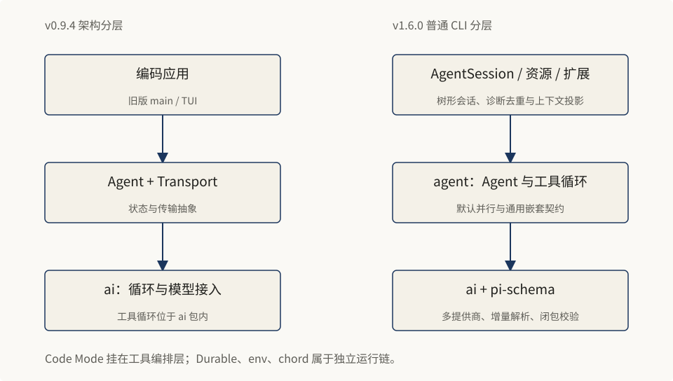

这张图把 v0.9.4 和 v1.6.0 普通 CLI 的主要职责并排对照。左侧循环挂在 `ai` 包里，由旧 transport 桥接；右侧循环收归 `agent` 包，`AgentSession` 管住会话和扩展生命周期，`ai` 专注多提供商协议和增量流式解析，`pi-schema` 承接统一参数校验。这些迁移是在十多个月里逐步完成的，并非某一次发布突然推倒重来。

# 第 2 章：v0.9.4 当年是怎么跑起来的

许多人回看早期命令行编码工具，会下意识以为它就是一个壳脚本包着几行 API 请求。打开 v0.9.4 的源码树，会发现它从第一版起就已经把模型接入、有状态 Agent、编码应用和终端渲染拆成了独立分层。

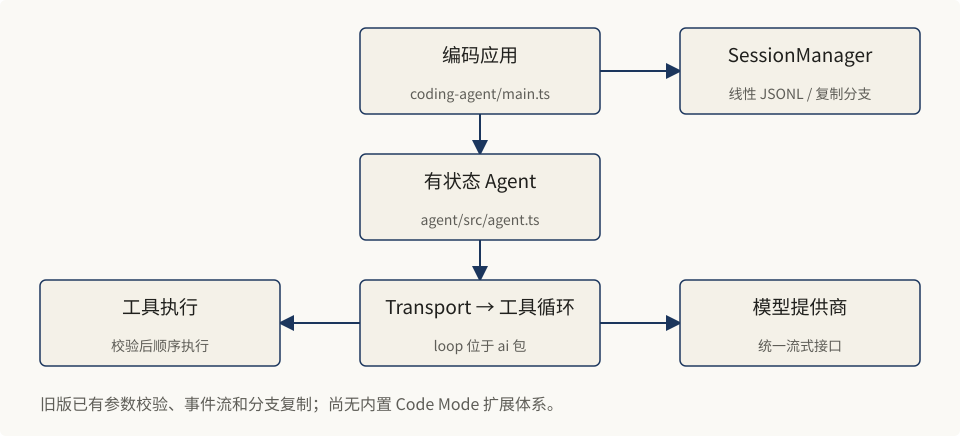

在 v0.9.4 里，核心工具循环写在 `packages/ai/src/agent/agent-loop.ts`，有状态 `Agent` 类位于 `packages/agent/src/agent.ts`。`Agent` 接收一个 `AgentTransport` 实例，执行时通过 `transport.run(...)` 拉取流式事件；`coding-agent` 负责把用户输入、会话文件和终端渲染装配到一起。[S3](#s3)、[S4](#s4)

### 顺着一条简单请求走完旧循环

假如用户输入“读 package.json，告诉我包名”，v0.9.4 的处理链条非常直接：

`Agent` 把用户输入包装成应用消息，经消息转换器转成模型协议要求的格式后交给 transport。循环消费模型返回的流式块；一旦识别出 `read` 工具调用，就按名字查找工具定义、做参数校验、执行 `execute()`，再把产出封装成 `toolResult` 塞回消息列表，触发下一轮模型请求，直到模型不再发起工具调用。

下面这段简化伪代码勾勒出当时循环的骨架：

```js
while (hasToolCalls || queuedMessages.length > 0) {
  injectQueuedMessages();
  const assistant = await streamModel(context);
  for (const call of assistant.toolCalls) {
    const args = validate(call);
    const result = await findTool(call.name).execute(call.id, args, signal);
    context.messages.push(toToolResult(call, result));
  }
}
```

拆看这段骨架，有两个容易记混的历史事实。第一，工具参数校验在 v0.9.4 就已经接入主循环，后来引入 Code Mode 或 `pi-schema` 只是升级校验引擎和报错体验，工具调用从来没有裸奔过。第二，旧循环用带 `await` 的 `for...of` 按顺序逐个执行工具调用，直到后面的版本才改成同回合默认并行执行。[S4](#s4)、[S6](#s6)

### 状态怎么摆，分支怎么存

当时 `Agent` 自己管着消息列表、当前模型、流式中间态、待处理调用 ID 和待注入队列。消息转换器把附件等应用侧结构翻译成 provider 认识的内容块；事件流则对外发射 `message_start`、`message_update`、`message_end` 以及工具和回合边界，让 UI 只需要订阅事件就能重画界面。

持久化由旧版 `SessionManager` 负责，底层同样是 JSONL 文件，按行记录会话头、消息、模型切换和思考等级变化。区别在于当时每条记录还没有如今的 `id` 与 `parentId` 树形指针。调用 `createBranchedSession()` 时，程序会新建一个 JSONL 文件，把分支点之前的历史整段复制过去。早年已经支持从历史节点分叉继续对话，只是靠复制新文件实现，跟今天在单文件内部原地切换树形分支的形态不同。[S5](#s5)

### 当时缺少哪些组件

v0.9.4 里还看不到内置 Code Mode、MCP 客户端和工具按需发现，扩展点也散落在独立的 hooks 与自定义工具机制里。同期仓库里带着 `mom`、`web-ui`、`pods`、`proxy` 等配套目录，说明作者很早就想让核心库服务多种前端界面，只是那些早期目录后来大多经历了拆改或淘汰。

顺手做个归位练习：Anthropic 流式事件归一化归模型接入层，终端局部重画归 TUI，判断是否继续请求下一轮归 Agent 循环。哪怕文件从 `packages/ai` 搬到了 `packages/agent`，这套分层边界至今依然成立。

# 第 3 章：v1.6.0 的包地图与三条边界

直接打开 v1.6.0 的 `packages/` 目录，里面摆着十二个包，旁边还有 `apps/` 目录。最容易犯的错，是看到目录挨在一起就把它们画进同一条 CLI 请求链路里。

先看主干：普通 CLI 依然跑在有状态 `Agent` 上，核心循环已经独立并入 `packages/agent/src/agent-loop.ts`。`coding-agent` 提供 `AgentSession`、树形会话持久化、上下文投影、资源加载、扩展生命周期、模型运行时以及 TUI/JSON/RPC/SDK 四种接口。Code Mode 与 MCP 作为内置扩展挂在工具执行管线下面，没有替换 Agent 循环，也没有取代模型接入层。[S6](#s6)、[S7](#s7)

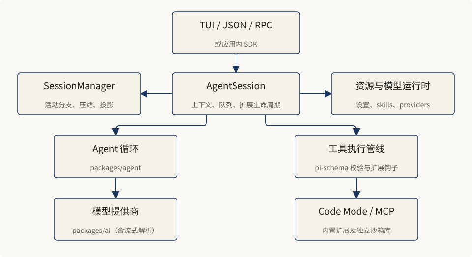

把 `packages/` 下十二个包的实际职责和与 CLI 的关系逐个对齐，就能彻底分清主干和旁支：

| 目录 | 主要职责 | 与普通 CLI 的关系 |
|---|---|---|
| `ai` | 多提供商协议、流式归一化、增量工具参数解析、缓存预热 | 直接依赖，模型基础层 |
| `agent` | 有状态 Agent、模型与工具循环、队列、事件流 | 直接依赖，核心循环 |
| `coding-agent` | CLI、AgentSession、资源、扩展、树形会话、SDK、RPC | 产品与 harness 主体 |
| `tui` | 差分终端渲染、组件只读缓存、鼠标与覆盖层调度 | 直接依赖，终端展示层 |
| `codemode` | 独立 QuickJS/WASM 沙箱、worker 桥与确定性协议 | 直接依赖，供内置 Code Mode 扩展调用 |
| `mcp` | 独立 MCP 协议客户端（stdio 与 Streamable HTTP） | 直接依赖，供内置 MCP 扩展调用 |
| `schema` | v1.5.0 新增零 `eval` JSON Schema 闭包校验与宽松转换库 | 间接依赖，经 `ai` 与 `agent` 接入 |
| `telemetry` | 厂商无关的观测契约与类型 | 间接依赖，由 `ai` 与 `durable` 使用 |
| `durable` | 实验性持久会话、任务调度、journal 重放运行时 | 独立运行时，CLI 不依赖 |
| `env` | Durable 配套的远程 ExecutionEnv 与 Rust daemon | 可选远程执行基础设施，CLI 不依赖 |
| `chord` | 类型化 runtime、文档状态与 RPC 基础设施 | Durable 与 `env` 使用，CLI 不依赖 |
| `evals` | 仓库内部评估工具集 | 开发评估工具，不在用户请求链路上 |

上面这张表逐项核对过 v1.6.0 各包的 `package.json`。根 README 里的包介绍往往滞后于目录增删，查真实依赖边界时，始终应该以 `packages/coding-agent/package.json` 为准。[S8](#s8)、[S35](#s35)

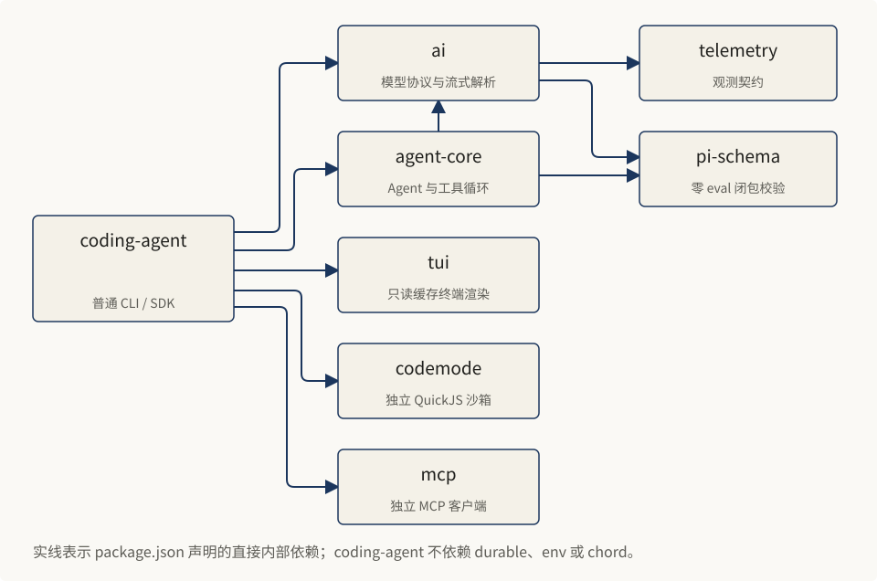

这张依赖图专门用来确认发布、排障和嵌入集成时哪些内部包必须保持版本同步。从图中一眼能看出两件关键事实：第一，v1.5.0 新引入的 `pi-schema` 进入了 `ai` 和 `agent-core` 底层，统一接管模型配置和工具参数校验；第二，`durable`、`env`、`chord` 完全在另一张依赖网里，普通 CLI 安装包不带它们。

### 贯穿后文的三条工程边界

记住几十个类名远不如钉牢三条边界，后面关于会话、沙箱、MCP 和 TUI 的设计取舍几乎都从这里长出来。

**推理边界**划在模型与常规代码之间。模型擅长决定目标、拆解策略和拼装调用，但遇到遍历几十个文件、做条件分支、抽提字段汇总这类确定性逻辑，交给 Code Mode 里的 JavaScript 去跑，可以省去把大量中间结果反复塞回模型的开销。

**上下文边界**由 harness 守住。磁盘上保存的原始 JSONL 历史、TUI 屏幕上画出的折叠卡片、脚本内部触发的嵌套工具调用记录，和下一轮发给 provider 的模型上下文，各自承担不同用途，绝不能当成同一份数组去改。

**能力边界**落在工具和操作系统这一侧。QuickJS 脚本里拿不到 Node 文件系统或网络 API，只能调用宿主注入的函数；可一旦宿主把 `bash` 暴露给脚本，命令就会继承 Pi 进程的真实系统权限。JS 沙箱挡住的是脚本直接碰宿主进程内存，真正的系统隔离还要靠容器、账户和凭据策略。


# 第 4 章：一次请求的完整生命周期

在长会话里排查为什么模型突然忘了三轮前的结论，或者为什么切回旧分支后磁盘文件还在，根源往往出在同一件事上：把磁盘历史、界面展示和发给模型的上下文混成了一团。

把一条真实输入放进 v1.6.0 的主链里跟踪一遍，每一步的归属就清晰了：

1. 终端 TUI、SDK 或 RPC 收到用户输入。提示模板按需展开，扩展的输入钩子可以先拦截命令或改写内容。
2. `AgentSession` 接管本次运行准备：解析模型与思考等级、装配工具列表、检查自动压缩阈值、维护消息队列与扩展生命周期。
3. `SessionManager` 从当前叶子节点沿着 `parentId` 往上回溯，抽出活动分支，重建发给模型的投影上下文。
4. harness 把系统提示、活动分支消息、工具声明和模型参数打包发往 provider。如果命中 Anthropic 消息线程（`compat.supportsMessageThreads`，v1.6.0 起对任何 `api.anthropic.com` 端点默认开启），请求可以只发新增消息，由服务端续接上一轮回复；一旦发生压缩或工具集变化，则自动回退到完整上下文请求。[S29](#s29)
5. provider 推送流式事件。v1.5.0 起大型工具调用的 JSON 参数在这里经 `StreamingJsonParser` 增量解析，Agent 再把事件归一化为消息、工具与回合信号。
6. 若模型发出工具调用，进入 `pi-schema` 参数转换与校验、触发扩展 `tool_call` / `tool_result` 钩子、执行工具并落盘结果。
7. 只要还有未消费的工具结果、自动重试或排队消息，循环继续推进；全部清空后才进入最终收尾。

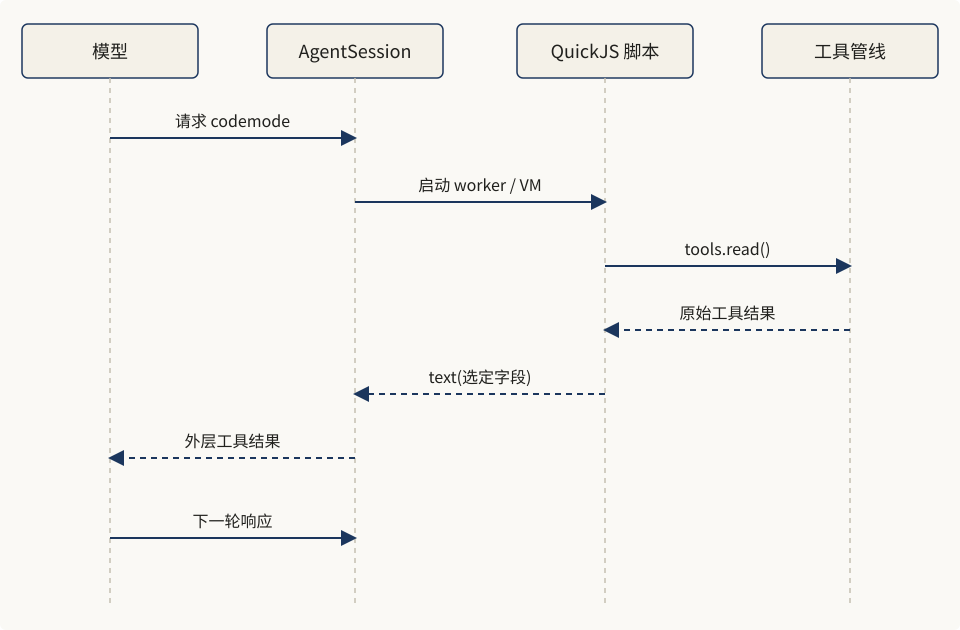

时序图省去了逐块流式事件和重试分支，只留出最关键的一道墙：**脚本发起的嵌套工具调用，原始结果先回到 QuickJS，不会直接灌进下一轮模型上下文。**[S7](#s7)、[S9](#s9)、[S10](#s10)

### 同回合并行调用和 Code Mode 解决的问题不同

当前 `packages/agent` 的工具管线已经支持同回合并行：收到一个包含多次工具调用的 assistant 回复后，harness 先按顺序跑完调用前钩子检查，再并发执行获准的工具；完成事件按实际完成先后通知 UI，而写回会话历史的 `toolResult` 消息严格维持 assistant 原回复里的调用顺序。需要独占共享状态的工具也可以声明顺序执行。[S6](#s6)

也就是说，模型在同一轮里连续发出三次 `read`，不开 Code Mode 一样能并行。Code Mode 额外补上的能力，是在脚本里直接写依赖关系、条件分叉、异常处理和结构化过滤，把不需要模型阅读的原始载荷留在执行侧。

### 三份历史各干各的活

| 视图 | 记录或呈现的内容 | 主要用途 |
|---|---|---|
| 原始会话树 | 消息、分支链接、压缩摘要、上下文编辑、配置变更、自定义状态 | 审计追溯、恢复、分叉、导出 |
| UI 与执行事件 | 流式增量、折叠状态、嵌套工具进度、耗时与提示 | 实时交互观察 |
| 模型上下文投影 | 活动分支经压缩边界、上下文编辑、消息转换后的最终请求载荷 | 驱动下一轮模型推理 |

当前 JSONL 文件里的每条记录都靠 `id` 和 `parentId` 串成一棵树。`/tree` 切回老节点继续对话时，被放弃的分支留在原文件里不会丢。压缩只是往分支上追加一条摘要和保留边界，不会改写旧行；`context_edit` 可以在投影阶段隐藏或替换某条历史消息，磁盘原始记录照旧保留。[S11](#s11)

顺带提一个 v1.5.2 补上的日常恢复痛点：项目文件夹改名或删掉以后再打开旧会话，交互模式以前只能硬着头皮在当前目录临时续跑，每次重启都要反复弹窗询问。v1.5.2 起，遇到原目录不存在时，`/resume`、`/import`、启动参数和扩展的 `ctx.switchSession()` 会同时给出 `Continue`、`Fork` 和 `Cancel` 三个选项。选 `Fork` 会把会话带新 ID 复制一份到当前目录，以后再恢复就不会反复追问。[S39](#s39)

### 自动压缩、摘要预算与截断恢复

自动压缩的触发条件很直白：

```text
contextTokens > contextWindow - reserveTokens
```

Code Mode 负责在原始数据进入上下文之前先瘦身，压缩负责在对话拉长之后把早期历史压成摘要。两者上下游配合，互不替代。拿测试日志举例，工具自带的截断只认头尾行数，不知道你想看哪三条失败断言；脚本可以直接解析测试输出、只留失败堆栈。反过来，如果脚本一股脑把几万行原始日志全 `text()` 出去，上下文同样会迅速撑满。[S12](#s12)

v1.4.0 修正过一个很隐蔽的预算耦合：`compaction.reserveTokens` 只负责决定何时触发压缩，不再用来折算摘要请求的输出上限。早期主摘要曾用 `floor(0.8 * reserveTokens)` 和模型上限取较小值，结果推理型模型光思考就用光了大半额度，正文摘要写到一半直接截断。如今摘要与分支总结都改用模型本身的输出上限，并在接近窗口上限时协同调整输入与输出空间。导出的 `generateSummary()` 和 `generateSummaryWithUsage()` 为兼容旧签名保留了 `reserveTokens` 形参位置，但内部已经忽略它；`/compact <instructions>` 附带的自定义指令也会透传给被切开的回合前缀摘要。[S12](#s12)、[S28](#s28)

另一条容易弄坏整场会话的边界在输出截断恢复上。如果模型输出撞到 token 上限留下一个残缺工具调用，投影层在丢弃残缺调用的同时，必须一并清掉与之对应的孤立 `toolResult`；否则后续发往 provider 的每一轮请求都会因为工具请求与结果不成对而报 400。v1.4.0 修通了这条协议一致性保护；v1.6.0 又补上了另一处场景：按 Esc 中断一批工具调用时，尚未开始执行的调用现在会收到明确的 `Operation aborted` 结果，不再悬空。[S2](#s2)

### v1.5.1 的两处底盘改动：流式读写与空闲缓存预热

当项目里出现几十兆的日志或压缩包，早期 `read` 和 `grep` 很容易把进程内存打爆。v1.5.1 把这两把高频工具的 I/O 方式做了重构：`read` 改用流式读取，哪怕文件很大，指定 `offset` 和 `limit` 时也只把展示范围内的行留在内存里，自定义 `ReadOperations` 可通过新的可选 `createReadStream` 接入同一能力；`grep` 的上下文行改由 ripgrep 直接吐出，不再自己把每个命中文件整份读进内存，原来的 `GrepOperations.readFile` 回调由此废弃不再调用。[S2](#s2)

同一版本把 `cacheWarming` 的默认策略从 `"streaming"` 调成了 `"idle"`。代码写在 `packages/ai/src/cache-warming.ts` 里，算盘打得很克制：单靠直觉定时发请求保活很容易倒贴钱，所以 Pi 在每次准备刷新缓存前，都会拿模型单价和当前提示规模算一笔账。[S37](#s37)

```text
expectedSavings = continuationProbability * missCost - warmCost
```

处于活跃流式阶段时延续概率按 `1` 算，最长保活 60 分钟（`CACHE_WARMING_MAX_AGE_MS`）；会话空闲后延续概率按上游经验常数 `0.15` 算，最长保活 30 分钟（`CACHE_WARMING_MAX_IDLE_AGE_MS`）。只有当预期节省不低于 `0.05` 美元（`CACHE_WARMING_MINIMUM_EXPECTED_SAVINGS`）时，才会在缓存 TTL 到达 90%（且至少提前 10 秒）时发一次 `maxTokens: 1`、`maxRetries: 0`、`disableContinuation: true` 的静默刷新，并且不干扰 Anthropic 的消息线程状态。

### 区分 agent_end 与 agent_settled

写 SDK 或 RPC 集成时，最常见的状态机 bug 是监听到 `agent_end` 就把界面标成空闲或直接退出进程。`agent_end` 只说明底层 Agent 跑完了一轮，后面还可能紧接着自动压缩、错误重试或者排队中的 follow-up 消息。真正代表 Pi 停下来不再自动推进的事件是 **`agent_settled`**。另外，v1.6.0 给 `AgentSessionRuntime` 补上了 `takeUnreportedDiagnostics()`，方便宿主在启动以及 `/new`、`/resume`、`/fork` 切换会话后按条去重取出配置或扩展加载告警，不再静默吞掉问题，也不再把同一条告警在 TUI 里刷屏。[S9](#s9)、[S40](#s40)

顺手确认一条底线：用 `/tree` 切回十分钟前的节点，磁盘上已经修改过的文件不会自动倒回。会话树记录的是对话与状态演进，无法替代 Git 或文件系统快照。

# 第 5 章：Code Mode 到底改变了什么

很多时候，让 Agent 卡壳的障碍并不在模型智商，而在工具返回了太多噪音。读取十几个配置文件、跑完一套测试再挑出三条报错，如果每次都把几万字符原封不动送回模型，既慢又容易稀释注意力。

Code Mode 的做法很直接：**让模型写一小段调用工具的 JavaScript，把循环、判断、容错和字段筛选放在脚本里跑完，只把主动调用 `text()` 或 `image()` 吐出来的精选结果交还给模型。**[S10](#s10)

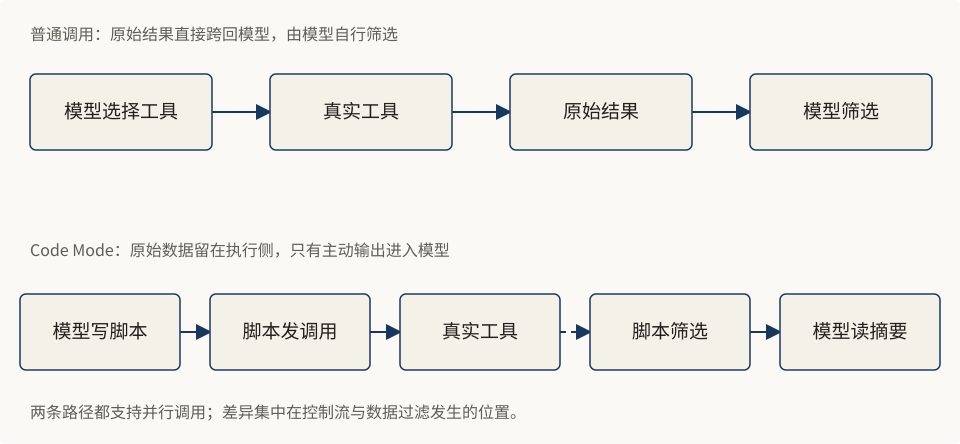

从模型视角看，它只发起了一次外层 `codemode` 工具调用；脚本在执行侧可以按需触发十几次真实工具调用。底层的 `read`、`bash`、MCP 工具照常执行，没有被任何替身架空。

### 用一个具体任务看差异：抽查三个 package.json

需求很简单：读取仓库根目录、`packages/api` 和 `packages/web` 三个 `package.json`，只报告各自的包名以及 `scripts` 里有没有 `test`。

用普通工具，模型可以连发三次 `read`，把三个完整 JSON 全部吞进上下文再摘字段；也可以拼一条 shell 命令用 `jq` 或 `node -e` 抽取。Code Mode 提供了另一条更结构化的路：

```js
const paths = [
  "package.json",
  "packages/api/package.json",
  "packages/web/package.json",
];

const rows = await Promise.all(paths.map(async (path) => {
  const raw = await tools.read({ path });
  const pkg = JSON.parse(raw);
  return { path, name: pkg.name, hasTest: Boolean(pkg.scripts?.test) };
}));
text(rows);
```

这段脚本假设三个文件都没有触发工具截断且为合法 JSON。注意 `tools.read` 读文本时直接返回字符串，别错写成 `raw.output`。要是目标文件大到被 `read` 截断，半截 JSON 会让 `JSON.parse` 报错；遇到超大文件时，要么换专门的结构化查询工具，要么用受控 shell 抽出所需片段再交给脚本。

### 把容错和控制流写进同一段代码

上面用 `Promise.all()` 有个隐患：只要其中一个路径不存在，整个表达式立刻 reject，连另外两个成功读出来的结果也会丢掉。并行读取多个相互独立的来源时，改用 `Promise.allSettled()` 稳得多：

```js
const paths = ["package.json", "missing/package.json"];
const results = await Promise.allSettled(
  paths.map(async (path) => JSON.parse(await tools.read({ path })))
);
text(results.map((r, i) => r.status === "fulfilled"
  ? { path: paths[i], name: r.value.name }
  : { path: paths[i], error: String(r.reason) }
));
```

拿到每项的 `fulfilled` 或 `rejected` 状态后，脚本自己决定如何汇总回报。放进同一个并发数组的调用彼此之间不能有先后依赖；如果第二步要读取第一步刚写出的文件，就老老实实按顺序 `await`。

### 算一笔直观的字符账

做个示意算术（纯数据量推导，非线上性能测试）：假设有 N 次独立调用，单次原始结果 R 字符，经脚本挑完后每项只留 S 字符。

```text
原样跨回模型：约 N * R 字符
脚本筛选输出：约 N * S 字符 + 脚本与外层结果包装
```

代入 N = 12、R = 20,000、S = 300，数据载荷从约 240,000 字符降到约 3,600 字符。字符数不等同于 token 数，也不直接等于账单费用，实际开销还取决于分词器、工具定义长度和缓存命中率。但这笔账清楚标出了收益来源：省下来的恰恰是那些本就不需要模型逐字阅读的中间噪音。

### 什么时候反而别套 Code Mode

只读一个五十行的小文件，直接 `read` 干脆利落；跑一趟全量单元测试，直接 `bash` 更直观；做耗时很长的密集计算，把任务塞进 QuickJS 解释器反而拖慢节奏。Code Mode 是一层按需启用的可编程数据过滤层，别为了用它把一行能说完的调用强行包成脚本。

# 第 6 章：拆开沙箱，顺着源码追一次调用

脚本跑在沙箱里听起来很让人安心，可一旦线上出了权限越界或内存打爆，光靠这几个字根本没法排障。必须看清楚脚本到底运行在哪一层，工具校验和扩展钩子又卡在哪个节点。

普通 CLI 的 Code Mode 拆成两层：`packages/codemode` 是零 Pi 内部依赖的独立 QuickJS/WASM 沙箱库；`packages/coding-agent/src/extensions/codemode` 负责把它接到 Pi 的工具管线、会话存储、TUI 卡片和模型运行时上。[S13](#s13)

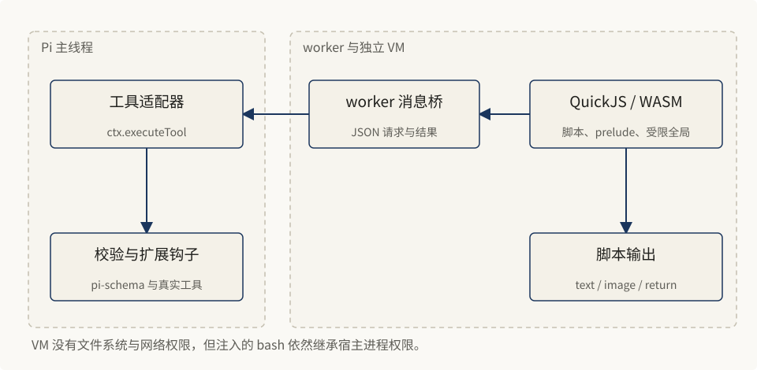

### 从源码一路追通 tools.read()

在 `packages/coding-agent/src/extensions/codemode` 和 `packages/codemode` 里顺着代码走一遍，一次 `tools.read(...)` 经过九个站点：

1. `tool.ts` 定义 `codemode` 工具的参数结构、模型可见提示和 `reachesTools` 静态分析。
2. `execute.ts` 读取当前会话里允许被脚本调用的工具列表 `ctx.tools`，逐个包成沙箱能力适配器。
3. 通过 worker 准入池拿到名额后，创建 `CodemodeSandbox`，配置 QuickJS WASM、worker 入口、256 MiB 堆上限和剩余 deadline。
4. `sandbox.execute()` 拉起 worker thread，在独立 WASM 实例里初始化新的 QuickJS VM。
5. VM 启动时加载 prelude，把 `tools`、`text`、`image`、`console`、`store` / `load` 等受限接口挂到全局，底层通信桥藏进闭包，外部脚本摸不到。
6. 脚本执行 `await tools.read(...)`，请求序列化为 JSON，经 worker 消息桥发回 Pi 主线程。
7. 主线程调用 **`ctx.executeTool()`**，完整经过 `pi-schema` 参数转换校验和所有扩展注册的 `tool_call` / `tool_result` 钩子。
8. 工具执行完，结果按契约转换成脚本值传回 VM；脚本筛选并输出。
9. `execute.ts` 触发沙箱关闭、在脚本成功时提交 `codemode-store` 状态、按预算截断过长输出、落盘临时图片，返回外层工具结果。

打开 `packages/coding-agent/src/extensions/codemode/execute.ts`，决定安全策略能否统一落地的就是这一行核心调用：

```ts
const outcome = await ctx.executeTool(tool.name, args, { signal: callSignal });
```

正因为脚本里的工具调用必须绕回 `ctx.executeTool()`，扩展在工具边界上写的命令白名单、目录保护或审计日志才能照常拦住嵌套调用。不过有一点必须提前搞清楚：Pi 默认**没有内置逐次弹窗确认的权限审批系统**，这里保证的是自定义扩展钩子不会被脚本绕过，而非开箱自带强制审批。[S14](#s14)、[S15](#s15)、[S25](#s25)

### v1.5.0 换装 pi-schema：统一 JSON Schema 校验

在 v1.5.0 之前，TypeBox 工具和普通 JSON Schema 工具（尤其是 MCP 服务器导出的工具）在参数宽容度和报错文案上存在温差。v1.5.0 新增了独立包 **`@earendil-works/pi-schema`**（`packages/schema`），把 JSON Schema Draft 2020-12 与 Draft 7 编译成纯 JavaScript 闭包，全程不使用 `eval` 或 `new Function`，因此能在严格 CSP 与 Cloudflare Workers 环境下运行。[S35](#s35)

`packages/ai/src/utils/validation.ts` 现在统一走 `pi-schema` 做参数转换与校验。不管是内置工具、TypeBox 扩展工具还是 MCP 原始 JSON Schema 工具，校验前都会经过同一套宽松转换：把数字字符串 `"42"` 转成 `42`，把 `"true"` 转成 `true`，把单个标量包成单元素数组，并丢弃可选属性上的 `null`。校验失败回传给模型的报错也统一成精简的点号路径格式，比如 `- path: missing` 或 `- limit: expected number, got string`。[S15](#s15)

这套切换带来一个明确的迁移注意点：超出 JSON Schema 表达范围的 TypeBox 私有特性，例如 `Type.Refine()`、`Type.Codec()` 以及通过 `Format.Set()` 注册的自定义格式，不再自动作用于工具参数校验，需要移进工具的 `execute()` 里自行检查。v1.5.1 随后补齐了 `Type.BigInt()` 与 `Type.Undefined()` 的转换兼容，而 `Type.Void()` 依旧拒绝任何 JSON 参数。[S2](#s2)

### 为什么舍弃 Node 的 eval 而绕道 QuickJS/WASM

脚本在 QuickJS/WASM 里完全看不到 `process`、`require`、`fs`、`fetch` 和 `setTimeout`。就算模型在脚本里写 `eval` 或 `new Function`，也只能在同一个受限 VM 里生成代码，凭空变不出宿主进程的任何句柄。再加上独立的 worker thread，一段同步死循环最多卡死当前 worker，不会把 Pi 主线程的终端响应和取消快捷键拖死。

把每一层的限额对号入座，排查报错时就不会找错地方：

| 层次 | 负责的限制或约束 |
|---|---|
| 脚本首行指令 | 可选 `// @options:` 必须写在第一行，放错位置或含非法字段会直接报错 |
| QuickJS VM | CLI 默认单脚本 256 MiB 堆内存上限，超限即分配失败 |
| 宿主与 worker | 总 deadline、取消信号、worker 存活数量上限与 FIFO 排队等待 |
| 输出收集器 | 16 Mi 字符总量及 100,000 条输出项硬上限 |
| 模型结果格式化 | 外层默认约 10,000 输出 token 预算，超长保留头尾并把全文存到临时文件 |
| 底层真实工具 | 自身参数校验、外部进程生命周期、输出截断与命令超时 |
| 操作系统或容器 | 文件系统、进程、网络与凭据的真正隔离边界 |

这些数字各自守着不同环节，切忌混用。256 MiB 是 CLI 集成定的值，Cloudflare 远程沙箱的默认 VM 内存则是 32 MiB；外层 10,000 token 输出预算管的是发回模型的体积，跟 VM 里能建多大的对象无关。[S10](#s10)、[S13](#s13)

### 别把 JS 沙箱当成系统权限沙箱

```js
await tools.bash({ command: "rm -rf ./important-dir" });
```

只要 `bash` 被注入进了 `tools`，上面这行代码完全合法，真正执行删除的是宿主进程里的 shell。QuickJS 碰不到本地文件系统，不代表经它转发出去的 `bash` 调用也碰不到。需要强隔离的环境，必须把 Pi 或工具执行端放进挂载受限、网络可控、凭据隔离的容器或虚拟机里。顺便留意，v1.5.0 已经删掉了仓库里早年的原生 OS `sandbox/` 扩展例子，官方现在推荐参考 `gondolin/` 示例或 `docs/containerization.md` 做容器化隔离。[S2](#s2)、[S25](#s25)

想顺着源码亲手走一遍的读者，推荐按这条顺序打开文件：`tool.ts` → `execute.ts` → `codemode/src/runtime/host.ts` → `worker.ts` → `vm.ts` → `prelude-source.ts`。先跟通一次普通调用，再去看声明渲染和模型辅助接口会轻松很多。


# 第 7 章：工具太多时，如何按需发现而不塞满提示

接入三五个 MCP 服务以后，注册表里很容易冒出一两百个工具。如果照传统做法把全部工具名、说明和参数 schema 一次性塞进每次模型请求，提示词体积会立刻膨胀，模型选工具的准确率下降，工具列表只要微调还会连带击穿 prompt 缓存。

Pi 把工具注册、向模型声明和允许脚本调用拆成了三个独立开关。一个工具可以已经注册、可以供脚本调用，却完全不写进模型的工具声明列表；也可以等模型主动搜索后再按需声明。**工具在提示词里不可见，不等于它不可用，也不等于权限被收回。**[S16](#s16)、[S17](#s17)

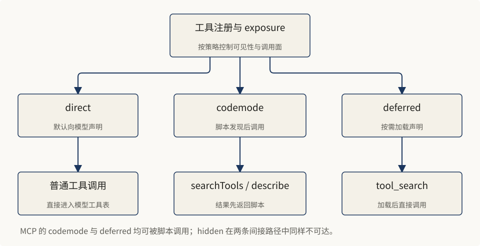

### MCP 的四种 exposure 策略

| MCP exposure | 默认向模型声明？ | 脚本可调用？ | 典型适用场景 |
|---|---|---|---|
| `direct` | 是，受当前活动工具集约束 | 是 | 极少数高频核心工具 |
| `codemode` | 否，默认也不展开进 Code Mode 说明 | 是 | 大多数 MCP 服务，先发现再组合调用 |
| `deferred` | 否，由 `tool_search` 加载后声明 | 是 | 希望发现后按普通工具直接调用 |
| `hidden` | 否 | 否 | 保留配置条目但使其完全不可达 |

MCP 工具默认走 `codemode`。普通扩展工具还多一种 `model-only` 策略，适合像 `codemode` 自身或交互问答这类只给模型直接调用、禁止其他工具嵌套调用的编排器。别把 MCP 的 exposure 配置和底层扩展工具属性硬揉成一张表：MCP 扩展还叠加了命名空间前缀、延迟连接和全局过滤，最终可达性要看禁用清单、工具筛选与活动集合的交集。[S15](#s15)、[S16](#s16)

### 脚本里的四个发现入口

```js
const hits = await searchTools("search documentation", { limit: 3 });
text(hits);
```

脚本侧提供四个分工明确的查询入口：`ALL_TOOLS` 给出当前可调用目录的名称与简述；`searchTools(query, options)` 做相关性排序召回候选；`describeTool(name)` 返回单个工具的完整说明与 TypeScript 声明；`describeNamespace(name)` 读取某个命名空间的服务指令和工具列表。

三个查询 helper 都是异步函数，调用时必须带 `await`。拿到候选后要先调用 `describeTool()` 核对参数字段，别凭名字盲猜参数直接调用。[S10](#s10)

```js
const hits = await searchTools("read documentation page", { limit: 3 });
if (hits.length === 0) return "没有找到候选工具";
text(await describeTool(hits[0].name));
```

发现结果交回给模型后，下一轮模型再据此写出精确的参数调用。把探索接口和执行操作分成两轮，比硬塞进一段赌运气的长脚本稳得多。

v1.5.0 到 v1.6.0 连续修通了工具发现里的几处常见暗礁：第一，旧版分词器只认 ASCII 字母和数字，中文、日文、泰文查询几乎搜不到结果；现在 `tool_search` 和 `searchTools()` 支持多语种与无空格中文切词（例如直接搜 `搜索记录`），也做了 Unicode 规范化匹配。第二，排序规则改成了工具名命中权重远高于描述词出现次数，且命中更多查询词的条目排在前面，避免搜 `peekaboo app` 时真正叫 `mcp__peekaboo__app` 的工具排到十几名开外。第三，v1.5.1 起索引器会沿着本地 `$ref` 展开 `$defs` 里的字段名和描述（带循环引用防护，遇到非法百分号转义降级为 `unknown` 而不让整个脚本崩掉）。第四，v1.6.0 修复了某个扩展在 `session_start` 里关闭自家工具时，顺带把 `tool_search` 之前动态加载进来的 MCP 工具在恢复或 `/reload` 后弄丢的问题。[S2](#s2)

### codemode.mode 的 on 与 only

默认配置是 `on`：已声明的工具保持直接可见，同时附带脚本编排提示。切到 `only` 后，底层工具从模型直接声明里隐藏，调用入口收拢到 `codemode`；但脚本依然能调用它们，隐藏声明只影响提示词呈现与编排方式，不会带来额外的操作系统隔离。

```json
{
  "defaultTools": ["+codemode"],
  "codemode": { "mode": "on", "inlineBudget": 3000 }
}
```

`inlineBudget` 按大约每四个字符折算一个 token 的方式估算内联声明预算，超出预算的工具交由发现接口按需查找。默认暴露为 `codemode` 的 MCP 工具本就不会逐个铺进说明里。v1.5.0 还缩减了复杂输出类型的内联声明：对象联合类型改由字段与鉴别器摘要展示，更长的多行类型则引导脚本调用 `describeTool()` 查看完整声明。[S2](#s2)、[S17](#s17)

### MCP 为什么不拖慢每次启动

自 v0.99.2 起，非 `direct` 的 MCP 服务器在后台异步建连，不卡住首个 prompt。具体等到什么时候才等待连接就绪，靠编排工具声明的 `reachesTools(input)` 契约决定：脚本里点名调用了 `tools.mcp__docs__search`，MCP 扩展只等 `docs` 这一个服务连好；如果脚本调用了 `searchTools()` 或访问 `ALL_TOOLS`，说明可能覆盖全目录，才等待全部延迟服务器就绪。v1.2.0 借由 `reachesTools` 把 MCP 和内置 Code Mode 彻底解耦，替换自定义编排器时只需实现同一契约即可联动延迟连接。[S2](#s2)、[S15](#s15)、[S16](#s16)

在连接与传输稳定性上，v1.5.0 与 v1.5.1 也有几项务实加固：MCP OAuth 登录默认改用 `oauth.clientRegistration: "auto"`，优先走 Client ID Metadata Document，服务端不支持再回退到动态客户端注册，并拒绝非 `http:`/`https:` 协议的授权地址；stdio 传输修复了大消息分片到达时反复拷贝扫描的卡顿，POSIX 退出时能清理掉孤儿守护子进程；Streamable HTTP 与 SSE 则补齐了消息体积上限，超过上限或错误响应超过 8 KiB 会立即取消传输，不再把整份异常响应读进内存。[S2](#s2)

### 一条容易误判权限的 CLI 参数

```sh
pi --tools read,codemode
```

在当前版本里，上面这条命令**不会顺手删掉 MCP 工具**，脚本里依然能调到已配置的 MCP 服务。如果要彻底屏蔽 MCP，必须显式加上 `--no-mcp`；要按名称筛选 MCP 用 `mcp__` 模式，排除特定工具用 `--exclude-tools`。千万别单看 `--tools` 白名单就以为做完了权限收口。[S16](#s16)、[S19](#s19)

# 第 8 章：返回值、失败处理、并发与状态边界

写 Code Mode 脚本时，语法错误很少见，真正让人半夜翻车的几乎全出在契约误判上：以为每个工具都返回字符串，以为命令失败一定会 `throw`，或者以为脚本报错会自动把前面写坏的文件回滚回去。

### 三类高频工具的返回形态

| 工具类别 | 脚本实际拿到的返回值 | 必须主动核对的字段 |
|---|---|---|
| `read` 读文本 | 字符串（读图片时为图片块对象） | 内容是否被截断、能否安全按预期格式解析 |
| `bash` | `{ output, exit_code, truncated, full_output_path?, ... }` | `exit_code`，Promise 正常 resolve 也可能命令执行失败 |
| MCP 工具 | 完整 `CallToolResult`（含 `content`、`structuredContent`、`isError`） | 先看 `isError`，再读结构化字段，别只取第一条文本就判成功 |

声明了 output schema 的工具会直接把结构化对象交给脚本；参数校验失败、扩展钩子拦截或内部异常才会 reject Promise。MCP 工具保留了协议原样对象，因此必须显式检查 `isError`。一切以 `describeTool()` 返回的声明为准。[S10](#s10)、[S14](#s14)、[S16](#s16)

```js
const result = await tools.bash({ command: "npm test" });
if (result.exit_code !== 0) {
  text({ passed: false, tail: result.output.slice(-4000) });
} else {
  text({ passed: true });
}
```

调用 MCP 工具时的判错套路如下（工具名与参数仅作契约示意，使用前需先经发现接口确认）：

```js
// 伪代码：工具名需先通过 searchTools / describeTool 核实
const result = await tools.mcp__docs__search({ query: "session" });
if (result.isError) throw new Error(JSON.stringify(result.content));
text(result.structuredContent ?? result.content);
```

顺便记住扩展侧调用外部命令的 `pi.exec()` 在 v1.5.0 和 v1.6.0 的变化：它新增了 `maxBuffer` 选项（默认上限为 256 MiB 与运行时字符串上限中的较小者，超限会终止进程并把 `truncated` 标为 `true`），超时或取消发 `SIGTERM` 后若 5 秒内进程仍不退出会补发 `SIGKILL`，而且从 v1.6.0 起，被信号杀死的命令不再误报退出码 `0`，而是照 shell 惯例返回 `128 + 信号编号`（例如 `SIGTERM` 为 `143`，`SIGKILL` 为 `137`）。[S2](#s2)

### 两层成功状态要分开判

`Promise.allSettled()` 里某一项拿到 `status === "fulfilled"`，只代表跨桥调用正常返回，既不代表 shell 退出码为零，也不代表远端业务执行成功。独立沙箱的 `sandbox.execute()` 遇到脚本内部抛错时，同样是正常返回 `{ ok: false, error }` 而不是直接 reject。把传输完成、命令退出码和业务成功拆成三道检查，脚本才不容易静默吞错。

### await 直接决定在途调用的生死

```js
// 错误写法：脚本立刻返回，尚未完成的 read 会被取消
tools.read({ path: "package.json" });
return "完成";
```

```js
// 正确写法：等依赖调用落袋再输出
const source = await tools.read({ path: "package.json" });
text(JSON.parse(source).name);
```

脚本一旦结束，所有还没跑完的在途工具调用都会收到取消信号；而已经执行完的外部写操作无法撤回。`Promise.all()` 只要有一项提前 reject，同样会带着外层脚本提前终止并取消同批其他调用。互不依赖的只读查询优先用 `Promise.allSettled()`，有读写因果的操作按顺序串行执行。

### store 只管分支内小状态，不管文件回滚

`store(key, value)` 和 `load(key)` 用来在同一会话分支内跨脚本保存小型 JSON 数据。CLI 只有在整段脚本成功结束后，才会把变更追加成一条 `codemode-store` 会话条目；单值 JSON 长度上限 262,144 字符，总量上限 1,048,576 字符。重新打开会话或用 `/tree` 切换分支时，Pi 只沿着当前路径重放状态。[S10](#s10)、[S14](#s14)

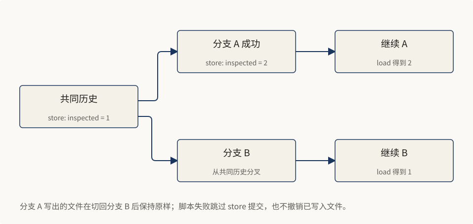

```js
const count = (load("inspected") ?? 0) + 1;
store("inspected", count);
text({ count });
```

假如脚本先调用 `tools.write` 改了磁盘文件，接着调用 `store()`，最后几行抛了异常：结果是 `store` 变更不会提交，但磁盘上那个文件已经被改掉了。分叉会话也一样，分支 A 写进 `store` 的游标不会漏进分支 B，可两边面对的是同一份文件系统。因此 `store` 只适合放分页游标、已筛选 ID 或短摘要，大体积日志、源码全文和图片 base64 应当留给文件或外部服务。

### 取消、真实退出与 worker FIFO 排队

同一个 Pi 进程里，Code Mode 默认最多同时存活两个 worker，跨会话共享；通过环境变量 `PI_CODEMODE_MAX_WORKERS` 可以设成更大的正整数，非法值自动回退到 2。由于 Bun 下某些不轮询中断的同步内建操作在取消后还会拖一小会儿才退出，v1.3.0 把立即向调用方返回取消结果，和等 worker 真正退出后再归还并发名额拆成了两件事，防止反复取消把僵尸 worker 越攒越多。[S2](#s2)、[S13](#s13)、[S14](#s14)

v1.4.0 在此基础上补上了排队机制：名额占满时，`reserveCodemodeWorker()` 不再直接报错拒绝，而是把等待者排进 FIFO 队列，等已有 worker 真正释放后由 `admitCodemodeWorkers()` 按顺序放行。排队最长等 60 秒，并且**等待耗时直接算在脚本自己的总 `timeout_ms` 里**。如果脚本总时限 10 秒、排队用掉 8 秒，实际能跑的时间就只剩 2 秒，拿到名额不会重算计时。[S26](#s26)

还要分清两组并行额度：进程级默认的两个 worker 管的是同时运行的脚本实例数量；单个脚本里并发发起十个互不依赖的普通工具调用，只占这一个 worker。而脚本内调用 `models.classify()` 和 `models.generateImages()` 另受每脚本最多 4 项在途请求的限制。脚本自身禁止嵌套启动另一个 `codemode`，调高 `PI_CODEMODE_MAX_WORKERS` 会同步推高内存与外部请求峰值，需要根据宿主资源评估。

### 四类高频故障的排查顺序

| 报错现象 | 优先检查的点 | 稳妥的恢复动作 |
|---|---|---|
| `tools.X` 不存在或报错 | 拼写、命名空间前缀、工具是否被过滤或处于 `hidden` | 走 `searchTools` / `describeTool` 核实，别反复瞎猜 |
| `JSON.parse` 失败 | 返回值是否被工具截断、混入日志或拿到错误页 | 换结构化工具，或先缩小读取范围 |
| 等待空闲 worker 超时 | 全进程在途脚本、残留未退出 worker 与总 deadline | 检查谁占着名额，别写死循环高频重试 |
| 超时或部分失败 | 已经落盘或发往外部系统的副作用 | 先核查实际外部状态再决定是否重试，写操作需幂等 |

# 第 9 章：扩展、渲染缓存、模型与集成界面

把一个长期工程接进 Pi 时，最容易犯的架构错误是把 Code Mode 当成万能胶。其实五种定制入口各守一块地盘：临时多步工具编排归 Code Mode，挂进宿主进程的可执行能力归扩展，按需加载的领域指令归 skill，可复用输入归提示模板，终端配色归主题。

### 扩展的打包、生命周期与诊断

自 v0.35.0 把 hooks 和自定义工具合为统一的 extensions 后，扩展就是一个接收 `ExtensionAPI` 的 TypeScript 工厂函数，直接运行在 Pi 宿主进程里，可以访问本地文件、凭据和会话状态，不受 QuickJS 那套沙箱限制。加载来源不明的扩展等同于在本地跑第三方代码。[S2](#s2)、[S15](#s15)

```ts
import type { ExtensionAPI } from "@earendil-works/pi-coding-agent";

export default function (pi: ExtensionAPI) {
  pi.registerCommand("hello", {
    description: "显示问候",
    handler: async (name, ctx) => {
      ctx.ui.notify(`你好，${name || "世界"}`, "info");
    },
  });
}
```

写扩展要盯牢四条生命周期和打包规矩：

第一，工厂函数里只做注册，别一上来就起文件 watcher、socket 或定时器，因为有些命令只加载扩展并不会开启会话。长寿命资源放进 `session_start` 启动，并在 `session_shutdown` 里幂等回收。顺带一提，v1.6.0 修掉了一个很折磨 SDK 宿主的 bug：以前 `AgentSession.reload()` 发出 `session_shutdown` 后漏发了 `session_start`，导致像 MCP 这样靠 `session_start` 建连的扩展在重载后一直处于断开状态；现在重载流程会完整触发重新启动。[S2](#s2)、[S15](#s15)

第二，状态按可见性分开放。分支相关的工具细节放结果 `details`，不给模型看的持久元数据用 `appendEntry()`，需要模型参与的自定义消息用 `sendMessage()`，跨会话数据走外部存储；重建分支状态始终读 `getBranch()`，别扫全文件把别的分支混进来。

第三，打包发布扩展包时，宿主提供的五个共享包（`@earendil-works/pi-ai`、`pi-agent-core`、`pi-coding-agent`、`pi-tui`、`typebox`）必须声明在 `peerDependencies`（范围 `"*"`）而非 `dependencies`，避免在 ESM 环境里装出双份类实例和注册表。v1.5.0 新增了扩展包更新日志展示：只要包里包含至少一个扩展，升级版本号后下次冷启动就会自动读取根目录 `CHANGELOG.md`（或 `package.json` 里的 `pi.changelogPath`，设成 `""` 可关闭），在 Extension Updates 区域列出新条目，用户可以通过 `collapseChangelog` 设置把每个包折叠成单行。同期，工具与消息渲染上下文里开始直接注入 `keyText()` 和 `keyHint()`，避免扩展自己 import 一份副本却读不到用户改过的快捷键；v1.6.0 还修通了单文件独立二进制解析扩展 npm 依赖 `package.json` 里 `main` 和 `exports` 入口的问题。[S2](#s2)、[S36](#s36)

第四，v1.6.0 收拢了扩展和配置告警的输出通道。过去 `/reload`、`/new`、`/resume` 期间一旦触发 `git`/`npm` 刷新输出、`pi.events` 处理器异常或 `enabledModels` 告警，文字会直接冲刷覆盖全屏 TUI 画面。现在交互模式统一收进聊天区展示，print、JSON 和 RPC 模式写往 stderr，且通过 `AgentSessionRuntime.takeUnreportedDiagnostics()` 去重，防止每切换一次会话把同一条警告打印一遍。[S40](#s40)

### v1.5.0 到 v1.6.0 的性能主线：增量流式解析与 TUI 只读渲染缓存

聊长了、工具参数动辄几十 KB 时，很多终端 Agent 都会突然卡成幻灯片：一边是每个流式字符块都在重头解析整段 JSON，一边是每来一个增量或滚一下滚轮都在把整屏上千行历史重新高亮和拷贝一遍。v1.5.0 和 v1.6.0 连续对这条热路径动了两次大手术。

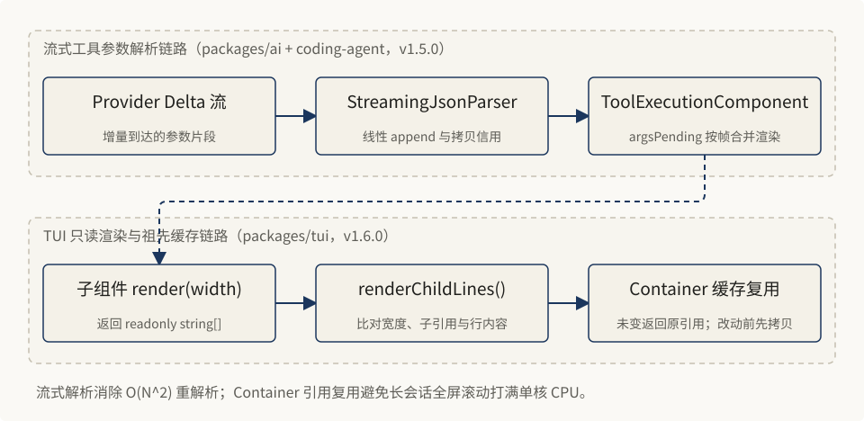

先看上半条链（v1.5.0，`packages/ai/src/utils/streaming-json.ts`）。过去 provider 每收到一小片工具参数 delta，就会把迄今累计的全部文本拿去做一次容错 JSON 解析，流越长 CPU 和内存就按 O(N²) 飙升。现在每个流式工具调用由 `ToolCallArgumentsStream` 持有原始文本和一个 `StreamingJsonParser` 实例：`append(delta)` 逐字符线性推进状态机，每个字符只扫一次；`snapshot()` 返回供 UI 预览的不可变纯 JSON 对象，只浅拷贝当前尚未闭合的开路径容器，已经闭合的子容器和字符串直接共享引用。[S30](#s30)

更有意思的是它防极端输入的拷贝信用机制：开路径上有多少成员和元素，拷贝一次就记多少 `#pathCost`。每次 `append(text)` 按 `CREDIT_PER_APPEND (256) + CREDIT_PER_CHARACTER (8) * text.length` 往账户里充信用；只有当信用够支付当前 `#pathCost` 时，`snapshot()` 才生成新快照，否则直接复用上一份快照。这样就算模型一口气往一个未闭合数组里吐几千个元素，预览最多略微滞后几帧，整体时间复杂度绝不会退化成平方级。等到调用结束，`finish()` 再拿完整原始文本做一次严格 `parseToolCallArguments()` 产出最终参数与错误诊断。[S30](#s30)

流出来的部分参数传到界面层后，`ToolExecutionComponent.updateArgs()`（`packages/coding-agent/src/modes/interactive/components/tool-execution.ts`）也不再收到一次 delta 就立刻重跑语法高亮和排版，而是只把 `argsPending` 置为 `true` 并调用 `ui.requestRender()`，把两帧之间涌来的几十个 delta 合并成**每帧最多渲染一次**。同一时期，`AssistantMessageComponent` 引入了 `MarkdownSlot` 槽位复用，流式回答过程中已经渲染完的 Markdown 块与代码高亮不再每帧重算。[S33](#s33)、[S34](#s34)

再看下半条链（v1.6.0，`packages/tui/src/tui.ts`，也是本版最重要的破坏性变更）。长会话在全屏模式下用鼠标滚轮滚动时，过去每滚一格都要把整段对话树逐层拼接拷贝，很容易把单核 CPU 打满。v1.6.0 把组件契约改成了：

```ts
render(width: number): readonly string[];
```

`Container.render(width)` 内部调用 `renderChildLines(this.children, width, this.childLines)`。只要宽度没变、子组件数组引用没变、每个子组件返回的渲染行通过 `sameLines()` 对比也没变，就直接把上一次缓存的 `ChildLines` 连同 `lines` 数组引用原样返回。未变化的子树保持数组引用不变，所有祖先容器都能跳过拼接拷贝。[S31](#s31)、[S32](#s32)

这项优化直接带来一条必须遵守的扩展开发铁律：**绝不能原地修改 `render()` 或 `super.render()` 返回的数组。** 直接往上面 `push` 或改下标，会当场污染容器缓存并破坏后续帧画面。标准做法看内置的 `AssistantMessageComponent`（`assistant-message.ts`）就行：先拿引用做身份比对，只在缓存源变了时拷贝一份再加首尾标记：

```ts
const lines = super.render(width);
if (this.zoneLines?.source !== lines) {
  const zoned = [...lines];
  zoned[0] = OSC133_ZONE_START + zoned[0];
  zoned[zoned.length - 1] = OSC133_ZONE_END + OSC133_ZONE_FINAL + zoned[zoned.length - 1];
  this.zoneLines = { source: lines, lines: zoned };
}
return this.zoneLines.lines;
```

除此之外，v1.5.1 还给 `ctx.ui.custom()` 覆盖层补上了 `blocked` 选项支持（通过 OSC 7501 通知终端当前正在等待用户回答或授权），并给 `pi.registerMarkdownTransformer()` 增加了 `{ messageTypes }` 选项，可以按需作用于 `custom`、`summary` 和 `changelog` 表面，内置 Mermaid 渲染也支持了饼图、自定义样式和展开摘要里的图表绘制。[S2](#s2)、[S32](#s32)

### 模型提供商、思考约束与图片分类

Code Mode 不会抹平各家模型提供商的协议差异，流式归一化、缓存保活和推理参数适配仍由 `packages/ai` 承担。从 v1.3.0 起，切换模型时会自动丢弃上一个模型产生的历史 thinking 块，避免它们被当成普通文本喂给新模型。[S2](#s2)

v1.5.0 到 v1.6.0 在模型矩阵和协议细节上有多处值得留意的工程约束：

- **GPT-6.1 Terra 与 GPT-6.2 Astra / Sol**：v1.5.0 先在 `openai`、`azure` 和 `openai-codex` 上加入 `gpt-6.1-terra`（Codex 下 500K 上下文，支持工具搜索、会话中途切换思考等级，且允许把思考关到 `off`）。v1.6.0 上线 `gpt-6.2-astra` 与 `gpt-6.2-sol`，并把 `gpt-6.2-sol` 设为三家提供商的默认模型（Azure 提供 1.05M 上下文，Codex 为 Sol 提供 500K、为 Astra 提供 272K）。注意 `packages/ai/catalog/families/openai.ts` 中的 `GPT_6_NO_NONE_EFFORT_MODEL_IDS` 集合明确包含 `gpt-6.2-astra` 和 `gpt-6.2-sol`：这两款模型拒绝 `none` 和 `minimal` 推理强度，因此无法开启 thinking `off`。同时，当 OpenAI 在压缩后丢弃旧推理条目（如 `prefix_mismatch`）且开启了 `showCacheMissNotices` 时，对话记录里会给出带原因的提示。[S38](#s38)
- **Qwen Token Plan 四套提供商**：v1.5.1 与 v1.6.0 补齐了 Team 与 Individual 两条线的国际站和国内站提供商（`qwen-token-plan`、`qwen-token-plan-cn`、`qwen-token-plan-individual`、`qwen-token-plan-individual-cn`），切换到新网关 `token-plan.maas.qwencloudapi.com` 与 `token-plan.maas.qianwenaiapi.com`（旧 `aliyuncs.com` 仍兼容），支持按套餐拆分 `QWEN_TOKEN_PLAN_TEAM_API_KEY` 等环境变量（保留共用变量回退），新增 `qwen4-max-preview` 和 `deepseek-v4.1-flash`，同时移除了下线的 `deepseek-v3.2` 与 `deepseek-v4-flash`。[S2](#s2)
- **分类器与图片输入**：脚本里的 `models.*` 可以查目录、调分类器和生图，但不允许把聊天模型当作任意子 Agent 直接递归调用。`models.classify()` 自 v1.4.0 起支持传入 `images`（适用于具备视觉能力的 Jev、Clef 分类器，v1.5.1 又接入了通过 GitHub Copilot 调用的 Microsoft-Decision-1 分类器）。模型类型是 `classifier` 不代表一定支持图片，调用前必须检查 `m.input?.includes("image")`，并按 `models-configuration.md` 核对代理的 `compat.imageInput` 与 `sendImageOptInHeader` 字段。图片展示走 `image(block)`，绝不用 `text()` 打印 base64。[S10](#s10)、[S27](#s27)、[S29](#s29)

下面这段脚本和 `examples/scripts/06-classify-image.js` 保持逐字一致，用来演示图片分类器的完整契约检查（真实运行需要可用图片分类器凭据与本地 `screenshot.png`，可能产生费用）：

```js
const candidates = await models.getAvailableOfType("classifier");
const vision = candidates.find(m => m.input?.includes("image"));
if (!vision) throw new Error("没有可用的图片分类器");
const photo = await tools.read({ path: "screenshot.png" });
if (photo.type !== "image") throw new Error("需要图片块");
const result = await models.classify(vision, {
  state: { task: "检查页面布局" },
  images: [photo],
  questions: {
    broken: {
      type: "bool",
      instructions: "图片中是否有重叠或被截断的内容？",
      criteria: { true: "存在布局缺陷", false: "未发现布局缺陷" },
    },
  },
});
if (result.stopReason !== "stop") {
  throw new Error(result.errorMessage ?? result.stopReason);
}
const answer = result.answers.broken;
if (answer?.type !== "bool") throw new Error("分类回答类型不符");
text({ probability: answer.probability });
```

### 命令行运维新入口：凭据管理与自定义自更新

在自动化或 Nix、mise 托管环境里，过去常遇到两个麻烦：一是为了给某个 provider 登录还得先启一个交互会话，二是 `pi update` 碰到非官方包管理器安装会直接报错放弃。v1.5.0 和 v1.5.1 把这两块补齐了：

- **自定义自更新命令（v1.5.0）**：设置环境变量 `PI_SELF_UPDATE_COMMAND`（按空白拆分参数，优先级最高）或在全局 `~/.pi/agent/settings.json` 里写 argv 数组 `selfUpdateCommand`（支持含空格的参数）。当 pi.dev 报告新版本时，`pi update` 会把 `{packageName}`、`{version}`、`{installSpec}` 替换成新版本信息并执行该命令，例如 `mise use -g npm:{packageName}@{version}` 或 `["nix", "profile", "upgrade", "pi"]`。[S19](#s19)
- **脱离会话的命令行登录（v1.5.1）**：在 shell 里直接运行 `pi auth login <provider>`（支持 `--api-key` 静默录入密钥、`--no-browser` 走设备码或复制码登录）与 `pi auth logout <provider>`，登录 Radius 时还会顺带配好对应的 MCP 服务器。配合 `pi auth check --json` 与 `pi update --extensions` 逐包版本差异报告，CI 和无头机器上的运维顺畅很多。[S19](#s19)

### 选哪一种集成接口

| 使用场景 | 推荐入口 | 需要提前注意的边界 |
|---|---|---|
| 人在终端里交互编码 | TUI | 默认全屏模式，可切回 regular；自定义组件遵守只读 `render()` |
| 单次脚本或管道任务 | `--print` | 跑完一轮后退出，无交互确认框 |
| 外部程序消费事件流 | `--mode json` | stdout 输出 JSONL 事件流，v1.6.0 修复启动期 `session_start` 事件丢失 |
| 非 TypeScript 宿主长连控制 | RPC | stdin 发指令，stdout 收响应与事件；关停期间等待清理完成 |
| Node / Bun 应用内嵌 | SDK | 宿主自管生命周期、资源加载、诊断读取与内置扩展绑定 |
| 只需要受限工具脚本引擎 | 独立 `pi-codemode` | 零 Pi 内部依赖，不必拖入整个编码代理 |
| 需要跨重启持久任务恢复 | 实验性 `pi-durable` | 独立存储、journal 与 replay 策略，属于实验 API |

TUI 只是事件消费者与终端绘制层，RPC 和 SDK 驱动的都是同一套 `AgentSession` 和 Agent 循环。写自定义交互组件时要检查 `ctx.mode` / `ctx.hasUI`，不能假定 print 模式下也有弹窗确认。另外，CLI 默认装配了内置 Code Mode、`tool_search` 和 MCP 三个扩展，而 **SDK 默认不会自动装好它们**，必须在 `DefaultResourceLoader.extensionFactories` 里显式传入，并在创建会话后调用 `session.bindExtensions({})` 触发 `session_start`（完整代码见 `examples/sdk-codemode-mcp.ts`）。[S9](#s9)、[S20](#s20)

如果企业要求每次执行 shell 前必须过合规审批，切忌把审批逻辑塞进模型生成的 Code Mode 脚本里。可审计的拦截规则应当落在扩展的 `tool_call` 钩子边界，而文件、进程和网络的硬隔离则交给容器和操作系统权限去守。


# 第 10 章：从 v0.99.2 到 v1.6.0，到底演进了什么

如果团队线上跑的早就是 `v0.99.2`，Code Mode、独立 `pi-codemode` 包、工具按需发现、MCP、树形会话和统一扩展这些骨架其实早就已经在车上了。真正需要逐条核对的，是从 `v0.99.2` 一路走到 `v1.6.0` 这段时间里落下的契约调整、性能重构和破坏性变更。[S2](#s2)、[S21](#s21)

| 版本 | 关键架构与运行时变化 | 对开发者与使用者的直接影响 |
|---|---|---|
| v1.0.0 | 缩短 Code Mode 提示词、新增 `models.generateImages()`、默认全屏 TUI、从 `pi-agent-core` 移除旧实验 `AgentHarness` | 提示开销下降；探测工具改用 `in`；依赖旧实验 harness 的 SDK 需迁移 |
| v1.0.1 至 v1.0.4 | 16 Mi 字符与 10 万条输出硬上限、`image()` 落盘临时文件、冻结内建原型、`read` 读图返回图片块 | 防止无限输出拖垮宿主；不能再篡改 `Array.prototype` 等内建对象 |
| v1.1.0 | CLI `--tools +name/-name` 增量语法、输出项分隔 | 增减单个工具更顺手，多段输出边界更清晰 |
| v1.2.0 | `reachesTools` 解耦 MCP 与 Code Mode；独立包新增 `RemoteCodemodeSandbox`、`InlineCodemodeSandbox`、确定性 `sandbox.start()`；Durable 接入可重放 Code Mode；清理未发布实验服务栈 | 编排器可替换；沙箱可部署到 Cloudflare；旧实验目录不可继续沿用 |
| v1.3.0 | 取消结果与真实 worker 退出解耦；恢复会话保留活动工具集；内部包精确版本锁定 | 重复超时不再无限堆积残留 worker；恢复后的工具集更稳定 |
| v1.4.0 | worker 满额 FIFO 排队（上限 60 秒，计入总 deadline）、`PI_CODEMODE_MAX_WORKERS`；摘要改用模型输出上限；`models.classify()` 支持图片输入与 `models-configuration.md`；修补截断工具消息配对与并发弹窗 | 并行脚本不再立刻因满额失败；`reserveTokens` 不再错当摘要长度上限 |
| v1.5.0 | 新增零 `eval` 闭包校验库 `@earendil-works/pi-schema`；`StreamingJsonParser` 增量解析大工具调用与 TUI 按帧合并及高亮复用；扩展包更新日志与 `collapseChangelog`；`PI_SELF_UPDATE_COMMAND` / `selfUpdateCommand`；GPT-6.1 Terra 与多语种 CJK 工具搜索；移除原生 OS `sandbox/` 示例 | JSON Schema 与 MCP 工具统一宽松转换；大参数流式不再卡顿；TypeBox 非 JSON Schema 特性不再用于参数校验 |
| v1.5.1 | `pi auth login/logout`；默认开启空闲 prompt 缓存预热；Anthropic 消息线程；流式 `read` 与 ripgrep `grep` 上下文（废弃 `GrepOperations.readFile`）；OpenAI 兼容端点省略空 `"tools": []`；MCP `$ref` 搜索与流大小限制；Copilot 分类器与更丰富的 Mermaid 图表 | 降低长会话和重复提示费用；大文件读取不再打爆内存；自定义 `GrepOperations` 需改写 `execute()` |
| v1.5.2 | 原工作目录消失时，恢复/导入会话提供 `Continue`、`Fork`、`Cancel` | 移动或重命名项目目录后，一次 Fork 即可绑定新路径不再反复弹窗 |
| v1.6.0 | TUI `Component.render()` 改为返回 `readonly string[]`，`Container` 复用未变子树的缓存数组引用；GPT-6.2 Astra/Sol 成为默认模型（不支持 thinking `off`）；Qwen Token Plan 四套提供商与新网关；`AgentSessionRuntime.takeUnreportedDiagnostics()`；修复 SDK `reload()` 漏发 `session_start` 与 `find` 相对路径模式 | 长会话全屏滚动不再打满单核 CPU；原地修改 `super.render()` 的扩展必须先拷贝；切换与重载告警不再刷花终端 |

### 从 v1.4.0 升到 v1.6.0，优先核对六处破坏性或高影响变更

如果已经跑在 v1.4.0，往 v1.6.0 升级时先把下面六件事逐项查完，能省掉绝大部分线上踩坑：

1. **检查所有自定义 TUI 组件与 `Container` 子类（v1.6.0）**：搜索代码里对 `render()` 或 `super.render(width)` 返回值调用 `.push()`、`.splice()`、`.unshift()` 或下标赋值的地方，一律改成先拷贝再改（`const lines = [...super.render(width)]`），否则会直接破坏 `Container` 的帧缓存。[S31](#s31)、[S32](#s32)
2. **检查工具参数里的 TypeBox 私有用法（v1.5.0）**：`pi-schema` 只执行标准 JSON Schema 约束与内置格式，不再运行 `Type.Refine()`、`Type.Codec()` 或 `Format.Set()`。依赖这些校验的工具要把额外检查搬进 `execute()`；如果上游提示词或测试硬匹配了 TypeBox 旧英文报错文案，也要同步更新成 `pi-schema` 的 `- field: reason` 格式。[S15](#s15)
3. **检查自定义远程 `grep` 扩展（v1.5.1）**：`GrepOperations.readFile` 不再被上下文行逻辑调用，面向远端文件系统的扩展需要直接覆写 `grep` 工具的 `execute()`。[S2](#s2)
4. **检查 OpenAI 兼容网关与思考等级假设（v1.5.1 / v1.6.0）**：禁用全部工具时 Pi 不再发送 `"tools": []`；若老版本代理在历史含工具调用时强制要求带上该字段，需在 `models.json` 里设置 `compat.requiresToolsWithToolHistory: true`。切换到默认 `gpt-6.2-sol` 后，不能再假定 thinking `off` 始终可用。[S2](#s2)、[S38](#s38)
5. **检查 `find` 工具的路径 glob 写法（v1.6.0）**：含 `/` 的模式现在相对搜索目录匹配（`src/*.ts` 只命中根目录 `src/a.ts`，不再误扫 `pkg/src/a.ts`），跨层级匹配需写 `**/src/*.ts`。[S2](#s2)
6. **检查扩展重启与诊断上报（v1.6.0）**：SDK 宿主可在启动和每次会话切换后调用 `runtime.takeUnreportedDiagnostics()` 读取去重后的加载告警，并确认依赖 `session_start` 的扩展在 `reload()` 后能正常重连。[S40](#s40)

### 顺手澄清三个老版本迁移断点与一句流行数字

如果你是从 v0.99.2 跨大版本直奔 v1.6.0，下面三个早期断点同样躲不过：探测工具是否存在别写 `typeof tools.foo`（访问未知成员可能直接抛带近似建议的错），统一改用 `"foo" in tools`；独立 MCP 包早在 v1.2.0 就删掉了 `MCP_TYPESCRIPT_PREAMBLE` 与 `mcpStructuredContentSchema()`，输出 schema 直接描述完整返回对象；独立沙箱 `close()` 和执行结果返回只代表发出了关闭请求，自己做资源池必须挂 `onWorkerStarted(exited)` 或 `acquireWorker()` 释放回调追踪真实退出。[S13](#s13)、[S21](#s21)

另外，社区里常转述的一句“Code Mode 少用约 40% token”，出处是 v1.0.0 变更日志里的一个特定样本：开启默认工具和 Code Mode 时，一次 GPT-5.6 请求的初始提示词从约 5,300 降到了约 3,300 token，省下来的是精简后的工具说明与按需加载。那是上游记录的单一场景数字，既不是本书实测，也不能当成所有模型和工具规模下的通用折扣。[S2](#s2)

# 第 11 章：独立沙箱、云端隔离与 Durable 重放

工程评审里常听到一句模糊的话：“Pi 的 Code Mode 已经支持崩溃恢复了。”这句话缺了主语，很容易把三种保障级别完全不同的运行时混成一锅粥。

| 运行形态 | 工具与状态归谁管 | 进程中途崩溃后会发生什么 |
|---|---|---|
| 普通 CLI Code Mode | `AgentSession` 与内置扩展 | 此前已成功提交的小型 `store` 仍在分支里；中途死掉的脚本没有指令级续跑 |
| 独立 `CodemodeSandbox.execute()` | 你的宿主程序 | 宿主自管持久化；单次执行不会自动变成持久任务 |
| 独立 `sandbox.start()` | 宿主驱动的确定性 VM | 提供可重放的确定性执行引擎，但 journal 与调度归宿主自己写 |
| 实验性 `pi-durable/codemode` | Durable Harness、存储、任务与 journal | 重启后按日志顺序重放已交付结果再继续推进；未完成调用按各自 `replay` 策略处理 |

### 11.1 不引入整个编码代理，单独使用沙箱

`packages/codemode` 没有任何 Pi 内部包依赖，非常适合嵌进你自己的服务或 Agent 产品里，只借用它的受限脚本执行和工具桥接能力：[S13](#s13)

```ts
import { CodemodeSandbox } from "@earendil-works/pi-codemode";

const sandbox = new CodemodeSandbox({
  timeoutMs: 10_000,
  tools: [{
    name: "lookup",
    execute: async ({ id }) => ({ id, title: `条目 ${id}`, privateNote: "不输出" }),
  }],
});

try {
  const result = await sandbox.execute(`
    const row = await tools.lookup({ id: 7 });
    text({ id: row.id, title: row.title });
  `);
  if (!result.ok) throw new Error(result.error.message);
  console.log(result.output);
} finally {
  await sandbox.close();
}
```

这是独立注入自有可信函数的写法。如果打算把它接进已有 Agent 框架，工具桥接必须回落到框架自己的完整工具调用管线（像官方 CLI 走 `ctx.executeTool()` 一样），切忌直接调用裸 `tool.execute()` 绕开校验与安全钩子。[S13](#s13)

### 11.2 为什么 Cloudflare 要把 VM 放进单独部署的 Worker

Node 和 Bun 下可以用 worker thread 把 QuickJS 计算挪出主事件循环。Cloudflare Workers 没有同样的线程模型，QuickJS 的同步计算会直接堵住承载它的 isolate。

v1.2.0 引入的 `RemoteCodemodeSandbox` 把位置拆开了：工具和调用账本留在会话侧，QuickJS VM 放到**单独部署的 Worker 里的 Durable Object** 中，每次工具调用走 Workers RPC 回调宿主。注意这里的 Durable Object 是 Cloudflare 的平台原语，跟 Pi 仓库里的 `pi-durable` 包没有任何从属关系。[S13](#s13)、[S21](#s21)

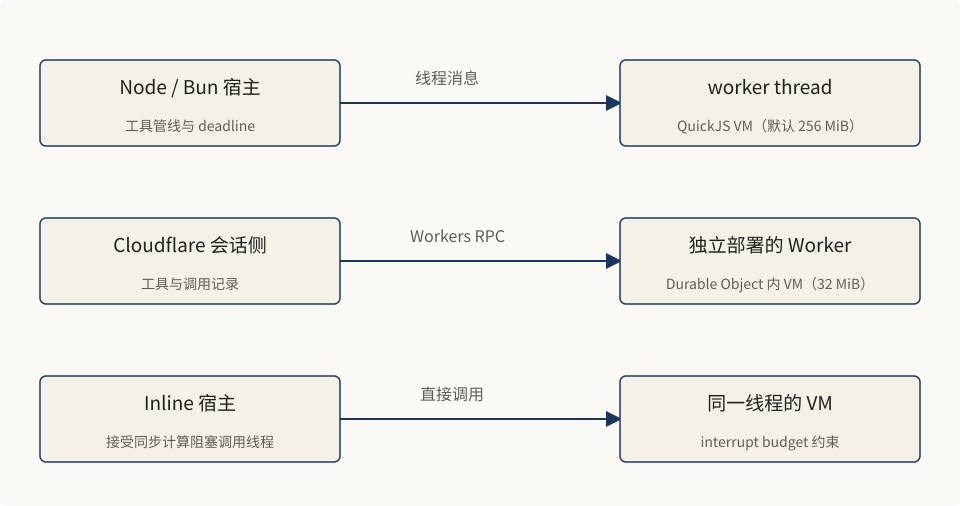

上游 `packages/codemode/README.md` 记录过一组 Cloudflare 实测对比：让脚本持续做十秒密集计算，如果 VM 跑在会话对象内部或其动态加载的 Worker 里，同一会话对象的其他请求会被卡住约十秒；拆到单独部署的 Worker 后，其他请求的响应延迟大约在 50 ms。这个数字出自上游测试环境，说明的是隔离部署的架构理由，不代表你在任意账号区域都能复现一模一样的延迟。

在 Cloudflare 上跑还要盯紧三条额外约束：脚本如果不主动 yield，墙钟 timeout 挡不住纯 CPU 死循环，必须配 interrupt budget；远端 abort 先解除调用侧等待，VM 要等到下一次工具调用或耗尽中断预算才会停；远端单个 VM 默认内存上限只有 32 MiB，远小于普通 CLI 的 256 MiB。至于 `InlineCodemodeSandbox`，它直接在调用线程里跑 VM，适合明确接受短暂阻塞的轻量宿主，配合零 Node 依赖的 portable 入口共用同一套脚本 API。[S13](#s13)

### 11.3 Durable 重放的是调用日志，不存 VM 内存快照

`packages/durable` 是一套仍在快速演进的实验性持久执行运行时。它的 Harness 把会话条目、文档状态、任务检查点和提交统一写进底层存储；结合确定性 `sandbox.start()` 后，能让长时间运行的 Code Mode 脚本跨进程重启恢复。[S23](#s23)

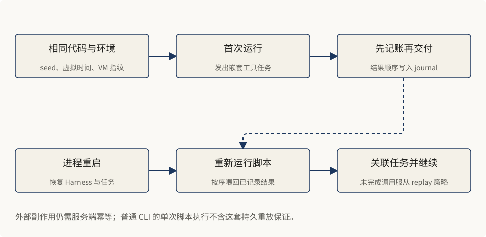

它的恢复原理跟时间旅行调试很像，不依赖给 QuickJS 堆拍内存快照：

1. 启动脚本时锁定全部不确定因素：由宿主提供虚拟 `Date.now()`、固定随机种子、锁定 UTC 时区、隐藏 `WeakRef` 与 `FinalizationRegistry`，并校验代码和 VM 指纹。
2. 脚本发出的嵌套工具调用会注册成 Durable 子任务。
3. 工具完成后，宿主先按交付顺序把结果写进 journal，再把值交回 VM。
4. 进程崩溃重启后，Harness 从头重跑同一段脚本，沿着 journal 把已经记录过的结果按原序瞬间喂回去。
5. 脚本在确定性条件下推演出完全一致的调用序列，自动接上已完成或仍在跑的子任务，然后继续推进尚未执行的新步骤。

### 一个检验边界的案例：扣款成功瞬间宕机

假设脚本调用了外部支付工具，远端银行已经扣款成功，但本地进程还没来得及把结果写进 journal 就断电了。重启后框架能盲目再调一次吗？绝对不能。在 Durable 里，只有工具明确声明了 `replay: "safe"`，中断后的未决调用才允许自动重跑；默认情况下框架会报 interrupted 错误，把善后权交回业务层。就算标成了 `safe`，真正避免重复扣款靠的还是外部服务端的幂等 key 或查询对账。[S23](#s23)

确定性重放提供的是可追溯、可检查、可恢复的编排调度，变不出跨任意外部系统的恰好一次副作用魔法。只要脚本代码改了路径、VM 指纹变了或者总 deadline 过期，重放都会主动报错停下，避免在错位状态下继续发外部请求。

### 11.4 远程执行环境 pi-env 解决另一半问题

`packages/env` 决定命令和文件操作在哪台机器上执行：本地留着 Harness、存储和模型凭据，通过 SSH 在目标机器上拉起一个小型 Rust daemon，用协议化接口跑文件和进程操作，让 `RemoteExecutionEnv` 尽量贴近 `NodeExecutionEnv` 的语义。[S24](#s24)

把 QuickJS VM 放到远端（`RemoteCodemodeSandbox`）和把文件与命令放到远端（`pi-env`）是两个正交的架构选择：前者管脚本计算位置，后者管工具副作用落点。远程执行同样不等于自动沙箱，仍然必须校验 SSH host key，并收紧远端账户权限、网络出口和凭据暴露面。

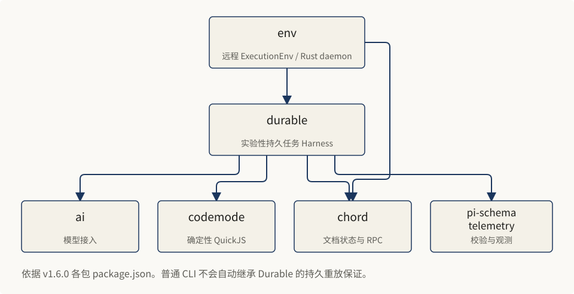

把这张图和第 3 章的 CLI 依赖图放在一起对照最直观：两边共享 `ai`、`codemode`、`pi-schema` 和 `telemetry` 四个底层包，但在上层分道扬镳。普通 CLI 不会自动继承 Durable 的持久重放契约。

# 第 12 章：迁移路线、动手实验与核对工具

读完架构图之后，最怕关上页面只剩满脑子术语。这一章把迁移核对拆成可执行清单，再给四组零付费模型成本就能在本地跑通的动手实验。

### 12.1 从 v0.9.4 跨版本迁移，按所在层逐项拆解

如果只用终端 CLI，先备份现有会话和配置目录，把包名从 `@mariozechner/*` 切到 `@earendil-works/*`，并确认运行环境满足 Node.js 22.19 或更新版本（别继续沿用早期仓库的 Node 20 门槛），再逐步启用 Code Mode 和 MCP。

如果在业务代码里嵌入了旧版 `Agent`，重点核对旧 transport 抽象到当前 `streamFn`、消息转换器、事件流以及默认并行工具语义的变化。曾经引用过旧 `AgentHarness` 的项目要注意，`pi-agent-core` 自 v1.0.0 起已经移除该导出，需要明确决定迁向标准 `AgentSession`，还是进入实验性 `pi-durable`。[S6](#s6)、[S22](#s22)

如果维护着旧版自定义 hooks 和工具，按当前 `ExtensionAPI` 统一合并注册入口，逐条核对拦截、改写事件的返回值契约，并把宿主提供的核心包放进 `peerDependencies`。

### 12.2 升级至 v1.6.0 的工程检查表

- [ ] 自定义 TUI 组件与 `Container` 子类把 `render()` 输出视为只读，改动前先浅拷贝数组（`[...super.render(width)]`）。
- [ ] 工具参数校验不再依赖 `Type.Refine()`、`Type.Codec()`、`Format.Set()` 等非 JSON Schema 特性，必要检查移入 `execute()`。
- [ ] 远端文件检索扩展不再依赖已废弃的 `GrepOperations.readFile`，改为覆写 `grep` 的 `execute()`。
- [ ] 探测工具存在性使用 `"name" in tools`，所有发现 helper 均带 `await`。
- [ ] 脚本显式检查 `bash` 的 `exit_code` 与 MCP 的 `isError`，不把 Promise fulfilled 当成业务成功。
- [ ] `// @options:` 确实放在脚本第一行；图片结果走 `image()` 而非用 `text()` 打印 base64。
- [ ] 自定义沙箱资源池追踪真实 worker 退出回调释放名额，并清楚排队时间会扣减总 deadline。
- [ ] `compaction.reserveTokens` 只按触发阈值配置，不再拿来折算摘要输出长度。
- [ ] 使用 `gpt-6.2-sol` / `gpt-6.2-astra` 时不假设 thinking `off` 可用；如使用老代理且需保留空 `tools: []`，按需配置 `compat.requiresToolsWithToolHistory`。
- [ ] `find` 工具含 `/` 的路径模式已按搜索目录相对路径核对（跨层改用 `**/...`）。
- [ ] 恢复或重载会话后，核对活动工具、`--no-mcp` 隔离边界，以及 SDK 宿主的 `bindExtensions({})` 与 `takeUnreportedDiagnostics()`。
- [ ] 扩展包若需在更新后展示变更说明，检查 `package.json` 版本号与 `pi.changelogPath`；使用 Nix/mise 托管时按需配置 `PI_SELF_UPDATE_COMMAND` 或 `selfUpdateCommand`。

### 12.3 核对固定版本源码快照

本书依据固定标签源码编写，完整提交 SHA 与区间文件统计记在 `sources/UPSTREAM.md` 和 `sources/versions.json` 里。读者如需对照任意一行上游代码，可以直接按对应标签检出官方仓库，不影响本机已安装的全局 Pi：

```sh
git clone --depth 1 --branch v1.6.0 https://github.com/earendil-works/pi.git pi-v1.6.0
git -C pi-v1.6.0 rev-parse HEAD
# faac585884ae2c013a6b1400f3e9e77f10b34bac
```

### 实验 A：开启 Code Mode 观察信息瘦身

在已安装 v1.6.0 或兼容版本的终端里，用增量参数启动：

```sh
pi --tools +codemode
```

或者把下面配置合并进项目的 `.pi/settings.json`（保留原有其他字段）：

```json
{
  "defaultTools": ["+codemode"]
}
```

让模型同时检查仓库里五到十个配置文件并只返回名称和版本号。观察 TUI 里出现的一个外层 `codemode` 卡片和内部多次嵌套 `read` 调用，再对比要求它直接逐个输出完整文件内容时的上下文膨胀速度。

### 实验 B：零模型依赖跑通 Python 教学模型与 20 项单元测试

本书 `examples/pi_runtime_model.py` 用零第三方依赖的 Python 3.10+ 复刻了 Pi v1.6.0 的四块核心架构机制：树形会话投影与截断配对、Code Mode 工具桥接及 `pi-schema` 宽松转换与 worker 排队、v1.5.0 增量流式 JSON 解析与 v1.6.0 `Container` 只读渲染缓存、以及 MCP exposure 矩阵与多语种 `reachesTools` 延迟连接。配套的 20 项单元测试可以直接在终端验证：

```sh
python3 -m unittest discover -s examples -v
```

同时，原有的 Node 模拟检查脚本 `examples/run-checks.mjs` 依然保留，验证 `examples/scripts/` 里的 6 段 JavaScript 教学脚本（字段筛选、部分失败、非零 shell 退出码、成功与失败的 `store` 提交、磁盘副作用留存和图片分类正反契约）：

```sh
node examples/run-checks.mjs
```

这两套本地检查都用模拟工具验证控制流与不变量，不消耗模型费用，也不替代 QuickJS 安全审计或上游集成测试。

### 实验 C：亲眼验证分支 store 与磁盘文件的分离

在一个可丢弃的临时目录里开启会话，跑一段脚本先用 `tools.write` 写一个测试文件，再调用 `store("step", 1)`。接着用 `/tree` 回到该脚本执行前的节点开辟新分支，在新分支里调用 `load("step")` 并检查目录里的测试文件：此时 `load("step")` 返回 `undefined`，而那个测试文件依然稳稳躺在磁盘上。切勿拿生产数据做这个实验。

### 实验 D：对照官方 SDK 示例装配三个内置扩展

打开本书保存的 `examples/sdk-codemode-mcp.ts`（与 v1.6.0 上游 `packages/coding-agent/examples/sdk/14-codemode-mcp.ts` 逐字节一致），盯住三处关键装配点：`extensionFactories` 显式传入内置 Code Mode、`tool_search` 与 MCP 扩展，`defaultTools` 增量开启能力，以及创建会话后调用 `session.bindExtensions({})` 触发后台连接。

### 五道自测题

1. **Code Mode 带来的收益只是把工具调用从串行变并行吗？** 现在的普通工具调用默认就已经支持同回合并行；Code Mode 真正多出来的是执行侧的控制流、异常处理与中间数据筛选。
2. **脚本执行到一半抛异常，前面已经写出的磁盘文件会跟着回滚吗？** 不会。`codemode-store` 只在脚本成功结束时提交，它和外部文件系统之间没有分布式事务。
3. **MCP 工具调用返回的 Promise 正常 resolve 了，就能直接判定操作成功吗？** 不能。必须检查返回的 `CallToolResult.isError` 字段和具体内容。
4. **把一个 TUI 扩展升级到 v1.6.0 后，为什么往 `super.render(width)` 返回的数组里 `push` 一行状态提示会导致画面错乱？** 因为 `Container` 在子组件未变化时直接返回缓存数组引用；原地修改会污染缓存，导致下一帧重复叠加。必须先拷贝一份新数组再修改。
5. **QuickJS 里拿不到 `fs` 和 `fetch`，是不是就意味着脚本里跑任何工具都绝对安全？** 不是。脚本的破坏半径由宿主注入的工具及其背后进程或容器的真实权限决定。

### 术语速查表

| 术语 | 在本书语境下的准确含义 |
|---|---|
| Agent loop | 模型生成响应、执行工具调用、判断是否进入下一轮的核心循环 |
| Harness | 环绕在 Agent 循环外围的会话、上下文投影、资源、扩展与生命周期层 |
| AgentSession | 普通编码代理中统筹单场会话与运行状态的核心对象 |
| Turn / Run | Turn 指单次模型回复及其工具调用；Run 指一次用户输入触发的整串回合直至 `agent_settled` |
| Exposure | 控制工具如何声明给模型、能否被脚本或 `tool_search` 触达的策略 |
| Nested call | 由编排工具内部发起、原始结果先回到调用方脚本的工具调用 |
| Projection | 从磁盘原始树形历史按活动分支、压缩边界与上下文编辑算出的模型输入 |
| Copy credit | `StreamingJsonParser` 用来限制大容器开路径快照拷贝频次的信用额度，防止退化为平方复杂度 |
| Read-only render cache | v1.6.0 `Container` 对未变子树返回同一 `readonly string[]` 引用以省去逐层拷贝的机制 |
| Journal / replay | Durable 运行时按顺序记录已交付工具结果并在重启后确定性重放的机制 |
| Idempotency | 同一外部业务操作在重试时不会造成重复不可逆副作用的契约 |

### 顺着源码继续深挖的路线

想先吃透普通 CLI，推荐从 `docs/how-pi-works.md` 和 `docs/sdk.md` 入手，再依次读 `docs/codemode.md`、`extensions/codemode/tool.ts` 与 `execute.ts`；想研究 v1.5.0 和 v1.6.0 的热路径优化，直接翻 `packages/ai/src/utils/streaming-json.ts`、`packages/tui/src/tui.ts` 中的 `renderChildLines()` 与 `packages/schema/`；打算把受限脚本能力嵌进自有产品，优先读 `packages/codemode/README.md`；只有确定业务真的需要跨进程重启恢复长任务时，再进入 `packages/durable/README.md` 与 `packages/env/README.md`。


# 来源索引与核查范围

所有源码链接均固定到对应版本标签，正文方括号编号可直接跳转。版本提交与差异统计见仓库中的 `sources/UPSTREAM.md` 与 `sources/versions.json`。

<div class="source" id="s1">

**[S1] [最新发布与固定标签 v1.6.0](https://github.com/earendil-works/pi/releases/tag/v1.6.0)**

本版比较端点：v1.6.0（提交 faac585884ae2c013a6b1400f3e9e77f10b34bac，发布于 2026-11-20）；详细元数据见 versions.json 与 UPSTREAM.md。

</div>

<div class="source" id="s2">

**[S2] [coding-agent 版本变更日志](https://github.com/earendil-works/pi/blob/v1.6.0/packages/coding-agent/CHANGELOG.md)**

完整版本时间线，涵盖 Code Mode/MCP 引入及 v1.0.0 至 v1.6.0 的演进与破坏性变更。

</div>

<div class="source" id="s3">

**[S3] [旧版有状态 Agent](https://github.com/earendil-works/pi/blob/v0.9.4/packages/agent/src/agent.ts)**

早期 transport.run、消息转换、事件与队列设计。

</div>

<div class="source" id="s4">

**[S4] [旧版 ai 包中的工具循环](https://github.com/earendil-works/pi/blob/v0.9.4/packages/ai/src/agent/agent-loop.ts)**

工具参数校验、顺序工具执行与回合循环。

</div>

<div class="source" id="s5">

**[S5] [旧版线性 SessionManager](https://github.com/earendil-works/pi/blob/v0.9.4/packages/coding-agent/src/session-manager.ts)**

线性 JSONL 记录与复制到新文件的早期分支方式。

</div>

<div class="source" id="s6">

**[S6] [当前 Agent 核心文档](https://github.com/earendil-works/pi/blob/v1.6.0/packages/agent/README.md)**

消息变换、事件流、默认并行工具执行与历史写入顺序保证。

</div>

<div class="source" id="s7">

**[S7] [How Pi Works](https://github.com/earendil-works/pi/blob/v1.6.0/packages/coding-agent/docs/how-pi-works.md)**

当前主运行链、上下文、会话和交互接口总览。

</div>

<div class="source" id="s8">

**[S8] [普通 CLI 包清单与依赖](https://github.com/earendil-works/pi/blob/v1.6.0/packages/coding-agent/package.json)**

v1.6.0 依赖精确固定；直接依赖 agent-core、ai、codemode、mcp、tui，不依赖 durable、env 或 chord。

</div>

<div class="source" id="s9">

**[S9] [SDK 生命周期与状态](https://github.com/earendil-works/pi/blob/v1.6.0/packages/coding-agent/docs/sdk.md)**

AgentSession、SessionManager、agent_settled、资源加载与内置扩展差异。

</div>

<div class="source" id="s10">

**[S10] [Code Mode 用户与脚本契约](https://github.com/earendil-works/pi/blob/v1.6.0/packages/coding-agent/docs/codemode.md)**

全局接口、返回值、输出上限、store、models 辅助能力与资源限制。

</div>

<div class="source" id="s11">

**[S11] [当前会话文件格式](https://github.com/earendil-works/pi/blob/v1.6.0/packages/coding-agent/docs/session-format.md)**

树形条目、压缩边界、context_edit、自定义状态与上下文投影。

</div>

<div class="source" id="s12">

**[S12] [压缩机制](https://github.com/earendil-works/pi/blob/v1.6.0/packages/coding-agent/docs/compaction.md)**

触发阈值、保留边界、模型输出上限预算、分支总结与恢复。

</div>

<div class="source" id="s13">

**[S13] [独立 Code Mode 沙箱库](https://github.com/earendil-works/pi/blob/v1.6.0/packages/codemode/README.md)**

worker 与 QuickJS/WASM、独立接入、Cloudflare 远程沙箱、确定性 start 与结果契约。

</div>

<div class="source" id="s14">

**[S14] [Code Mode executor 实现](https://github.com/earendil-works/pi/blob/v1.6.0/packages/coding-agent/src/extensions/codemode/execute.ts)**

ctx.executeTool 调用链、结果适配、状态提交、worker 排队与容量准入。

</div>

<div class="source" id="s15">

**[S15] [扩展、嵌套调用与工具契约](https://github.com/earendil-works/pi/blob/v1.6.0/packages/coding-agent/docs/extensions.md)**

exposure、reachesTools、pi-schema 参数校验边界、生命周期事件与权限扩展。

</div>

<div class="source" id="s16">

**[S16] [MCP 接入与 exposure](https://github.com/earendil-works/pi/blob/v1.6.0/packages/coding-agent/docs/mcp.md)**

命名规则、后台连接时机、发现与过滤、CallToolResult、OAuth CIMD 与替换扩展。

</div>

<div class="source" id="s17">

**[S17] [设置与工具呈现](https://github.com/earendil-works/pi/blob/v1.6.0/packages/coding-agent/docs/settings.md)**

defaultTools、codemode.mode、inlineBudget、cacheWarming、collapseChangelog 与 selfUpdateCommand。

</div>

<div class="source" id="s18">

**[S18] [删除未发布的实验服务栈](https://github.com/earendil-works/pi/commit/7472cda0d6e51dfbf53c03f46b47aa42ac64bf64)**

2026-10-12 清理从未进入正式发布包的实验客户端/协议/服务端目录。

</div>

<div class="source" id="s19">

**[S19] [命令行参考](https://github.com/earendil-works/pi/blob/v1.6.0/packages/coding-agent/docs/cli.md)**

增量工具选择、MCP 排除、自定义自更新命令 PI_SELF_UPDATE_COMMAND 与 pi auth 登录命令。

</div>

<div class="source" id="s20">

**[S20] [官方 SDK Code Mode/MCP 示例](https://github.com/earendil-works/pi/blob/v1.6.0/packages/coding-agent/examples/sdk/14-codemode-mcp.ts)**

装配三个内置扩展、启用工具、bindExtensions 与资源释放。

</div>

<div class="source" id="s21">

**[S21] [独立 Code Mode 包版本记录](https://github.com/earendil-works/pi/blob/v1.6.0/packages/codemode/CHANGELOG.md)**

start、portable、remote、未知成员报错、内建冻结、close 与真实 worker 生命周期。

</div>

<div class="source" id="s22">

**[S22] [Agent 包迁移与清理记录](https://github.com/earendil-works/pi/blob/v1.6.0/packages/agent/CHANGELOG.md)**

旧 transport 删除、并行工具执行与 v1.0.0 移除旧实验 harness 导出。

</div>

<div class="source" id="s23">

**[S23] [实验性 Durable Harness](https://github.com/earendil-works/pi/blob/v1.6.0/packages/durable/README.md)**

持久任务与存储、Code Mode journal/replay、幂等与 replay 策略。

</div>

<div class="source" id="s24">

**[S24] [远程执行环境 pi-env](https://github.com/earendil-works/pi/blob/v1.6.0/packages/env/README.md)**

SSH、Rust daemon、RemoteExecutionEnv 与 host key 校验。

</div>

<div class="source" id="s25">

**[S25] [安全与项目可信决策](https://github.com/earendil-works/pi/blob/v1.6.0/packages/coding-agent/docs/security.md)**

默认无逐调用审批；OS 权限、容器隔离、项目信任与 prompt injection 边界。

</div>

<div class="source" id="s26">

**[S26] [v1.4.0 worker 排队与容量准入](https://github.com/earendil-works/pi/blob/v1.4.0/packages/coding-agent/src/extensions/codemode/execute.ts)**

reserveCodemodeWorker、FIFO 放行、60 秒等待上限、共享 deadline 与 PI_CODEMODE_MAX_WORKERS。

</div>

<div class="source" id="s27">

**[S27] [分类器图片能力与供应商边界](https://github.com/earendil-works/pi/blob/v1.6.0/packages/coding-agent/docs/models.md)**

classifier input 能力、图片格式、System One 与 Copilot 分类器、usage 与计费边界。

</div>

<div class="source" id="s28">

**[S28] [摘要输出预算实现](https://github.com/earendil-works/pi/blob/v1.4.0/packages/coding-agent/src/core/compaction/compaction.ts)**

移除按 reserveTokens 折算的固定输出上限，将自定义指令透传到切分回合前缀摘要。

</div>

<div class="source" id="s29">

**[S29] [Models Configuration 字段参考](https://github.com/earendil-works/pi/blob/v1.6.0/packages/coding-agent/docs/models-configuration.md)**

由 schema 生成的 provider、模型与 compat 字段参考，含 supportsMessageThreads 与分类器图片协议字段。

</div>

<div class="source" id="s30">

**[S30] [增量流式工具参数解析器](https://github.com/earendil-works/pi/blob/v1.6.0/packages/ai/src/utils/streaming-json.ts)**

v1.5.0 新增 StreamingJsonParser 与 ToolCallArgumentsStream：线性 append、开路径拷贝信用额度与不可变快照共享。

</div>

<div class="source" id="s31">

**[S31] [TUI 组件契约与 Container 渲染缓存](https://github.com/earendil-works/pi/blob/v1.6.0/packages/tui/src/tui.ts)**

v1.6.0 破坏性变更：render() 返回 readonly string[]，renderChildLines 在子组件未变时复用缓存数组引用。

</div>

<div class="source" id="s32">

**[S32] [TUI 扩展与响应性文档](https://github.com/earendil-works/pi/blob/v1.6.0/packages/coding-agent/docs/tui.md)**

只读渲染行契约、复制后再修改规范、blocked 状态与高性能渲染实践。

</div>

<div class="source" id="s33">

**[S33] [AssistantMessageComponent 块复用与拷贝写](https://github.com/earendil-works/pi/blob/v1.6.0/packages/coding-agent/src/modes/interactive/components/assistant-message.ts)**

MarkdownSlot 流式块复用，以及在修改 super.render() 输出前先拷贝到 zoneLines 的示范实现。

</div>

<div class="source" id="s34">

**[S34] [ToolExecutionComponent 按帧合并渲染](https://github.com/earendil-works/pi/blob/v1.6.0/packages/coding-agent/src/modes/interactive/components/tool-execution.ts)**

updateArgs 置 argsPending 并交由下一帧渲染，避免每个流式 delta 重复高亮与重绘。

</div>

<div class="source" id="s35">

**[S35] [零 eval 闭包校验库 pi-schema](https://github.com/earendil-works/pi/blob/v1.6.0/packages/schema/package.json)**

v1.5.0 新增 @earendil-works/pi-schema，将 JSON Schema Draft 2020-12/7 编译为普通闭包，统一工具参数校验与宽松类型转换。

</div>

<div class="source" id="s36">

**[S36] [扩展包更新日志与依赖规范](https://github.com/earendil-works/pi/blob/v1.6.0/packages/coding-agent/docs/packages.md)**

pi.changelogPath、collapseChangelog 与 host 提供包的 peerDependencies 规范。

</div>

<div class="source" id="s37">

**[S37] [空闲 Prompt 缓存预热策略](https://github.com/earendil-works/pi/blob/v1.6.0/packages/ai/src/cache-warming.ts)**

v1.5.1 默认切至 idle 预热，30 分钟窗口与 expectedSavings >= 0.05 美元的经济性门槛。

</div>

<div class="source" id="s38">

**[S38] [OpenAI 模型家族与思维等级约束](https://github.com/earendil-works/pi/blob/v1.6.0/packages/ai/catalog/families/openai.ts)**

GPT-6.2 Astra/Sol、GPT-6.1 Terra 定价与 GPT_6_NO_NONE_EFFORT_MODEL_IDS 集合定义。

</div>

<div class="source" id="s39">

**[S39] [会话恢复与目录缺失分叉](https://github.com/earendil-works/pi/blob/v1.6.0/packages/coding-agent/docs/sessions.md)**

v1.5.2 新增目录丢失时 Continue/Fork/Cancel 交互，Fork 生成新会话写入当前目录。

</div>

<div class="source" id="s40">

**[S40] [AgentSessionRuntime 去重诊断接口](https://github.com/earendil-works/pi/blob/v1.6.0/packages/coding-agent/src/core/agent-session-runtime.ts)**

v1.6.0 新增 takeUnreportedDiagnostics()，统一在交互、print、JSON 与 RPC 模式上报会话切换与重载诊断。

</div>

## 核查范围与限制

本书逐项核对五个固定版本标签（`v0.9.4`、`v0.99.2`、`v1.3.0`、`v1.4.0` 与 `v1.6.0`）的包依赖、主运行链文档、核心循环、Code Mode 适配层、`pi-schema`、流式解析器与 TUI 渲染缓存源码，正文中明确区分可直接运行的本地示例与教学伪代码。

本地验证包含零依赖 Python 3.10+ 教学模型及 20 项单元测试、6 个 Node 模拟脚本，以及 HTML、EPUB 3 和 PDF 的结构与渲染核对。未执行上游全量测试套件、真实 Cloudflare 或 SSH 部署、付费模型线上压测或沙箱安全审计；引用的上游性能数字均标明了出处。

按专题深入源码的优先入口：S7 建立主运行链全景，S10 与 S14 追踪脚本执行契约，S30 至 S34 深入 v1.5.0 与 v1.6.0 的流式解析和只读渲染缓存，S35 阅读 `pi-schema` 校验层，S13 与 S23 分别面向独立沙箱与实验性 Durable 重放。

## 固定提交

- `v0.9.4`：`a484330cd15e5844dfa42a4749594067128ea0c1`
- `v0.99.2`：`005af57d88ee23b33778f343a9595b32e67ff788`
- `v1.3.0`：`71023aec1546d6d677a65669c5665c0927ce0dd0`
- `v1.4.0`：`4a080252f06caf63a525d7873c5d94d3c23887e0`
- `v1.6.0`：`faac585884ae2c013a6b1400f3e9e77f10b34bac`

来源材料归官方仓库所有；本书属于源码整理与教学拆解，不代表项目官方文档。
